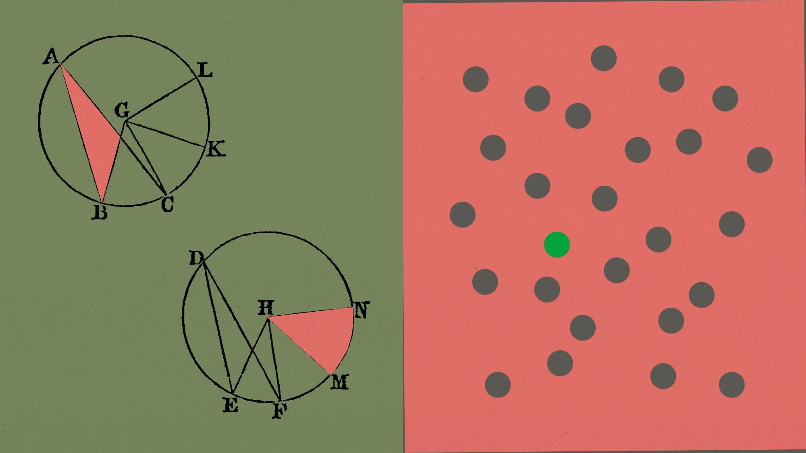
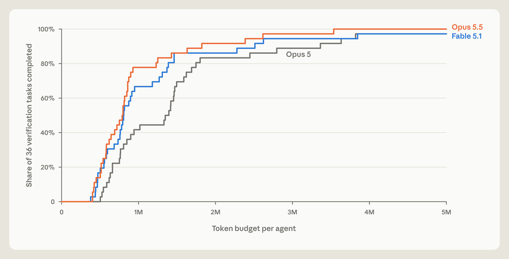
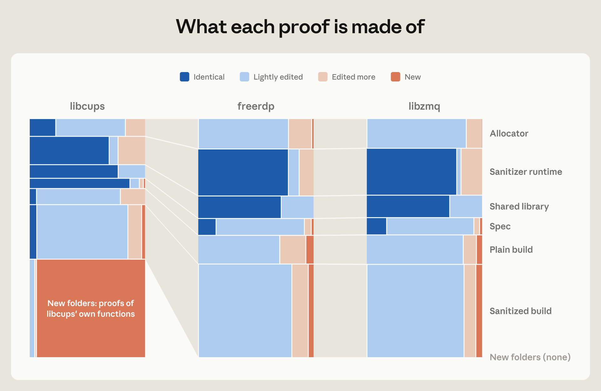

## 0. 背景知识：Fuzz、sanitizer、ASan 与 LPS

### 0.1 Fuzz：自动生成输入，寻找失败执行

**Fuzz testing（模糊测试）** 反复生成半随机输入或变异已有输入，再把它们交给开发者编写的 **fuzz target（测试入口）**。入口调用库 API，并可用断言检查结果；导致 crash 的输入被保留下来。原文从 OSS-Fuzz 已有的入口出发，把“继续寻找失败输入”改成“证明指定范围内的所有输入都通过检查”。[原文对 fuzzing 的说明](https://www.anthropic.com/research/formal-verification)

本文复用的 OSS-Fuzz 测试已经配有 sanitizer 和维护者写在入口中的 `assert`：前者检查内存等运行时错误，后者检查编码与解码往返、幂等性、与参考实现一致等性质。违反检查会使测试失败，部分功能正确性要求也由此进入可执行规约。项目直接把这些现成检查转为证明目标。[原文的测试规约与功能性质](https://www.anthropic.com/research/formal-verification)

@@opinion-begin@@

**检查什么，已经由现有工具和维护者的断言给出；大模型接手的是证明这些检查对所有允许输入都成立。**

@@opinion-end@@

### 0.2 Sanitizer：ASan 与 UBSan 各自检查什么

Sanitizer 通过编译器插桩，在程序执行时检查相应错误。本文使用两类：

- **ASan（AddressSanitizer）**：检查缓冲区越界、释放后使用等内存错误。本实验的 ASan 构建检测到错误后调用 `abort()`，以 SIGABRT 中止，退出状态为 134。
- **UBSan（UndefinedBehaviorSanitizer）**：检查启用的未定义行为，包括有符号整数溢出、整数除零、非法移位、对齐等。本实验使用 trap 模式，检查失败触发非法指令，以 SIGILL 终止，退出状态为 132。

公开仓库分别提供普通、ASan、UBSan 和 ASan/UBSan 组合构建的目标；其检查配置固定在构建产物中。[公开构建配置与检查列表](https://github.com/theorem-labs/oss-verify-proofs/blob/98e995d4daced70a0a4aa2c810854b88720735f1/docs/building.md)

### 0.3 ASan 的直观例子：能发现什么，会漏掉什么

@@opinion-begin@@

对一个分配了 16 字节的堆缓冲区写入 `p[16]`，通常就会触发越界报告。[ASan 官方说明](https://clang.llvm.org/docs/AddressSanitizer.html)

结构体内部的越界可能漏检：

```c
struct S { char data[8]; int allowed; };

void put_member(struct S *s, int i) {
    s->data[i] = 1;
}
```

在常见布局下，`i == 8` 会越过 `data`，写坏后面的 `allowed`，却仍落在整个结构体内部，默认 ASan 可能不报警。[ASan 的对象内部越界说明](https://github.com/google/sanitizers/wiki/AddressSanitizerIntraObjectOverflow)

@@opinion-end@@

### 0.4 LPS：在 Rocq 中定义二进制怎样运行

**LPS（Linux process semantics）** 是 Theorem 用 Rocq 写出的 Linux 进程形式模型。它描述 64 位 RISC-V（RV64GC）二进制的指令执行、内存、系统调用和可观察事件，并提供行为一致、无错误和终止等命题及证明库。[LPS 仓库说明](https://github.com/theorem-labs/rocq-linux-process-semantics/blob/f1006fe8178338a499b5e5c41be83006c4edd058/README.md)

在主实验中，**二进制** 给出要执行的指令，**LPS** 规定指令和进程怎样执行，**spec** 规定要排除什么错误及比较什么行为，**Claude** 生成证明，**Rocq 内核** 检查证明项是否具有指定命题的类型。[原文图 2 与公开检查流程](https://github.com/theorem-labs/oss-verify-proofs/blob/98e995d4daced70a0a4aa2c810854b88720735f1/docs/checking.md)

官方仓库的 [`Sem.v`](https://github.com/theorem-labs/rocq-linux-process-semantics/blob/f1006fe8178338a499b5e5c41be83006c4edd058/theories/Riscv/Sem.v#L456) 这样定义加载指令，以下原样节选：

```coq
| Load msz sgn rd rs1 imm =>
    load_val msz sgn (rget c rs1 + sext 64 imm)
      (λ v, EDone (rset rd v cn))
```

@@opinion-begin@@

**加载指令**

- **输入**：当前状态中的基址寄存器 `rs1`、偏移量 `imm`、读取宽度 `msz`、有符号标记 `sgn`，以及目标寄存器 `rd`。
- **计算地址**：读取 `rs1`，把 `imm` 符号扩展到 64 位，再将两者相加。
- **读取并继续**：`load_val` 按宽度和符号规则读取数值；`λ v` 表示拿到结果 `v` 后，把它写入已准备的下一状态 `cn` 的 `rd` 寄存器，再以 `EDone` 返回结果状态。

@@opinion-end@@

读不到所需字节时，机器层返回 `MachineFault`，进程层通过 `sstep_instr_fault` 进入 `SError`。[访存解释](https://github.com/theorem-labs/rocq-linux-process-semantics/blob/f1006fe8178338a499b5e5c41be83006c4edd058/theories/LinuxProcessSem/RiscvSemantics.v#L879)、[故障转换](https://github.com/theorem-labs/rocq-linux-process-semantics/blob/f1006fe8178338a499b5e5c41be83006c4edd058/theories/LinuxProcessSem/Run.v)

## 1. 引言：程序验证开始规模化

2026 年 10 月 22 日，Anthropic 与 Theorem 发布了 [*LLMs are making formal software verification feasible at a much larger scale*](https://www.anthropic.com/research/formal-verification)。作者报告：在数周内，为 **123 个开源库的 239 个 fuzz 入口** 完成了特定条件下的 RISC-V 二进制证明，成功证明包含约 **1.8 亿行 Rocq**。

[](../assets/papers/anthropic-verification/cover.jpg)

*原文封面。下文依次沿原文六章展开，相关附录与源码说明就近补入；保留全部六张原图的英文标注、三个视频与一个 GIF。黑色为原文、附录或公开源码中的内容，橙色为补充讨论、例子与评价。*

原文以两组数据说明程序验证的需求与成本：Linux 近期披露漏洞超过 1,000 个；seL4 的实现与形式验证分别消耗约 2 和 20 人年。主实验二进制的规模中位数约为 18,000 条 RISC-V 指令。[原文背景与实验规模](https://www.anthropic.com/research/formal-verification)

## 2. 把测试变成证明（Turning tests into proofs）

原文从规约的困难切入：PNG 解码可以参照格式规范，编辑器和浏览器的完整要求却很难一次写清。这项工作的做法是把已有可编译测试转成“所有允许输入都通过”的命题，再让模型完成机器码层的证明。[原文的规约构造](https://www.anthropic.com/research/formal-verification)

### 2.1 图 1：测试找到反例，证明覆盖一个明确的输入范围

OSS-Fuzz 中的 fuzz target 是开发者提供的测试入口。它接收输入、调用库代码，并可能用断言检查结果。Fuzzer 不断寻找会让入口崩溃的输入；OSS Verify 则尝试证明，在陈述规定的范围内不存在这样的输入。[Theorem 项目说明](https://theorem.dev/oss-verify/)

@@anthropic-figure-1@@

*原文图 1：从一个入口反复执行 fuzz 测试。[原始动画](https://cdn.sanity.io/files/4zrzovbb/website/6851e539c36759ac1682d6b169d0319b1d97a0f7.mp4)*

动画先固定左侧的 **Fuzz entrypoint**，再让输入沿迷宫中的不同路线执行。灰色线是一份输入走过的路径；触发崩溃时，路径变红，终点出现红点，左侧 **Crashes found** 增加。问题修补后，相应路线变绿，并标出修补标记。

随后，**Inputs tried** 持续增加，新的执行路径不断出现；结尾仍有大量区域未被这些执行触及。整个动画把“生成输入 → 执行 → 找到崩溃 → 修补 → 继续测试”依次展示出来。

### 2.2 图 2：程序、语义、规约和证明如何连接

项目把库和 fuzz driver 编译成静态 RISC-V 二进制，在 Rocq 中用 **LPS（Linux process semantics）** 解释机器指令、进程启动和系统调用，再为指定二进制提出命题。附录解释了这样选择的动机：直接解释编译产物，避免另行把 fuzz 程序翻译成 Rocq 时的翻译错误，或源码解释器与实际编译执行不一致；LPS 则承担机器与进程的执行定义。公开仓库的声明直接引用二进制映像；编译器正确性及源码与二进制的对应关系不属于这些声明。[公开证明仓库](https://github.com/theorem-labs/oss-verify-proofs)、[信任基础说明](https://github.com/theorem-labs/oss-verify-proofs/blob/98e995d4daced70a0a4aa2c810854b88720735f1/docs/trust.md)

@@anthropic-figure-2@@

*原文图 2：从代码到机器检查过的结论。[原始动画](https://cdn.sanity.io/files/4zrzovbb/website/ce66333a831ef2f37e91c2f0ecfdaca27cdfa2c9.mp4)*

动画依次补齐四列：**Source code → RISC-V executable → Specification → Proof**。

1. 测试入口、库和运行时先被编译成 RISC-V 可执行文件。
2. 可执行文件、蓝色的 **Desired property** 和 **RISC-V + Linux semantics** 一起进入机械生成步骤，得到要证明的 **Specification**。
3. Claude 编写证明，Rocq 检查器检查它。动画先展示红色的拒绝状态，再展示修改后通过检查的绿色状态。
4. 通过后，证明、命题以及对应可执行文件沿连线变绿。蓝色部分继续标出执行语义、目标性质和证明检查器这些可信组件。

图 2 的蓝色语义框由 LPS 提供：指令解码器识别二进制指令，执行语义规定寄存器、内存和程序计数器怎样变化，进程模型连接系统调用、输入输出与错误。`Decode.v` 将 32 位指令字转换成指令数据类型，`Run.v` 定义进程单步、多步、轨迹与错误。下面提供固定版本的完整源码。

@@lps-source-Decode@@

@@lps-source-Run@@

#### 附录中的路线选择：为什么直接解释编译后的二进制

附录第 1 页比较了三种做法：把 fuzz 测试翻译成 Rocq，需要处理翻译与原程序的对应；解释测试源码，需要处理源码解释器与实际编译结果的对应；本实验选择直接解释编译后的二进制，将指令、运行库和进程行为统一纳入 LPS。[附录第 1 页](https://www-cdn.anthropic.com/files/4zrzovbb/website/6867eadf760258fa8b42a504600cd3c036d16358.pdf#page=1)

附录接着解释为何同时验证两个构建：ASan 构建便于把内存错误变成中止，实际用户通常运行普通构建，因此还要比较两者行为，并分别排除错误。顶层目标的实际生成代码见 §2.6.1。

LPS 定义目标指令集的语法、执行规则和系统环境。不同源语言编译到受支持的机器代码后，共享这一层语义；运行时、并发和动态加载等行为由模型的支持范围决定。[LPS 结构说明](https://github.com/theorem-labs/rocq-linux-process-semantics/blob/f1006fe8178338a499b5e5c41be83006c4edd058/README.md)


### 2.3 图 3：把可执行检查变成规约，并在证明途中找 bug

入口、被调用的实现、sanitizer 和已有断言共同构成可执行的检查；项目再要求，在给定输入和环境范围内，这个检查程序不会到达规定的错误。已有断言检查了什么，生成的证明目标就可能间接约束什么。[定理陈述说明](https://github.com/theorem-labs/oss-verify-proofs/blob/98e995d4daced70a0a4aa2c810854b88720735f1/docs/statements.md)

@@anthropic-figure-3@@

*原文图 3：证明推进、发现 bug 与修补后的覆盖过程。[原始动画](https://cdn.sanity.io/files/4zrzovbb/website/53266e21746d781c80dbe9296b90da94b676dd67.mp4)*

动画仍从同一个入口出发。最初只有少量路径为绿色；随着证明推进，绿色扩展为从该入口可达的一片区域。途中出现红色缺陷点，修补后再证明，相应位置转为带修补标记的绿色。

结尾左侧出现机器检查通过的标记：该入口在目标前提下接受的输入都无法触发规定的 crash。迷宫右侧仍为灰色，并标注 **Not reached from this entry point**：这部分代码不由当前入口到达。图 1 扩展的是实际试过的执行，图 3 展示的是证明覆盖的可达执行。

### 2.4 要证明的命题，比“不会崩溃”更具体

主实验的输入上限为 **64 MiB 以下**，环境限定为受支持的单线程、静态 RISC-V/Linux 进程，并带有具体资源和环境前提。这些限制属于命题本身；更大的输入、不同架构或不同运行方式，需要相应的模型与证明。[主实验范围](https://www.anthropic.com/research/formal-verification)

公开仓库区分 **终止性质（halts）** 与 **行为一致性质（agreement）**。前者在资源与环境前提下要求正常退出；后者比较普通构建和 sanitizer 构建的有限行为轨迹集合，并分别要求两者无错误。`plain_halts` 的 16 GiB 是资源前提，终止是需要单独完成的目标。[定理陈述文档](https://github.com/theorem-labs/oss-verify-proofs/blob/98e995d4daced70a0a4aa2c810854b88720735f1/docs/statements.md)

### 2.5 证明规模：运行时占据了什么工作

附录报告，尝试过程中产生约十亿行 Rocq，其中约 1.8 亿行属于成功证明。大量内容由工具和脚本生成，单个证明的检查也需要明显的计算时间。[附录第 3–4 页](https://www-cdn.anthropic.com/files/4zrzovbb/website/6867eadf760258fa8b42a504600cd3c036d16358.pdf)

附录用 cJSON 说明规模反差：391 行解析入口对应约 63 万行证明，只有约十分之一围绕 cJSON 本身；链接约 5.1 万行代码的 fftw3 对应约 48 万行证明。典型交付约 60 万行、1,400 个文件，不同库的证明约为 33 万至 90 万行。启动过程、分配器、输出函数、ASan 运行时和驱动都要处理，当时这些共同结果尚需在各证明中处理。超过一半的文本由代理编写的工具生成；约 40% 属于定义、模型、引理与证明步骤等证明正文，其中一部分仍由脚本生成。典型入口的几百行 C 代码可能只编译为约 2,000 条指令，但完整进程的证明仍要处理上述公共组件。检查一个证明可消耗半小时到数小时 CPU 时间。[附录第 3–4 页](https://www-cdn.anthropic.com/files/4zrzovbb/website/6867eadf760258fa8b42a504600cd3c036d16358.pdf#page=3)

@@opinion-begin@@

由于直接在二进制层面证明，391 行解析入口对应约 63 万行证明，这个行数比例显得格外夸张：证明还要覆盖链接进来的运行时、分配器和 ASan 等组件。

@@opinion-end@@

#### 附录补充：专家观察到的短规约与抽象

附录第 4 页说明，研究团队起初要求模型证明普通构建与 ASan 构建等价，代理几乎普遍先自行提出一个描述输出的短规约，再证明两个构建都符合它。这类中间规约的中位数约 110 行，对应程序机器代码中位数约 86 KB，驱动实际涉及约 20%–50%。[附录第 4 页](https://www-cdn.anthropic.com/files/4zrzovbb/website/6867eadf760258fa8b42a504600cd3c036d16358.pdf#page=4)

专家观察到，证明反复写出寄存器内容、整数转换、地址互异、栈内容和各条分支。人类证明工程师通常会引入函数调用约定、不相交指针集合、分配器与栈的抽象，并合并相似分支。代理已经使用 framing、布局无关推理和分配器抽象，但使用并不一致，证明规模仅小幅改善。

附录指出，这些已检查证明与同一定理的其他证明具有相同逻辑效力；接下来的问题是如何扩展到更复杂程序。MachCSL 等项目曾遇到冗长证明造成的复杂度瓶颈，因此作者提出：由专家指导寻找抽象，还是提炼通用原则，让代理自行发现模块化抽象？[附录第 4–5 页](https://www-cdn.anthropic.com/files/4zrzovbb/website/6867eadf760258fa8b42a504600cd3c036d16358.pdf#page=4)

### 2.6 源码补充：cJSON 的顶层目标与中间规约

这一节只看四步：**工具生成目标 → 展开目标 → 定义错误 → 模型完成证明**。源码固定到公开仓库 `98e995d4` 与 LPS `f1006fe8`。

#### 2.6.1 工具生成目标

维护者提供 fuzz 入口，研究团队选定验证任务。cJSON 的 `harness.yaml` 指定比较普通构建与 ASan 构建，采用 `alloc-forced-only` 环境策略和 `asan` 预算组。生成器读取这些字段，选择 `agrees_in` 模板，自动生成下面的命题。[任务配置](https://github.com/theorem-labs/oss-verify-proofs/blob/98e995d4daced70a0a4aa2c810854b88720735f1/projects/cjson/cjson_read_fuzzer/harness.yaml)、[生成代码](https://github.com/theorem-labs/oss-verify-proofs/blob/98e995d4daced70a0a4aa2c810854b88720735f1/tools/oft/shapes.py#L45)

```coq
Definition asan_agrees : Prop :=
  agrees_in Env.alloc_forced_only Budgets.Asan.lim_source Budgets.Asan.lim_target Images.plain Images.asan.
```

@@opinion-begin@@

**cJSON 的顶层命题**

- **对象**：普通程序 `Images.plain` 和 ASan 程序 `Images.asan`。
- **条件**：指定环境策略和两边的内存预算。
- **目标**：把两边无错误、行为一致的要求命名为 `asan_agrees`，等待证明。

@@opinion-end@@

`Images.v` 也由工具生成，记录二进制映像。检查器用指纹绑定命题、二进制和 LPS 版本，检查提交的证明是否对应这一目标。[生成器](https://github.com/theorem-labs/oss-verify-proofs/blob/98e995d4daced70a0a4aa2c810854b88720735f1/tools/oft/generate.py#L87)、[检查器](https://github.com/theorem-labs/oss-verify-proofs/blob/98e995d4daced70a0a4aa2c810854b88720735f1/tools/oft/check.py#L252)

#### 2.6.2 目标：两边无错误，行为一致

[`Shapes.v`](https://github.com/theorem-labs/oss-verify-proofs/blob/98e995d4daced70a0a4aa2c810854b88720735f1/theories/Shapes.v) 中的 `agrees_in` 完整定义如下：

```coq
Definition agrees_in (env : SpuriousCfg) (lim_plain lim_san : Z) (plain san :
  Image) : Prop :=
  forall (en_plain en_san : ExecEntry) (inp : ProcInput),
    valid_entry plain en_plain inp ->
    valid_entry san en_san inp ->
    valid_input inp ->
    ~ run_scfg_budget_refused env plain lim_plain en_plain inp ->
    error_free (run_scfg env plain lim_plain en_plain inp)
    /\ error_free (run_scfg env san lim_san en_san inp)
    /\ trace_equiv (bh_traces (run_scfg env plain lim_plain en_plain inp))
                   (bh_traces (run_scfg env san lim_san en_san inp)).
```

@@opinion-begin@@

**行为一致目标的完整条件**

- **任取输入**：同一输入 `inp`，两边各自合法的启动布局。
- **前提**：输入合法，普通程序不会因预算不足被拒绝。
- **必须证明三件事**：普通程序无错误；ASan 程序无错误；两边允许的可观察轨迹集合相同。

@@opinion-end@@

@@opinion-begin@@

**为什么要同时证明“两边无错误、行为一致”？** 设普通构建为 A，ASan 构建为 B，三个结论各有作用：

- **B 无错误**：在允许输入与环境下，ASan 检查不会触发；普通执行中没有直接崩溃的越界，也可能被这些检查捕获。
- **A 无错误**：保证普通构建自身也不出错。ASan 改变了内存布局、分配器和运行时，不能仅由 B 无错误推出 A 无错误。
- **行为一致**：保证插桩保持可观察计算。A 输出解析结果、B 输出空字符串，也可能两边都不崩溃；仅证明安全性排除不了这种差异。

错误可达性与有限轨迹在 LPS 中分别记录，因此轨迹一致不能替代无错误条件。三个条件合起来仍允许两边输出同一个错误结果，也不自动排除无限执行：功能正确性需要相应检查，终止性需要另证 `halts`。

**本地构造的反例：ASan 不崩溃，普通构建却断言失败。** ASan 会暂时隔离已释放内存，延迟地址复用。下面是完整测试程序；它错误地要求下一次分配不能复用刚释放的地址：

```c
#include <assert.h>
#include <stdint.h>
#include <stdlib.h>
#include <stdio.h>
int main(void) {
    void *p = malloc(32);
    if (!p) return 2;
    uintptr_t old_address = (uintptr_t)p;
    free(p);
    void *q = malloc(32);
    if (!q) return 2;
    fprintf(stderr, "reused=%d\n", (uintptr_t)q == old_address);
    assert((uintptr_t)q != old_address);
    free(q);
    return 0;
}
```

用 GCC 的 `-O0 -fno-builtin` 编译普通版本，再加 `-fsanitize=address` 编译 ASan 版本。本地 Ubuntu 实测：普通版本打印 `reused=1`，断言失败并收到 `SIGABRT`；ASan 版本打印 `reused=0`，以状态 0 退出。程序在释放前把地址保存为整数，随后没有解引用已释放内存。

这是依赖分配器行为的演示，**不是论文发现的 bug**。它说明 ASan 可能改变控制流，使普通构建触发的失败分支没有被执行；因此，“ASan 构建无错误”不能普遍推出“普通构建无错误”。[ASan 的内存隔离机制](https://github.com/google/sanitizers/wiki/AddressSanitizerAlgorithm)、[三个证明条件的定义](https://github.com/theorem-labs/oss-verify-proofs/blob/a6839bb9e433b34c0d0710df5280194528877139/docs/statements.md)

@@opinion-end@@

输入包括参数、环境变量、初始文件和标准输入；布局包括栈、堆起点与随机字节。cJSON 的目标采用普通构建 2 GiB、ASan 构建 512 GiB 的预算。`alloc_forced_only` 要求内存请求只在预算耗尽或缺少地址空间时失败，其他请求仍可能失败。

行为观察包括标准输入读取、标准输出和错误输出、退出状态或终止信号、最终文件系统；性能不在其中。有限轨迹没有单独记下 crash，因此发生错误与不再产生事件的死循环可能具有相同前缀。这也是模板分别要求两个构建无错误的原因。[附录第 1–2 页](https://www-cdn.anthropic.com/files/4zrzovbb/website/6867eadf760258fa8b42a504600cd3c036d16358.pdf#page=1)

**该入口的已完成目标是 `asan_agrees`、`ubsan_agrees` 和 `asan_ubsan_agrees`。** `plain_halts` 仍是开放目标：它另用 16 GiB 预算，要求所有许可执行最终以 0 或 2 退出，排除无限执行、卡住、错误与信号终止。其环境策略 `forced_only_cfg` 要求环境只在被状态强制时拒绝请求。ASan 的地址空间预留在被拒绝后会等待，因此仓库没有为它提供任意环境失败下的同类 `halts_may_fail` 目标。[证明状态与环境](https://github.com/theorem-labs/oss-verify-proofs/blob/98e995d4daced70a0a4aa2c810854b88720735f1/projects/cjson/cjson_read_fuzzer/README.md)

驱动在参数、文件或输入头部不合要求，或文件达到 64 MiB 时可返回 2；部分环境函数被固定为 `getenv()` 返回 NULL、`getpid()` 返回 1。入口调用 JSON 解析、打印与压缩，但释放输出而不比较内容。概率界和可判定性命题也仍为开放目标。

#### 2.6.3 错误：存在一条路径进入 SError

遇到 `ecall` 后，LPS 收集系统调用号、参数寄存器、可读内存和可写范围，交给 `syscall_spec`。对应的规约用 `Sys` Monad 描述许可结果：返回值、内存及文件状态变化、可观察事件。`sstep_syscall` 把任一满足规约的效果应用到进程状态，再继续执行。[参数与转换](https://github.com/theorem-labs/rocq-linux-process-semantics/blob/f1006fe8178338a499b5e5c41be83006c4edd058/theories/LinuxProcessSem/Run.v#L394)、[系统调用规约](https://github.com/theorem-labs/rocq-linux-process-semantics/blob/f1006fe8178338a499b5e5c41be83006c4edd058/theories/LinuxProcessSem/Specs.v)

例如 `read` 的输入字节由进程输入固定，非确定的是一次读出多少字节；规约允许短读，并描述输入耗尽和相应失败情形。`SpuriousCfg` 再约束哪些环境失败被允许。证明需要覆盖全部许可后继。[官方 read 规约](https://github.com/theorem-labs/rocq-linux-process-semantics/blob/f1006fe8178338a499b5e5c41be83006c4edd058/theories/LinuxProcessSem/Sys/Fs/ReadWrite.v#L345)

对普通指令，以下是实际的故障转换规则：

```coq
| sstep_instr_fault : forall ms model,
    m_halted model = None ->
    ms_svc_pending ms = None ->
    mi_account_step ms model = MachineFault ->
    sstep (mkCfg ms model) [] SError
```

@@opinion-begin@@

**一条指令怎样进入错误状态**

- **前提**：尚未退出、没有待处理系统调用，当前指令产生 `MachineFault`。
- **结果**：一步进入 `SError`；`[]` 表示这一步没有可观察事件。

@@opinion-end@@

模型未覆盖的指令另有进入 `SError` 的规则。错误可达性定义为：

```coq
Definition reaches_error (c0 : config) : Prop :=
  exists tr c evs, star c0 tr c /\ sstep c evs SError.
```

@@opinion-begin@@

**什么叫“能够到达错误”**

- **路径**：从 `c0` 经过零步或多步到达 `c`，再一步进入 `SError`。
- **含义**：存在这样一条路径，`reaches_error c0` 就成立。

@@opinion-end@@

运行定义把这一可达性记录在 `bh_errors` 中，最终的无错误谓词就是：

```coq
Definition error_free (b : behavior)
  : Prop := ~ bh_errors b.
```

@@opinion-begin@@

**什么叫“无错误”**

- **对象**：程序行为 `b`。
- **要求**：`~ bh_errors b`，即不存在允许的错误执行。

@@opinion-end@@

因此，目标要求在许可初态和执行关系下排除所有错误路径。ASan 插入的地址检查也属于二进制指令，检查失败后的中止路径同样需要排除。显式建模 `abort` 的命题族还会使用 `KillEv` 与 `error_free_unkilled` 禁止信号终止。[运行与错误定义](https://github.com/theorem-labs/rocq-linux-process-semantics/blob/f1006fe8178338a499b5e5c41be83006c4edd058/theories/LinuxProcessSem/Run.v)、[信号终止定义](https://github.com/theorem-labs/rocq-linux-process-semantics/blob/f1006fe8178338a499b5e5c41be83006c4edd058/theories/EquivalenceDefinition/Equivalence.v#L194)

#### 2.6.4 证明：用同一个中间规约连接两边

顶层目标固定以后，代理可以为组织证明引入中间规约。cJSON 使用的类型是：

```coq
Definition TSet := list event -> Prop.
```

@@opinion-begin@@

**用谓词表示轨迹规约**

- **输入**：一条有限事件序列 `tr`。
- **含义**：`T tr` 是命题，表示这条轨迹符合规约 `T`。

@@opinion-end@@

实际 `t_body` 规约按驱动头部决定拒绝还是调用：输入上限为 `67108864` 字节，即 64 MiB；合法输入触发 1–4 次调用，输出相应数量的 `0` 加换行，最后以状态 0 退出；拒绝分支写错误消息并以状态 2 退出。这里描述的是驱动的可观察行为。[实际中间规约](https://github.com/theorem-labs/oss-verify-proofs/blob/98e995d4daced70a0a4aa2c810854b88720735f1/proofs/cjson/cjson_read_fuzzer/lib/ShapeSpec.v)

代理分别建立 `Hsource` 和 `Htarget`，证明普通构建与 ASan 构建实现同一个中间规约 `T`。以下从[组合引理](https://github.com/theorem-labs/oss-verify-proofs/blob/98e995d4daced70a0a4aa2c810854b88720735f1/proofs/cjson/cjson_read_fuzzer/lib/A/ATop.v#L27)的证明体中原样节选：

```coq
  split; [| split].
  - cbn. eapply realizes_no_error; exact Hsource.
  - cbn. eapply AS.SpinAlg.srealizes_no_error; exact Htarget.
  - intro tr. cbn.
    rewrite (realizes_obs_iff source_segs _ T Hsource tr).
    rewrite (AS.SpinAlg.srealizes_obs_iff target_segs _ T Htarget tr).
    reflexivity.
```

@@opinion-begin@@

**怎样把中间规约接回最终结论**

- **已有证明**：`Hsource`、`Htarget` 分别证明两边实现同一规约 `T`。
- **前两项**：用 `*_no_error` 得到两边无错误。
- **第三项**：用两条 `*_obs_iff` 把两边“能产生轨迹 `tr`”都改写成 `T tr`，最后用 `reflexivity` 收尾。

@@opinion-end@@

代理自行提出中间规约、执行不变量和辅助引理，Rocq 检查它们是否推出固定的顶层目标。[附录第 4 页](https://www-cdn.anthropic.com/files/4zrzovbb/website/6867eadf760258fa8b42a504600cd3c036d16358.pdf#page=4)

### 2.7 Rocq、生成脚本与证明工具

公开主实验的检查流程以 Rocq 为核心：给定二进制映像与固定命题，编译代理提交的证明，再检查假设。检查镜像包含 Rocq、LPS 及相关库，并不携带额外的证明自动化；编译、sanitizer 插桩、映像提取和生成脚本仍然参与整个流程。[检查环境](https://github.com/theorem-labs/oss-verify-proofs/blob/98e995d4daced70a0a4aa2c810854b88720735f1/docs/checking.md)

主实验在 Rocq 中检查二进制证明；Rust 解释器实验采用 Verus 的契约与循环不变量，并由 Z3 完成相应证明义务。[附录第 3 页](https://www-cdn.anthropic.com/files/4zrzovbb/website/6867eadf760258fa8b42a504600cd3c036d16358.pdf)

@@opinion-begin@@

人类设计宏观任务与检查接口，模型承担繁重的形式化和证明。

@@opinion-end@@

### 2.8 证明怎样检查，可信组件有哪些

公开检查流程会核对二进制哈希，从源文件编译证明，并生成独立包装定义，要求提交的证明具有指定陈述的类型；随后检查 `Print Assumptions`。仓库列出允许使用的公理，拒绝额外假设和未完成证明。默认检查使用 Rocq 内核；`rocqchk` 是可选的第二次检查。[证明检查流程](https://github.com/theorem-labs/oss-verify-proofs/blob/98e995d4daced70a0a4aa2c810854b88720735f1/docs/checking.md)

信任基础还包括 ELF 到内存映像的工具、读取映像的插件、检查包装和假设解析程序，以及实际使用的 LPS 定义。检查器确认一个形式命题有证明；这些外围环节决定该命题是否对应预定的验证目标。[信任基础文档](https://github.com/theorem-labs/oss-verify-proofs/blob/98e995d4daced70a0a4aa2c810854b88720735f1/docs/trust.md)

原文脚注还把运行证明检查器所依赖的硬件、操作系统与 OCaml 编译器纳入信任基础。因此，“信任 Rocq 内核”也包含让这份内核实现正确运行的执行环境。[原文脚注 5](https://www.anthropic.com/research/formal-verification)

公开发布的材料也有筛选：原文说明提供不需修补的部分完整证明、其他任务的陈述及可信组件，并暂不发布可能揭示未修复漏洞的证明。[原文的发布范围](https://www.anthropic.com/research/formal-verification) 固定快照 README 列出 25 个库、60 个入口的公开证明。


## 3. 发现和修复 bug（Finding and fixing bugs）

### 3.1 发现了哪些 bug，为什么常规 fuzzing 难以触发

主实验把库、fuzz 驱动与插桩运行时编译成程序，寻找使它进入规定错误的输入：普通程序故障、ASan 报告后中止、入口断言失败。模型未覆盖的执行也会阻碍无错误证明。

作者报告，针对数百个入口的证明尝试发现了**数百个 bug**，其中一些在既有万亿次量级的测试后仍未暴露。原文将常见 fuzzer 的输入上限描述为约 **1 MB**，用来解释大输入为何可能成为测试盲区。[原文的发现规模与测试背景](https://www.anthropic.com/research/formal-verification)

原文举出的一个例子是：某个解压器只有在约 20 MB、布局特殊的输入下才出现计数器下溢，进而发生越界写。这说明证明过程中寻找输入，可以触及常规 fuzzing 很难碰到的组合条件。原文主实验的最终目标是修补后完成指定入口的无 crash 证明；寻找漏洞也是即使未能证完仍可交付的成果。[原文的漏洞发现与实验目标](https://www.anthropic.com/research/formal-verification)

原文还列出其他触发条件：图像解码器越界读需要约 64 MB 输入与超过 2 GB 内存；另一处越界读依赖同一文件的两个句柄之间的特定调用历史；libexpat 的 CVE-2026-56132 则由深层嵌套输入触发。此外，代理还发现不一定导致 crash 的文件加载限制失效。[原文的缺陷案例](https://www.anthropic.com/research/formal-verification)

ASan 通过报告与中止暴露内存错误；维护者用断言表达算法要求。LZO 的入口就检查成功状态与还原长度。

@@opinion-begin@@

**形式化验证也是一种找 bug 的方法。** 即使形式语义有错误，找到的候选 bug 仍可以用具体输入在真实程序上重放，确认是否确实触发了错误。

**模型负责** 寻找候选输入，重放脚本负责确认实际执行结果；人类审查输入是否符合接口约定、失败是否属于需要修复的问题。崩溃的复现过程可以自动化。

@@opinion-end@@

### 3.2 自动修补后重新生成证明目标

原文允许 Claude 在证明过程中修补发现的 bug，随后为修补后的程序重新生成 spec，并继续证明。过程可以分为四步：[原文的发现与修补流程](https://www.anthropic.com/research/formal-verification)

1. **定位错误。** 证明推进中暴露失败路径，构造能触发它的输入，在真实目标上重放并确认。
2. **修改并重编译。** 修改库代码后，重新得到相关普通构建和 sanitizer 构建，提取新 ELF 的加载段、入口地址与程序头。
3. **生成新目标。** 将新的映像填入相应性质模板；重新计算目标指纹，绑定新的二进制和执行定义。
4. **调整证明并检查。** Claude 接着证明新目标，检查器编译证明、生成类型包装并核对依赖假设。

第三步具体体现为 `facts.py` 中的以下连续代码：

```python
    params, body = shapes.term(st.data)
    builds = st.harness.data["builds"]
    lines = [FINGERPRINT_TAG, st.id, "Definition %s%s : Prop := %s." % (st.name, params, body)]
    for b in sorted(set(st.data["builds"])):
        lines.append("build %s %s" % (b, builds[b]["sha256"]))
    lines += ["shapes %s" % digests["theories/Shapes.v"], "images %s" % digests["theories/Images.v"],
              "semantics %s" % lps]
```

其中 `lines` 收集命题名及正文、各构建的 SHA-256、`Shapes.v` 与映像定义的摘要，以及 LPS 版本。函数最后对这些内容计算 SHA-256。`rules.py` 检查证明记录中的 `fingerprint` 是否等于当前目标的指纹；不一致时要求重新检查。[指纹计算](https://github.com/theorem-labs/oss-verify-proofs/blob/98e995d4daced70a0a4aa2c810854b88720735f1/tools/oft/facts.py#L331)、[证明与目标的绑定](https://github.com/theorem-labs/oss-verify-proofs/blob/98e995d4daced70a0a4aa2c810854b88720735f1/tools/oft/rules.py#L416)

@@opinion-begin@@

**整份证明要针对新目标重新通过检查，已有证明可以复用。** 数学引理、未改变的公共组件和仍满足接口的函数证明可以继续使用；绑定具体指令字节、地址或寄存器状态的部分，需要随编译结果调整。源码改动可能传播为指令地址、内联结果与寄存器分配的变化，因此证明维护的范围可能大于补丁本身。

@@opinion-end@@

附录第 3 页说明，当时每份入口证明还要覆盖 C 启动、libc 的分配器和输出、ASan 运行时以及驱动，公共部分仍随完整入口重新证明；图 6 展示的是复制已有证明再针对新程序调整。原文报告，一次完整证明的检查可消耗半小时到数小时 CPU 时间。[附录第 3–4 页](https://www-cdn.anthropic.com/files/4zrzovbb/website/6867eadf760258fa8b42a504600cd3c036d16358.pdf#page=3)

原文还记录了修补过程的控制措施：对补丁施加惩罚，奖励刻画补丁改变了哪些输入及其范围，并保存日志、审查补丁。[原文脚注 6](https://www.anthropic.com/research/formal-verification)

### 3.3 超越内存安全：LZO 与 p11-kit 的功能断言

@@opinion-begin@@

**通过验证的程序仍可能有 bug；这条路线覆盖哪些错误，取决于检查程序在什么情况下会 crash。** 除了段错误等机器故障，sanitizer 的报告、`assert` 失败也可以使程序中止。把功能要求写成断言，就能把相应功能错误编码成 crash，纳入验证目标。

@@opinion-end@@

原文列举了入口可以检查的高层性质：编码与解码往返、幂等性、代数律、差分测试、自洽性，以及与参考实现等价。违反这些检查会触发失败，因而可以进入无 crash 的证明目标。[原文的功能性质讨论](https://www.anthropic.com/research/formal-verification)

附录第 6 页的这段原始 C 代码同时包含控制分支、函数调用与两条断言；这里只调整换行：

```c
r = lzo1x_1_compress(data, size, compressed, &compressed_len, wrkmem);
assert(r == LZO_E_OK);
if (compressed_len >= size) goto join;
decompressed_len = size + 1;
r = lzo1x_decompress(compressed, compressed_len,
                    decompressed, &decompressed_len, NULL);
assert(r == LZO_E_OK && decompressed_len == size);
```

第一条检查压缩成功；当压缩结果小于原输入时，后续分支解压并检查成功状态及还原长度。断言失败会进入中止路径，因而排除 crash 的证明也覆盖这些要求。在二进制中，两条断言编成跳向 abort 处理程序的分支，证明按确切指令地址分析并排除这些分支。附录还介绍了管理智能卡与密码硬件的 p11-kit：其配置词法分析器在识别 PEM 块时，断言块长度不超过输入缓冲区末尾；这类维护者写在入口中的约束，同样成为证明需要排除的失败分支。[附录第 6 页代码与说明](https://www-cdn.anthropic.com/files/4zrzovbb/website/6867eadf760258fa8b42a504600cd3c036d16358.pdf#page=6)

### 3.4 补充讨论：功能要求怎样进入检查

@@opinion-begin@@

排序可以用断言检查输出有序、元素及重复次数保持不变，也可以直接陈述 Rocq 的 `Permutation` 与 `Sorted`。可执行检查器这条路线还需要保证：原输入副本可靠、检查能终止、判断正确且会被执行；直接写逻辑性质则需要连接机器内存与列表表示。


@@opinion-end@@

### 3.5 为了排除栈溢出，证明红黑树保持对数高度

另一个具有代表性的例子来自 cpp-httplib：为了排除 `std::set` 析构递归引起的栈溢出，证明必须建立 libc++ 红黑树重平衡维持对数树高的性质。这说明无 crash 目标的内部证明，也可能需要复杂的算法不变量。[原文的红黑树案例](https://www.anthropic.com/research/formal-verification)

### 3.6 其他案例：zlib 与 Python 解释器

原文还报告了 x86 二进制的 zlib 格式规约验证，以及使用 Verus 验证 Rust 编写的 Python 子集解释器。**x86 实验采用 Claude 生成并经过大量测试的 ISA 语义**；RISC-V 主实验使用 Theorem 的 LPS。[原文其他案例与脚注 7](https://www.anthropic.com/research/formal-verification)

在 zlib 案例中，研究者指定 RFC 1950，Claude 据此编写形式规约，再证明 Linux 内核实现的 x86 二进制满足规约。作者还在另外约 6 个广泛使用的库上重复尝试，并发现若干不可利用的边界缺陷。作者据此认为，这些经过充分测试的代码库已接近正确，而且可以为真实现有代码建立端到端的正确性证明。[原文的其他验证案例](https://www.anthropic.com/research/formal-verification)

对于模型生成的 x86 语义，作者在脚注中进一步报告：可以通过语义单步执行，在 Linux 内核之上启动 Ubuntu 用户空间；构建过程还发现参考文档中的数百处错误和少量硬件问题。[原文脚注 7](https://www.anthropic.com/research/formal-verification)

解释器的附录定理要求：**如果解释器返回结果，结果就符合所选形式语义**。形式语义与 CPython 的对应另用测试检验；在约 170 万个程序上，一致率为 99.95%；作者将剩余差异归为已知的边界情况。[附录第 2–3 页](https://www-cdn.anthropic.com/files/4zrzovbb/website/6867eadf760258fa8b42a504600cd3c036d16358.pdf)

#### Python 解释器的完整实验条件与变异检验

**任务与语义由研究团队给定。** 附录第 3 页说明，团队选择基于 λπ 的 Python 子集，并依据相关论文定义形式语义；Claude 在开发解释器的同时使用这套语义证明实现。Claude 完成了全部 17 个层次，Verus 检查各层定理无错误。[附录第 3 页](https://www-cdn.anthropic.com/files/4zrzovbb/website/6867eadf760258fa8b42a504600cd3c036d16358.pdf#page=3)

**验证路线选择了 safe Rust、Verus 和 Z3。** 作者选择 Verus 出于它与 Rust 生态的契合及实践偏好，也为了检验 Claude 适应不同形式系统的能力。Verus 用 `requires`、`ensures` 与循环不变量表达契约，再调用 Z3；源码层的 Hoare 风格证明是这次实验特意尝试的另一种路线。附录把选择 Verus 而非 Lean 表述为偏好。

研究者还向早期解释器注入七个错误：其中五个通过了随机测试，七个都使证明失败。定理约束“返回结果时结果符合形式语义”，形式语义与 CPython 的对应另通过约 170 万个程序上的测试检验。

作者还报告，对安全性质的证明尝试发现了潜伏十余年的逻辑问题；在验证某 PDF 阅读器时，一周内发现的安全缺陷数量相当于该项目通常一年的报告量。[其他验证案例](https://www.anthropic.com/research/formal-verification)

### 3.7 公开源码中的三种结果：证明成立、找到反例、模型无法覆盖

以下核对公开仓库 `a6839bb9`（2026 年 10 月 30 日）的状态。`proved` 表示已收录证明；`open` 表示尚无已收录证明，不能据此判断是否尝试过；`witnessed-false` 表示已有具体反例；`model-gap` 表示受当前执行模型限制。[完整状态索引](https://github.com/theorem-labs/oss-verify-proofs/blob/a6839bb9e433b34c0d0710df5280194528877139/index/statements.tsv)

#### 3.7.1 zlib：通过无错误证明，得到具体的校验和性质

`checksum_fuzzer` 对同一输入分别进行分块计算和一次性计算，并用断言比较 CRC-32 与 Adler-32 的结果。CRC 循环中的以下片段来自实际入口：

```c
    uint32_t crc3 = crc32_z(crc0, data + offset, buffSize);
    uint32_t crc4 = crc32_combine_op(crc1, crc3, op);
    crc1 = crc32_z(crc1, data + offset, buffSize);
    assert(crc1 == crc4);
```

@@opinion-begin@@

- **第一条路线**：计算当前块的 CRC，再用组合函数将它接到前面各块的 CRC 上，得到 `crc4`。
- **第二条路线**：直接更新前面各块的 CRC，得到新的 `crc1`。
- **断言要求**：两种计算路线得到相同结果。证明这条断言永不失败，就证明了入口所检查的组合关系。

@@opinion-end@@

入口还检查分块 CRC 与一次性 CRC 相等、分块 Adler 与一次性 Adler 相等，以及两个 CRC 组合 API 的结果一致。部分断言在前面已经得到两个变量相等后，比较的只是相同参数调用；仓库说明明确将这些检查标为平凡成立。[入口源码](https://github.com/theorem-labs/oss-verify-proofs/blob/a6839bb9e433b34c0d0710df5280194528877139/projects/zlib/checksum_fuzzer/source/checksum_fuzzer.c)、[检查清单](https://github.com/theorem-labs/oss-verify-proofs/blob/a6839bb9e433b34c0d0710df5280194528877139/projects/zlib/checksum_fuzzer/README.md)

**已证明的是 `plain_halts`**：在规定环境下，只要普通构建未因超过 16 GiB 预算被拒绝内存，所有执行都会以 0 或 2 退出。上述断言已确认存在于二进制中，失败会终止程序，因此该证明也覆盖它们。**另外 14 个目标仍为 `open`**，包括三个插桩构建的终止性、两个允许任意环境失败的终止目标、三个 `agrees`，以及概率界和可判定性目标。[证明状态](https://github.com/theorem-labs/oss-verify-proofs/blob/a6839bb9e433b34c0d0710df5280194528877139/projects/zlib/checksum_fuzzer/README.md)

@@opinion-begin@@

这个案例直接说明：**可执行检查可以承载功能规约，不需要先把要求改写成独立的 Rocq 数学定义。** 这里已经得到的是校验和实现之间的具体关系；完整压缩格式正确性是另一项要求。该入口的普通构建证明，也不能替代尚未完成的 sanitizer 构建证明。

@@opinion-end@@

#### 3.7.2 libarchive：内存分配失败，使五个目标被反例否定

`libarchive_xar_fuzzer` 把输入当作 XAR 归档读取，遍历条目、访问文件名和元数据，并读取条目内容。它没有比较解包结果的功能断言。该入口的四个带预算前提的 `*_halts` 仍开放；两个 `*_halts_may_fail` 和三个 `*_agrees` 则已标为 **`witnessed-false`**。[入口和状态](https://github.com/theorem-labs/oss-verify-proofs/blob/a6839bb9e433b34c0d0710df5280194528877139/projects/libarchive/libarchive_xar_fuzzer/README.md)

仓库给出了同一个具体反例：使用其记录的输入文件，在第六次内存请求——一次 **16,384 字节的 `mmap`**——发生时拒绝分配。普通构建和 UBSan 构建会因未捕获的 `std::bad_alloc` 以 **SIGABRT** 中止；记录来自 `qemu-riscv64 10.0.11` 下的重放。

这足以否定两个“允许任意请求失败时仍能退出”的目标，也足以否定三个要求普通侧无错误的行为一致目标。这些 `agrees` 允许环境主动拒绝分配，区别于 cJSON 使用的 `alloc-forced-only` 策略。[反例与环境前提](https://github.com/theorem-labs/oss-verify-proofs/blob/a6839bb9e433b34c0d0710df5280194528877139/projects/libarchive/libarchive_xar_fuzzer/README.md)

@@opinion-begin@@

**这里不是证明搜索尚未完成，而是原命题确实有反例。** 下一步可以修复分配失败路径，或根据实际需求重新选择环境前提；两者得到的保证不同。限制环境失败会缩小保证范围，不等于原程序已经能正确处理任意内存分配失败。

@@opinion-end@@

#### 3.7.3 Apache Arrow：线程与 CPU 亲和性超出当前模型

`arrow-csv-fuzz` 对同一份输入运行五种读取方式，包括串行表读取、并行表读取、流式读取，以及两种换行配置下的异步行数统计。入口没有比较这些读取方式产生的表格和行数。

**四个终止目标和三个行为一致目标全部标为 `model-gap`。** 仓库说明：二进制会查询 CPU 亲和性并启动线程，而这一版模型不支持相关执行。文档进一步指出，这些路径使相应目标在当前模型中不成立，原因在模型覆盖范围，而非已经确认的程序错误。[Arrow 入口与模型缺口](https://github.com/theorem-labs/oss-verify-proofs/blob/a6839bb9e433b34c0d0710df5280194528877139/projects/arrow/arrow-csv-fuzz/README.md)

@@opinion-begin@@

**这种情况首先需要补足执行语义。** 单纯增加证明搜索时间，不能把当前模型没有支持的线程行为变成正常执行。即使补足模型并完成现有目标，若要保证五种读取方式的结果一致，仍需在入口加入相应比较，或另写功能规约。

这三个案例分别展示：已有检查可以得到功能保证；具体执行可以推翻目标；执行模型的覆盖范围也会限制能够验证的程序。应当分别查看每个入口的检查内容、命题前提与证明状态。

@@opinion-end@@

## 4. 这只是开始（This is just the beginning）

原文指出，生成证明可能消耗数亿 token，成本与复用是后续扩展的关键。[原文的成本讨论](https://www.anthropic.com/research/formal-verification)

### 4.1 图 4：较强模型用更少 token 到达同一完成率

[](../assets/papers/anthropic-verification/figure-4.png)

*原文图 4。横轴为每个代理的 token 预算，纵轴为 36 个验证任务的完成比例；橙、蓝、灰分别对应 Opus 5.5、Fable 5.1 和 Opus 5。曲线越靠左，达到同一完成比例所需 token 越少。每题有三次独立尝试，每次上限 500 万 token；题目在首次成功时计为完成。[原图](https://www-cdn.anthropic.com/images/4zrzovbb/website/02207cbc6f46e272fe9a0fa7929cb8ec29578e74-1920x980.png)*

原文对图 4 给出一个明确的比较点：**完成一半任务时，Opus 5.5 所需 token 比 Opus 5 少约 40%**。[模型比较结果](https://www.anthropic.com/research/formal-verification)

这些小任务由真实入口缩减而来，使用简化运行时和 mini-ASan，输入限制为 64 字节。[附录第 5 页](https://www-cdn.anthropic.com/files/4zrzovbb/website/6867eadf760258fa8b42a504600cd3c036d16358.pdf)

#### 这 36 个任务具体怎样缩减

缩减任务仍保留真实代码的核心：有的沿用 OpenVPN 的 base64 入口，有的由短驱动调用 libidn 的 punycode 解码、LZO 安全解压、miniz 的 inflate、zstd 帧头解码或 curl 的 fnmatch。mini-ASan 约百条指令，真实运行时则超过十万条指令。[附录第 5 页的任务来源](https://www-cdn.anthropic.com/files/4zrzovbb/website/6867eadf760258fa8b42a504600cd3c036d16358.pdf#page=5)

36 个任务分为三组，每组 12 个：第一组要求 mini-ASan 构建无错误；第二组换成较大的程序；第三组使用第一组程序，加强为普通构建与 mini-ASan 构建均无错误且行为一致。除库代码外，实验以少量内存和字符串函数替换 libc，将输入缩为 64 字节，以约百条指令的 mini-ASan 检查内存访问，最终程序为 283–2,491 条指令。每个代理使用与完整 OSS-Fuzz 实验类似的任务驱动和证明检查器独立工作。[附录第 5 页](https://www-cdn.anthropic.com/files/4zrzovbb/website/6867eadf760258fa8b42a504600cd3c036d16358.pdf#page=5)

### 4.2 图 5：共享证明减少重复劳动

@@anthropic-figure-5@@

*原文图 5：按任务完成顺序展示证明复用与 token 消耗，展开可播放原始 GIF。[原始动画](https://www-cdn.anthropic.com/images/4zrzovbb/website/5078468fa7e09774b1ab6e86984ec5691d3d11fa-1080x712.gif)*

动画分三步展开。首先，已完成的证明从左到右出现；橙色弧线连接复用了同一份未修改文件的证明，**Files reused** 计数最终达到 324。其次，各任务的 token 柱向下出现，并加入独立代理的平均成本黑线：深蓝柱更省，浅蓝柱没有更省。最后，两项独立运行未完成的任务标为 **Never proved alone**，统计框显示有独立成本可比的 34 项中，30 项更省 token。

横向位置表示完成顺序；向下的柱长表示 token 消耗。弧线展示文件怎样被后续证明接着使用，柱与黑线展示这种协作对应的成本结果。

共享工作区实验报告，代理所需 token 比独立运行少 **17%**。在有独立运行成本可对照的 34 个完成证明中，30 个更省 token；另外两项任务的独立代理没有完成。[原文的共享证明结果](https://www.anthropic.com/research/formal-verification)

### 4.3 图 6：不同项目的证明怎样复用

[](../assets/papers/anthropic-verification/figure-6.png)

*原文图 6。三列分别是 libcups、freerdp 和 libzmq 的完整证明，块的高度按各部分字节占比绘制。深蓝为完全相同，浅蓝为小幅修改，浅棕为更多修改，橙色为新增；浅改的判定采用相同文件且大小变化在 2% 内。右侧标出分配器、sanitizer 运行时、共享库、规约以及普通和插桩构建等部分。[原图](https://www-cdn.anthropic.com/images/4zrzovbb/website/8e295614d599d548fbd2ff97ed3cc3e62f501b2b-1920x1248.png)*

@@opinion-begin@@

**模型可自动完成** 证明检索、复制与适配，Rocq 检查复用后的证明是否推出新目标，工具核对依赖版本。共享引理作为证明内部步骤时可直接接受机器检查；首次对外采用或修改模块契约时，人类确认其是否表达项目需求。

@@opinion-end@@

### 4.4 先证明共用的基础库，再让上层软件复用

很多软件依赖同一批基础库。作者设想把证明按软件包组织：先证明广泛使用的依赖，再让上层程序复用这些结论，重点证明自己的新增逻辑。同一份基础证明被越多项目使用，前期工作就由越多项目分担。[原文的软件包复用设想](https://www.anthropic.com/research/formal-verification)

原文以 Mathlib 作类比：接近 30 万条定理由 700 多位贡献者逐步积累，新证明继续使用已有结果。作者希望软件验证也形成这样的共享基础。

@@opinion-begin@@

Theorem 的[软件栈路线图](https://theorem.dev/blog/verified-software-stack/)把每 KB 机器代码约 40 美元作为起始成本参数，并假设验证能力继续增长，用来估算验证 Nix 软件生态的进度与费用。主实验未披露完整美元账单。

@@opinion-end@@

## 5. 局限性（Limitations）

### 5.1 机器模型、部署平台与调用者契约

LPS 的范围说明列出了单线程、静态可执行文件、信号处理及文件系统等限制，也列出了若干未检查的外部假设。文档特别说明：某些模型中过宽的非确定行为，会影响两个程序行为集合的等价比较；行为等价的现实对应需要同时处理这些非确定分支。[LPS 范围与已知缺口](https://github.com/theorem-labs/rocq-linux-process-semantics/blob/f1006fe8178338a499b5e5c41be83006c4edd058/SCOPE.md)

原文指出，实验使用静态链接 musl 的 RISC-V 程序，常见部署则采用 x86 或 ARM、动态链接 glibc。实验没有验证每个库的全部入口；fuzz 入口的覆盖由可达代码决定。调用者的 API 使用条件也影响内存安全，因此库的公开函数还需要调用契约。[原文的部署与调用边界](https://www.anthropic.com/research/formal-verification)

附录解释，直接把测试翻译成 Rocq 可能引入翻译错误，源码解释器也可能偏离实际编译结果，因此项目选择解释编译后的二进制。[附录第 1–2 页](https://www-cdn.anthropic.com/files/4zrzovbb/website/6867eadf760258fa8b42a504600cd3c036d16358.pdf)

### 5.2 规约表达的困难：微信文章中的最短路例子

@@wechat-quote-begin@@


**复杂的规格难以用测试表述。** 有些性质用数学语言容易表达，写成测试程序却很麻烦。以最短路为例，设有向图 $G=(V,E,w)$：$V$ 是顶点集合，$E$ 是边集合，$w$ 为每条边给出非负权重。设 $\mathrm{Paths}_G(s,t)$ 是从起点 $s$ 到终点 $t$ 所有路径的集合，$\mathrm{Length}_G(p)$ 是路径 $p$ 上各条边的权重之和。若程序返回路径 $p$，正确性规格可以写成：

$$
p \in \mathrm{Paths}_G(s,t) \land \forall q \in \mathrm{Paths}_G(s,t),\quad \mathrm{Length}_G(p) \le \mathrm{Length}_G(q).
$$

这要求返回一条合法路径，且其长度不超过任何其他路径。igraph 的 OSS-Fuzz 测试入口会根据输入字节生成图，再调用距离计算和最短路函数，但没有检查返回路径的长度或最优性。若要用测试代码表达上述规格，就得增加可执行的检查，例如另写一个参考算法并比较结果。但是这样一来，参考算法自身的正确性又成为问题。

@@wechat-quote-end@@

### 5.3 RTE：机器故障与源语言运行时错误

LPS 的 `machine_result` 区分正常结果、执行故障与语义未覆盖。`sstep_instr_fault` 和 `sstep_instr_unmodeled` 将后两种结果连接到 `SError`；显式建模中止的目标还通过 `error_free_unkilled` 排除终止信号。ASan、UBSan 以及组合构建分别有对应的公开目标。[进程转换与错误定义](https://github.com/theorem-labs/rocq-linux-process-semantics/blob/f1006fe8178338a499b5e5c41be83006c4edd058/theories/LinuxProcessSem/Run.v)、[cJSON 的目标](https://github.com/theorem-labs/oss-verify-proofs/blob/98e995d4daced70a0a4aa2c810854b88720735f1/projects/cjson/cjson_read_fuzzer/Statements.v)

@@opinion-begin@@

这条路线统一处理语义与命题规定的错误或中止：硬件故障、显式 trap、运行时 `abort` 和模型未覆盖各有编码。系统调用返回错误码由程序处理，相应执行由环境前提与命题约束。

如果 RTE 指 C 源码验证中的运行时错误，它通常还包含非法指针访问、算术溢出等未定义行为。Frama-C 的 RTE 插件就为这类表达式生成需要证明的断言。源语言 RTE 需要由相应检查或直接规约覆盖。[Frama-C 对 RTE 的定义](https://www.frama-c.com/fc-plugins/rte.html)

例如 C 表达式 `x / y` 在 `y == 0` 时发生整数除零。

在 C 中，`y == 0` 是需要排除的运行时错误；但若生成的机器代码直接执行 RISC-V 整数除法指令，除零不会触发硬件异常，而会返回指令集规定的结果。LPS 的 `mul_div` 也明确实现了这一规则。这条机器指令的正常结果，和 C 源语言要排除的除零是两个层次。[RISC-V 除法规范](https://docs.riscv.org/reference/isa/v20240411/unpriv/m-st-ext.html)、[LPS 除法定义](https://github.com/theorem-labs/rocq-linux-process-semantics/blob/f1006fe8178338a499b5e5c41be83006c4edd058/theories/Riscv/Sem.v#L120)

启用相应 UBSan 检查并采用 trap 等失败策略，可以把这种情况转成证明必须排除的分支。有符号溢出、非法移位等也要逐项核对检查配置；实际启用项由各入口的构建配置决定。[UBSan 检查与失败策略](https://clang.llvm.org/docs/UndefinedBehaviorSanitizer.html)

@@opinion-end@@

### 5.4 模型是否正确，规约是否完整？

@@opinion-begin@@

**如果目的是找 bug，关键是能否在真实程序中复现。** 形式模型给出疑似出错的输入，再交给实际二进制运行。如果确实触发了错误，就有独立的运行证据；模型别处存在偏差，也不会推翻这次已确认的失败。模型预测会崩溃、实际却没有崩溃，则不能当作已确认的程序 bug。

**如果目的是保证没有 bug，首先要问模型是否正确。** 例如，真实指令可能因非法访存而失败，模型却允许它正常读取；或者模型漏掉一种系统调用结果。Rocq 只检查证明是否符合给定定义，无法自动确认定义忠实描述了机器。因此，模型内的无错误证明不一定能排除真实执行中的错误。

**即使形式模型完全正确，也不意味着能发现或排除所有 bug。** 模型描述程序怎样执行，规约决定哪些行为算错误；把 bug 定义完整，本身就像写好 spec 一样困难。Sanitizer 的检查不能覆盖所有内存错误，例如 ASan 可能漏掉同一对象内部的越界。完整内存安全要求按对象边界、生命周期等规则排除非法访问，包括没有导致 crash 的访问。[公开陈述中的 ASan 覆盖限制](https://github.com/theorem-labs/oss-verify-proofs/blob/98e995d4daced70a0a4aa2c810854b88720735f1/projects/cjson/cjson_read_fuzzer/Statements.v)

功能错误更难完整刻画：程序可以内存安全、不崩溃、通过所有现有检查，却仍然算错结果或遗漏业务要求。没有写进规约或检查的错误，也就不在相应证明的保证范围内。无 crash 的结论还受入口、输入、环境和资源前提约束，并不自动排除死循环；终止性需要单独证明。

**测试 formalization 而不是实现**：这里强调把测试用于检验形式模型与真实执行是否一致，再在模型上证明实现的性质。例如，让模型和真实机器执行同一条指令或同一段程序，比较寄存器、内存和错误结果。这种差分测试能暴露模型错误，但测试通过本身不能保证模型在所有情况都正确。

@@opinion-end@@

## 6. 结论（Conclusion）

随着模型能力、证明复用与开发流程改进，形式验证将像类型系统和测试框架一样，逐步成为生产软件开发的内置环节。此次工作展示的是：从现有测试形成目标，直接验证编译后的二进制，由 Claude 构造大规模证明，再交给 Rocq 检查。

@@wechat-quote-begin@@

机器码路线带来跨语言通用性，也增加底层执行与编译优化的推理工作；现有测试降低规约构建门槛，复杂功能要求仍需要充分表达；逐入口、绑定特定二进制的证明，需要持续处理复用和版本维护。

@@wechat-quote-end@@

@@opinion-begin@@

**可执行检查本身就可以承载功能规约。** 例如，把“压缩后再解压应恢复原输入”写成断言，证明该断言对所有允许输入都不会失败，就能得到相应的功能保证。规约不必只用证明器中的逻辑公式表达。

**但沿用已有检查，并没有解决怎样提出好的功能规约。** 这项工作把证明已有要求的过程自动化了；要检查哪些功能、现有断言是否充分表达这些功能，仍是另一个问题。

@@opinion-end@@
