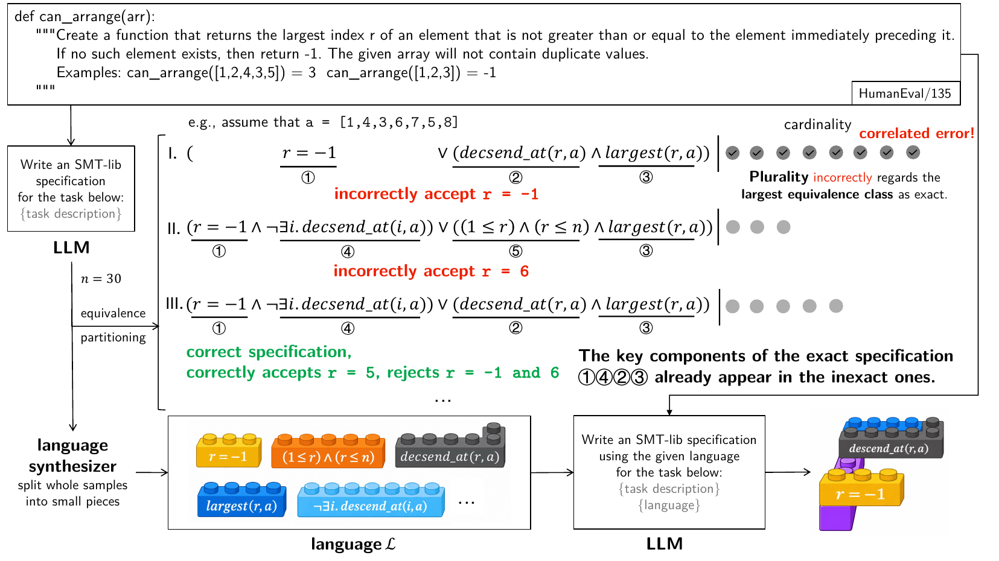

## 1. 引言：从 CLEVER 到规约评估

### 1.1 CLEVER 如何组织端到端验证

[CLEVER](https://arxiv.org/abs/2505.13938v4) 是一个面向端到端验证代码生成的 Lean 4 基准，将 HumanEval 中的 161 个编程任务改写为形式验证任务。每题包含自然语言需求、函数签名、人工编写的参考规约，以及规约等价性和实现正确性的待证命题。[论文 §1—2](https://arxiv.org/html/2505.13938v4#S2)

模型需要完成下面四个步骤。前两步组成**规约认证**，后两步组成**实现认证**。[官方任务说明](https://github.com/trishullab/clever#benchmark-focus)

| 步骤 | 模型需要生成的内容 | 检查目标 |
| --- | --- | --- |
| 规约生成 | 根据自然语言需求生成 Lean 规约 $\psi$ | 形式定义能够通过编译 |
| 规约认证 | 生成 $\psi$ 与隐藏参考规约 $\psi^*$ 的等价证明 | 生成规约与参考规约语义等价 |
| 实现生成 | 生成符合函数签名的 Lean 实现 $\pi$ | 实现能够通过编译 |
| 实现认证 | 生成 $\pi$ 满足 $\psi^*$ 的正确性证明 | 实现符合人工参考规约 |

这里有一个重要设置：实现认证针对的是人工参考规约 $\psi^*$。CLEVER 这样设计，是为了让实现正确性的评价独立于模型能否生成正确规约。端到端成功要求两项认证都完成，相关证明由 Lean 检查。[论文 §2—3](https://arxiv.org/html/2505.13938v4#S2)

[](../assets/papers/coins-evaluation/clever-figure-1.png)

*CLEVER 原论文图 1。Task 1 生成规约并证明其与人工参考规约等价；Task 2 生成实现，并针对人工参考规约证明正确性。两条认证路径分别到达 QED 1、QED 2。[原论文 PDF，第 2 页](https://arxiv.org/pdf/2505.13938v4)*

COINS 在引言中指出，CLEVER 的评估方式存在以下局限。[COINS §1](https://github.com/taylor-swift-13/Coins_ICML_2026/blob/main/paper/main.pdf)

1. **参考规约构造成本高**。参考等价认证依赖人工编写的参考规约，需要投入较多专家时间，限制了评估的扩展。
2. **全称等价证明负担重**。要求候选规约与参考规约对所有输入输出等价，可能超出当时大模型的证明能力，导致认证成功率很低。
3. **认证失败的原因难以区分**。规约生成、实现生成和形式证明耦合在同一流程中，失败可能来自候选规约有误、实现有误，也可能只是证明尚未完成。
4. **评估信号稀疏**。认证依赖完整证明；当证明成功率很低时，大量候选只能得到“未通过认证”的结果，难以据此有效区分不同候选规约的质量。

为此，我们提出 COINS，将评估目标转向具体输入输出行为：把候选规约应用于正负案例，由模型构造证明，再交给 Rocq 检查。正例获得接受证明，说明规约保留了该正确行为；负例若也获得接受证明，则暴露规约放过错误行为的问题。COINS 也允许使用可计算定义辅助实例检查，旨在降低单次检查的证明负担，为规约质量提供更具体的行为证据。[COINS §1、§3、§4.4](https://github.com/taylor-swift-13/Coins_ICML_2026/blob/main/paper/main.pdf)

## 2. COINS 的评估对象与流程

### 2.1 评估对象：输入输出之间的逻辑关系

COINS 将形式规约视为输入与输出上的逻辑命题，刻画正确实现应满足的功能性关系。论文主要讨论与实现无关的输入输出行为，内存布局、运行时异常等语言相关性质不在该工作的评估范围内。[论文 §2](https://github.com/taylor-swift-13/Coins_ICML_2026/blob/main/paper/main.pdf)

评估时，我们固定输入输出对，将其代入候选规约，得到具体的 Rocq 命题，再由模型尝试构造证明。实验覆盖 HumanEval 的 164 个任务：正例来自 HumanEval+，负例从变异实现的错误输出中提取，每题选取 10 个。[论文 §3.1、§4.1](https://github.com/taylor-swift-13/Coins_ICML_2026/blob/main/paper/main.pdf)

### 2.2 论文中的 `sort_third` 示例

论文使用 HumanEval 的 `sort_third` 说明规约与实例化检查：给定一个列表，将索引能被 3 整除的位置上的元素按非递减顺序排列，其余位置的元素保持不变。索引从 0 开始。[论文 §2](https://github.com/taylor-swift-13/Coins_ICML_2026/blob/main/paper/main.pdf#page=3)

原文的 Rocq 规约 `sort_third_spec` 包含三个条件：

1. 输出是输入的一个排列，保留所有元素及其出现次数。
2. 索引不能被 3 整除的位置，输出元素与输入相同。
3. 索引能被 3 整除的位置，其元素按非递减顺序排列。

论文给出的输入为 `[2;1;3;7;8;9;10]`，对应的正负例输出如下：

| 案例 | 输出 |
| --- | --- |
| 正例 | `[2;1;3;7;8;9;10]` |
| 变异负例 | `[7;1;3;2;8;9;10]` |

正例对应的 Rocq 证明目标是：

```coq
Example sort_third_pos :
  sort_third_spec [2;1;3;7;8;9;10]
                  [2;1;3;7;8;9;10].
```

对负例，候选规约不应允许该输出；若模型仍能构造出通过 Rocq 检查的接受证明，就暴露了规约过于宽松的问题。这两类案例分别用于检查正确行为的接受情况，以及发现被规约放过的错误行为。[论文 §2](https://github.com/taylor-swift-13/Coins_ICML_2026/blob/main/paper/main.pdf#page=3)

### 2.3 四阶段筛选

COINS 依次执行 `SYNTAX`、`PASSfirst`、`PASSall` 和 `REJECTall`，逐步筛选生成规约。[论文 §3.2](https://github.com/taylor-swift-13/Coins_ICML_2026/blob/main/paper/main.pdf)

[](../assets/papers/coins-evaluation/coins-figure-1.png?v=2987d78)

*COINS 图 1。上方为规约和行为案例的准备，下方为四阶段评估。图中 Gemini 3 Pro Preview 的候选数量从 164 份筛选至 46 份。[论文 §3.2、表 2](https://github.com/taylor-swift-13/Coins_ICML_2026/blob/main/paper/main.pdf)*

| 阶段 | 检查内容 | 候选如何保留 |
| --- | --- | --- |
| `SYNTAX` | 规约定义能否在 Rocq 环境中编译 | 编译成功 |
| `PASSfirst` | 首个正例能否获得接受证明 | 证明通过 Rocq 检查 |
| `PASSall` | 全部选定正例能否获得接受证明 | 所有正例的接受证明均通过 |
| `REJECTall` | 负例是否也能获得接受证明 | 未发现通过检查的负例接受证明 |

负例阶段允许模型判断拒绝后跳过证明，因此 `REJECTall` 不要求为每个负例构造否定证明。[论文 §3.2](https://github.com/taylor-swift-13/Coins_ICML_2026/blob/main/paper/main.pdf)

@@opinion-begin@@

`REJECTall` 的通过应理解为“本轮检查没有获得负例被接受的证明”，而不是已经证明所有负例均被拒绝。对于声明式规约，正向的接受证明难以构造时，反向的拒绝证明有时同样困难。因此，这项工作只要模型判断拒绝，或未能给出通过 Rocq 检查的负例接受证明，就将该案例计为 reject。本质上，这仍是对证明能力的一种妥协。

@@opinion-end@@

## 3. COINS 的主要实验与发现

论文围绕四个研究问题组织主实验：选择证明模型、评估规约生成、区分规约质量与证明能力，以及考察可执行成分的作用。实验比较六个模型；每个证明任务最多尝试三次，尝试之间提供编译器或验证器的错误反馈。[论文 §4、附录 C](https://github.com/taylor-swift-13/Coins_ICML_2026/blob/main/paper/main.pdf#page=5)

### 3.1 RQ1：先用人工规约选择证明模型

为了减少规约质量与证明能力相互影响带来的不确定性，论文先固定经过人工编写与审核的规约，比较各模型完成实例证明的能力，再选取表现最好的模型评价后续生成规约。下方直接使用原论文表 1，保留原表的百分比和通过任务数，任务总数为 164。[论文 §4.1、表 1](https://github.com/taylor-swift-13/Coins_ICML_2026/blob/main/paper/main.pdf#page=5)

[](../assets/papers/coins-evaluation/coins-table-1.png?v=2987d78)

*COINS 原论文表 1。比较各证明模型的 `PASSfirst` 与 `PASSall`，括号中为通过任务数。[原论文 PDF，第 5 页](https://github.com/taylor-swift-13/Coins_ICML_2026/blob/main/paper/main.pdf#page=5)*

Gemini 3 Pro Preview 的 `PASSall` 最高，为 **50/164（30.49%）**，因此被选为后续实验的主要证明模型。论文同时指出，即使使用人工规约，完成全部实例证明仍然困难。[论文 §4.1](https://github.com/taylor-swift-13/Coins_ICML_2026/blob/main/paper/main.pdf#page=5)

**评估对偶性。** 规约未能通过验证时，错误可能来自规约，也可能来自证明器；更强的证明器有助于识别规约质量，更可靠的规约也有助于评价证明能力。人工规约在这里作为相对可靠的参照，原文没有将其宣称为绝对正确的真值。[论文 §4.1](https://github.com/taylor-swift-13/Coins_ICML_2026/blob/main/paper/main.pdf#page=5)

@@opinion-begin@@

人工编写规约的表现已经说明，这套评估方法在当时仍会受到证明能力的限制，从而低估规约质量。但随着模型证明能力提升，加上测试用例并不稀缺，这类方法能够通过不断扩充输入输出案例，持续积累细粒度的行为证据，为规约质量提供更连续的评估信号。

@@opinion-end@@

### 3.2 RQ2：统一证明模型后，规约生成表现如何

这一实验由六个模型分别生成规约，主要比较统一使用 Gemini 3 Pro Preview 生成证明的结果，同时报告各模型自验证的表现。下方直接使用原论文表 2，保留全部阶段和两种证明设置；百分比以 164 个任务为分母，括号中为通过任务数。[论文 §4.2、表 2](https://github.com/taylor-swift-13/Coins_ICML_2026/blob/main/paper/main.pdf#page=7)

[](../assets/papers/coins-evaluation/coins-table-2.png?v=2987d78)

*COINS 原论文表 2。`Generate Model` 为规约生成模型，`Verify Model` 为证明模型，后续各列对应四阶段评估。[原论文 PDF，第 7 页](https://github.com/taylor-swift-13/Coins_ICML_2026/blob/main/paper/main.pdf#page=7)*

**语法是第一道瓶颈。** 六个模型的语法通过率从 7.93% 到 78.05%，大量候选在行为评估之前就因无效语法或类型构造被淘汰。原文在 HumanEval 和该测试协议的范围内，将这类形式表达错误归纳为主要失败来源。[论文 §4.2](https://github.com/taylor-swift-13/Coins_ICML_2026/blob/main/paper/main.pdf#page=6)

@@opinion-begin@@

语法问题主要体现在 pass@1 的单次生成设置中；在现在采用编译器反馈、允许多轮修正的 Agent 流程中，这类问题基本不再构成障碍。

@@opinion-end@@

论文还报告了三项观察：

- **单个正例不足以支持完整评价。** Gemini 3 Pro Preview 的 `PASSfirst` 为 100/164，而 `PASSall` 为 46/164。原文据此强调，多个测试共同约束规约语义，单例成功不能代表整套案例都能通过。
- **模型差异能够被区分。** 最终筛选率从 DeepSeek-V3.1 的 1.22% 到 Gemini 3 Pro Preview 的 28.05%，并非所有模型都停留在接近零的认证成功率。
- **结果不只来自自验证。** 原文同时比较模型证明自身规约的表现。例如 Claude 4.5 Opus 自验证的 `PASSall` 为 18/164，改用 Gemini 后为 24/164；GPT-5 则从 12/164 变为 25/164。作者据此认为，Gemini 的整体优势不能仅归因于验证自身产物。[论文 §4.2、表 2](https://github.com/taylor-swift-13/Coins_ICML_2026/blob/main/paper/main.pdf#page=7)

此外，本表六组统一证明模型的结果中，`PASSall` 与 `REJECTall` 计数均相同。原文将二者接近归因于测试覆盖对过度近似空间的约束，以及 HumanEval 任务相对简单；这是作者对该实验结果的解释。[论文 §4.2](https://github.com/taylor-swift-13/Coins_ICML_2026/blob/main/paper/main.pdf#page=6)

### 3.3 RQ3：规约质量与证明能力分别贡献多少

论文以“模型生成规约，并由自身证明”（Self-Verify + Self Spec）为基线，分别更换规约来源或证明模型，进行两项受控干预。保留证明模型、将规约替换为人工规约（Self-Verify + Human Spec），原文报告平均提升 **5.08 个百分点**；保留生成规约、将证明模型替换为 Gemini（Gemini-Verify + Self Spec），平均提升 **3.05 个百分点**。各模型的结果见原论文图 2。[论文 §4.3、图 2](https://github.com/taylor-swift-13/Coins_ICML_2026/blob/main/paper/main.pdf#page=6)

[](../assets/papers/coins-evaluation/coins-figure-2.png?v=2987d78)

*COINS 原论文图 2。分别改变规约来源和证明模型，观察通过率变化。[原论文 PDF，第 6 页](https://github.com/taylor-swift-13/Coins_ICML_2026/blob/main/paper/main.pdf#page=6)*

**验证复杂度的权衡。** 两项干预都影响评估结果。虽然替换人工规约带来的平均提升更大，证明能力在实例检查中仍有显著影响。原文由此强调：证明义务越复杂，就越依赖强证明器，也越容易因证明失败而系统性低估规约质量；即使评价目标本身严格，过难的证明过程仍可能使评分难以反映生成能力。[论文 §4.3](https://github.com/taylor-swift-13/Coins_ICML_2026/blob/main/paper/main.pdf#page=7)

### 3.4 RQ4：允许可执行成分会怎样影响规约与证明

论文构造允许和禁止 `Fixpoint` 的两版人工规约，并用 Gemini 3 Pro Preview 进行比较。同时，图 3 统计了不同来源的规约中 `Fixpoint` 的使用情况。[论文 §4.4、图 3—4](https://github.com/taylor-swift-13/Coins_ICML_2026/blob/main/paper/main.pdf#page=7)

[](../assets/papers/coins-evaluation/coins-figure-3.png?v=2987d78)

*COINS 原论文图 3。柱内同时标出使用数量与分母：Gemini 为 43/128，GPT-5 为 44/110，Claude 4.5 Opus 为 43/98，人工规约为 65/164。[原论文 PDF，第 7 页](https://github.com/taylor-swift-13/Coins_ICML_2026/blob/main/paper/main.pdf#page=7)*

在图 3 的统计中，三个较强模型的使用比例为 33.6%—43.9%，人工规约约为 39.6%；较弱模型使用 `Fixpoint` 的比例明显更低。图 4 则显示，禁止 `Fixpoint` 后，人工规约的首例与全部正例通过率都下降；原文还报告，禁止递归定义的版本需要更多代码，关系式表达更冗长，证明也更困难。[论文 §4.4](https://github.com/taylor-swift-13/Coins_ICML_2026/blob/main/paper/main.pdf#page=8)

[](../assets/papers/coins-evaluation/coins-figure-4.png?v=2987d78)

*COINS 原论文图 4。允许 `Fixpoint` 时，`PASSfirst`、`PASSall` 分别为 75.6%、30.5%；禁止后分别降至 61.6%、15.2%。图中百分比保留一位小数，与表 1 的人工基线一致。[原论文 PDF，第 8 页](https://github.com/taylor-swift-13/Coins_ICML_2026/blob/main/paper/main.pdf#page=8)*

**可执行成分很重要。** 用 `Fixpoint` 封装适当的子逻辑，可以降低规约复杂度与验证难度；强制只使用纯关系式表达，会使定义和证明义务更冗长。这也是论文允许规约包含可执行成分的实验依据。[论文 §4.4](https://github.com/taylor-swift-13/Coins_ICML_2026/blob/main/paper/main.pdf#page=8)

### 3.5 补充实验：实例筛选之后，等价证明仍有多难

附录 E 进一步比较通过筛选的人工与模型规约。在双方都通过筛选的 29 个任务上，**9 个**任务的两个蕴含方向均证明成功，**3 个**只有一个方向证明成功，另有 **17 个**两个方向都未完成证明。[论文附录 E](https://github.com/taylor-swift-13/Coins_ICML_2026/blob/main/paper/main.pdf#page=22)

论文人工复核了三个单向成功的案例，并认为它们实际语义等价，缺失方向来自证明能力限制。因此，原文把这组结果作为等价证明可能低估规约质量的进一步证据，认为它不适合作为主要质量指标。[论文附录 E](https://github.com/taylor-swift-13/Coins_ICML_2026/blob/main/paper/main.pdf#page=22)

## 4. 其他工作如何评估规约

### 4.1 VERINA

**发表**：[ICLR 2026](https://openreview.net/forum?id=0A4Uf88pog)。

对照人工 GT，评价前后置条件的 soundness 与 completeness。先尝试证明关系，再通过 `decide` 和 `plausible` 检查正负案例；未决结果单独报告。[评估方法](https://arxiv.org/html/2505.23135v3#S4.SS1)

记参考前后置条件为 $P,Q$，生成条件为 $\widehat P,\widehat Q$，四项全称关系为：

- 前置条件 soundness：$P(i)\Rightarrow\widehat P(i)$。
- 前置条件 completeness：$\widehat P(i)\Rightarrow P(i)$。
- 后置条件 soundness：$P(i)\land\widehat Q(i,o)\Rightarrow Q(i,o)$。
- 后置条件 completeness：$P(i)\land Q(i,o)\Rightarrow\widehat Q(i,o)$。

@@opinion-begin@@

**不足**：仍依赖 GT 和等价性目标。`decide` 需要可计算的判定过程，靠枚举处理量词时需要有限或有界的量词域；无界量词可能导致 unknown。Lean 的评估流程迁移至 Rocq 还需另行实现。

@@opinion-end@@

### 4.2 VerinaPlus / VeriScale

**公开版本**：[arXiv 预印本，2026](https://arxiv.org/abs/2605.22368v1)。

扩充合法输入输出、无效输入和错误输出，尤其利用对抗实现寻找规约漏掉的错误行为，再用 VERINA 的评估脚本计分。VerinaLite 则选用较少的测试，保留边界输入和能暴露已知错误实现的案例，以减少评估耗时。[评估方法](https://arxiv.org/html/2605.22368v1#S3)

[](../assets/papers/coins-evaluation/veriscale-table-1.png)

*VeriScale 原论文表 1。[原论文 PDF，第 6 页](https://arxiv.org/pdf/2605.22368v1#page=6)*

@@opinion-begin@@

**不足**：测试标签仍依赖参考前置条件与参考实现；对抗案例只能暴露已触及的错误类型，增加测试数量不能保证规约已完整表达需求。

@@opinion-end@@

### 4.3 AuXSpec

**公开版本**：[arXiv 预印本，2026](https://arxiv.org/abs/2611.21421v1)。

为声明式后置条件配对可执行检查器，以**编译检查、冻结测试和 LLM judges**评价候选。Judges 检查需求忠实性、非平凡性等；声明式与执行形式的等价证明另行审计。[评估方法](https://arxiv.org/html/2611.21421v1#S2)

@@opinion-begin@@

**不足**：新候选的接纳不要求先完成桥接证明；测试和 LLM judge 仍可能漏掉语义错误。两种表示即使一致，也可能共同遗漏需求。

@@opinion-end@@

### 4.4 LeetProof

**发表**：[ASE 2026](https://doi.org/10.1145/3832783.3837559)。

在代码合成前，用输入输出例子和随机性质测试检查规约能否接纳正确行为、排除错误输出。实验另以参考规约等价证明和人工复核评价生成质量。[评估方法](https://arxiv.org/html/2604.16584v1#S4)

@@opinion-begin@@

**不足**：随机测试与输出变异的覆盖有限；输出唯一性检查需要确定性需求作为前提。参考等价评价也仍受 GT 质量和证明能力限制。

@@opinion-end@@

### 4.5 Fulminate

**发表**：[POPL 2025 / PACMPL 9，Article 43](https://doi.org/10.1145/3704879)。

把 CN 分离逻辑规约编译成 C 运行时检查，检查具体执行中的前后置条件、内存所有权及其转移，并通过注入缺陷和测试执行观察能否发现错误。[评估方法](https://www.cs.ox.ac.uk/people/christopher.pulte/2024-cn-testing-paper.pdf)

@@opinion-begin@@

**不足**：需要可执行的规约片段和外部测试，结论仅覆盖执行到的路径与堆状态；检查失败后，仍需区分问题来自规约还是实现。

@@opinion-end@@

### 4.6 Spec-Harness

**公开版本**：[arXiv 预印本，2026](https://arxiv.org/abs/2604.00280v3)。

固定具体输入输出，结合 OpenJML 符号验证与输入输出变异，分别评价前后置条件的正确性和完整性。反馈测试与最终评估测试分开使用。[评估方法](https://arxiv.org/html/2604.00280v3#S5)

[](../assets/papers/coins-evaluation/spec-harness-figure-1.png)

*Spec-Harness 原论文图 1。[原论文 PDF，第 4 页](https://arxiv.org/pdf/2604.00280v3#page=4)*

@@opinion-begin@@

**不足**：分数依赖测试覆盖、变异方式和合法性标签；未被案例触及的遗漏约束仍可能保留，验证器的未决结果也限制了可评估范围。

@@opinion-end@@

### 4.7 Contrapuntal Languages

**公开版本**：[arXiv 预印本，2026](https://arxiv.org/abs/2610.30059v1)。

在两种不同的任务专用语言中独立形式化需求，用求解器检查两份规约是否等价；实验再用正例和变异负例评价正确行为覆盖与错误行为排除。[评估方法](https://arxiv.org/html/2610.30059v1#S6)

[](../assets/papers/coins-evaluation/contrapuntal-figure-1.png)

*Contrapuntal Languages 原论文图 1。[原论文 PDF，第 3 页](https://arxiv.org/pdf/2610.30059v1#page=3)*

@@opinion-begin@@

**不足**：两种表示仍可能共享同一个需求误解；相互等价无法独立排除这种错误，行为层面的结论也受测试范围限制。

@@opinion-end@@

### 4.8 需求忠实性研究

**公开版本**：[*Are LLM-Generated Formal Specifications Faithful to Their Requirements?*，arXiv 预印本，2026](https://arxiv.org/abs/2610.32053v1)。

在 1,403 个 C 程序上，同时提供需求和正确性未知的实现，结合 Frama-C 验证与 E-ACSL 运行检查，观察规约是否错误接纳错误行为，或拒绝正确行为。[评估方法](https://arxiv.org/html/2610.32053v1#S3)

@@opinion-begin@@

**不足**：忠实性判定仍受测试覆盖、分类标准和工具能力影响；无法完成验证或执行检查时，难以直接判断规约是否符合需求。

@@opinion-end@@

### 4.9 Isomorphism Is Not Enough

**公开版本**：[arXiv 预印本，2026](https://arxiv.org/abs/2605.23772v2)。

审计 CLEVER 全部 161 项任务，区分参考错误、合理解释差异和证明失败。论文报告 80 项参考规约问题，另有 13 项合理解释不匹配，并经人工复核及 CLEVER 作者确认。[审计方法与结果](https://arxiv.org/html/2605.23772v2#S3.SS1)

@@opinion-begin@@

**不足**：主要贡献是诊断参考规约与评分失效，尚未形成独立、通用的规约评估器；合理解释与语义错误的区分仍需要人工判断。

@@opinion-end@@

### 4.10 评估方法小结

将前述工作按使用的评估环节归纳如下。同一工作可以采用多种方式；各项分数的检查对象和计数单位仍需分别阅读。

| 评估方式 | 使用该方式的工作 |
| --- | --- |
| 实现或系统级验证、程序变异 | [SpecGen](https://doi.org/10.1109/ICSE55347.2025.00129)、[FormalBench](https://aclanthology.org/2025.acl-long.1068/)、[OSVBench](https://arxiv.org/html/2504.20964v2#S3)、[CLEVER 的实现认证](https://arxiv.org/html/2505.13938v4#S2)、[Spec-Harness 的验证与变异分析](https://arxiv.org/html/2604.00280v3#S2.SS2)、[需求忠实性研究](https://arxiv.org/html/2610.32053v1#S3) |
| 与人工参考规约的关系证明或复核 | [CLEVER](https://arxiv.org/html/2505.13938v4#S2)、[VERINA](https://arxiv.org/html/2505.23135v3#S4.SS1)、[VerinaPlus 沿用的评估器](https://arxiv.org/html/2605.22368v1#S4.SS2)、[LeetProof](https://arxiv.org/html/2604.16584v1#S5.SS1)、[Isomorphism Is Not Enough](https://arxiv.org/html/2605.23772v2#S2) |
| 行为实例证明、执行或性质测试 | [COINS](https://github.com/taylor-swift-13/Coins_ICML_2026/blob/main/paper/main.pdf)、[Spec-Harness](https://arxiv.org/html/2604.00280v3#S5)、[VERINA](https://arxiv.org/html/2505.23135v3#S4.SS1)、[VerinaPlus](https://arxiv.org/html/2605.22368v1#S4.SS2)、[AuXSpec](https://arxiv.org/html/2611.21421v1#S2)、[LeetProof](https://arxiv.org/html/2604.16584v1#S4)、[Contrapuntal Languages](https://arxiv.org/html/2610.30059v1#S6)、[Fulminate 的堆状态与所有权检查](https://doi.org/10.1145/3704879) |
| 不同表示之间的一致性检查 | [Contrapuntal Languages 的候选等价检查](https://arxiv.org/html/2610.30059v1#S2)、[AuXSpec 的声明式与执行形式对应](https://arxiv.org/html/2611.21421v1#S2) |
| 需求定向与对抗测试构造 | [VeriScale / VerinaPlus](https://arxiv.org/html/2605.22368v1#S3) |
| 需求与参考规约的人工审核 | [SpecGen](https://liyiweb.com/files/Ma2025SAG.pdf)、[COINS](https://github.com/taylor-swift-13/Coins_ICML_2026/blob/main/paper/main.pdf)、[CLEVER](https://arxiv.org/html/2505.13938v4#S2)、[Spec-Harness](https://arxiv.org/html/2604.00280v3#S5.SS6)、[需求忠实性研究](https://arxiv.org/html/2610.32053v1#S3)、[AuXSpec](https://arxiv.org/html/2611.21421v1)、[VERINA](https://arxiv.org/html/2505.23135v3#S3.SS2)、[LeetProof](https://arxiv.org/html/2604.16584v1#S5.SS1)、[Isomorphism Is Not Enough](https://arxiv.org/html/2605.23772v2#S2.SS2) |

## 5. 规约评估的困难

@@opinion-begin@@

1. **需求与使用场景决定什么是正确规约**。同一功能在不同场景下可能有不同的边界条件、允许行为和资源要求。现有基准多采用需求相对清晰的算法题，真实场景中的需求歧义和上下文依赖更难评估。
2. **内存权限与系统状态更难处理**。许多工作集中在算法题和 Lean 中的输入输出关系，避开了复杂内存管理。进入 C 等系统程序后，还需检查指针别名、资源所有权及其转移，单纯比较返回值远远不够。
3. **定理证明的瓶颈正在逐步消退**。随着大模型定理证明能力提升，因证明未完成而低估规约质量的问题有望持续减少，评估也能覆盖更复杂的声明式规约。
4. **可判定性与可执行性不是必要条件**。规约代入实例后不必能直接判定，规约本身也不必可执行。要求可判定或可执行，主要是出于检查成本的考虑。另外，一些工作要求规约不暴露实现细节，但仍依赖 LLM judge 作判断，缺少独立、确定的检查。因此，声明式规约更有利于隐藏实现细节，但更难进行自动检查。

@@opinion-end@@
