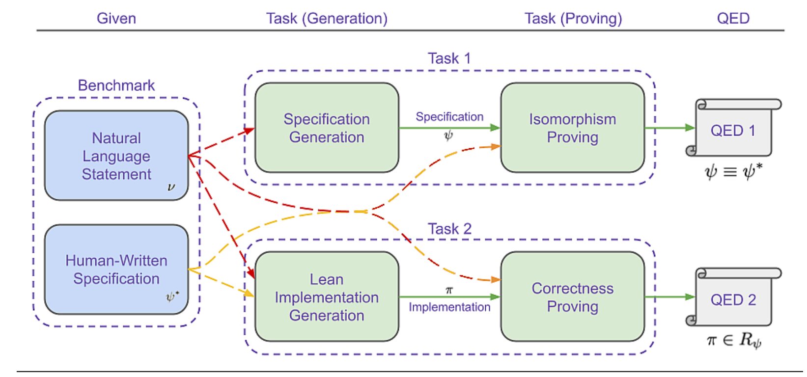
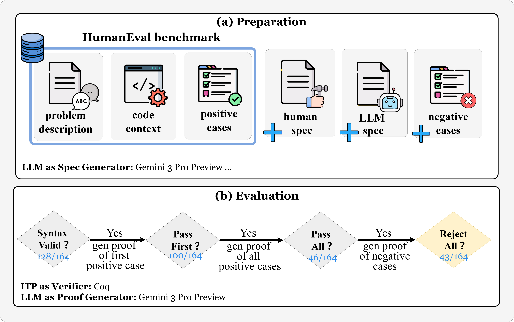
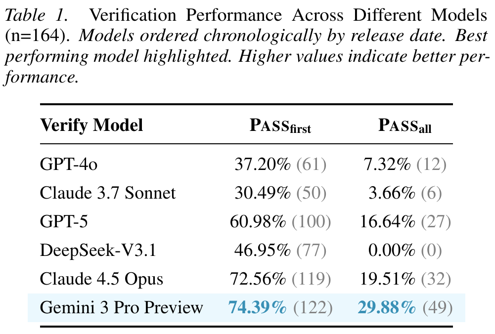
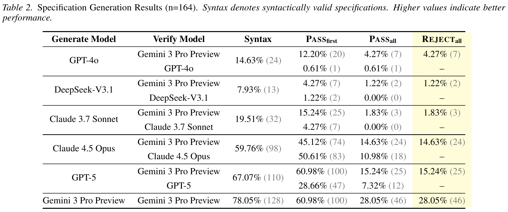
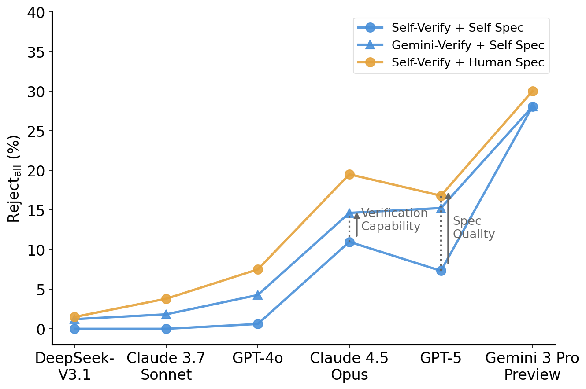
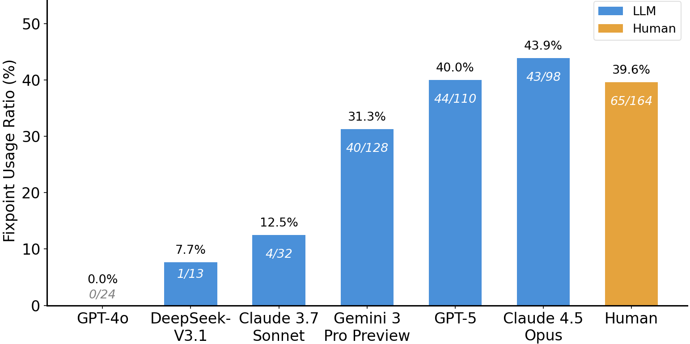
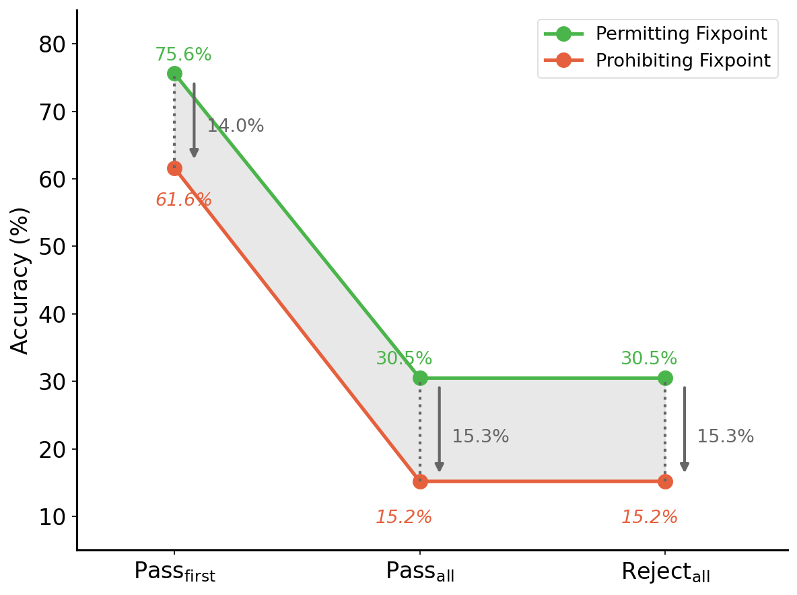
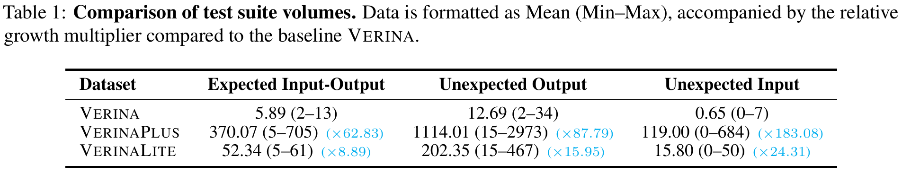
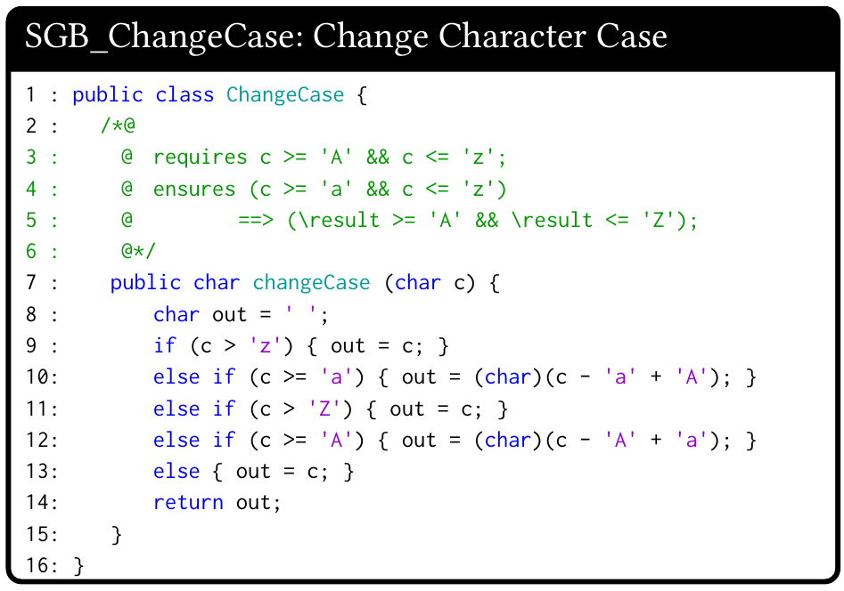

## 1. 引言：从 CLEVER 到规约评估

### 1.1 CLEVER 如何组织端到端验证

[CLEVER](https://arxiv.org/abs/2505.13938v4) 是一个面向端到端验证代码生成的 Lean 4 基准，将 HumanEval 中的 161 个编程任务改写为形式验证任务。每题包含自然语言需求、函数签名、人工编写的参考规约，以及规约等价性和实现正确性的待证命题。[论文 §1—2](https://arxiv.org/html/2505.13938v4#S2)

模型需要完成下面四个步骤。前两步组成**规约认证**，后两步组成**实现认证**。[官方任务说明](https://github.com/trishullab/clever#benchmark-focus)

| 步骤 | 模型需要生成的内容 | 检查目标 |
| --- | --- | --- |
| 规约生成 | 根据自然语言需求生成 Lean 规约 $\psi$ | 形式定义能够通过编译 |
| 规约认证 | 生成 $\psi$ 与隐藏参考规约 $\psi^*$ 的等价证明 | 生成规约与参考规约语义等价 |
| 实现生成 | 生成符合函数签名的 Lean 实现 $\pi$ | 实现能够通过编译 |
| 实现认证 | 生成 $\pi$ 满足 $\psi^*$ 的正确性证明 | 实现符合人工参考规约 |

这里有一个重要设置：实现认证针对的是人工参考规约 $\psi^*$。CLEVER 这样设计，是为了让实现正确性的评价独立于模型能否生成正确规约。端到端成功要求两项认证都完成，相关证明由 Lean 检查。[论文 §2—3](https://arxiv.org/html/2505.13938v4#S2)

[](../assets/papers/coins-evaluation/clever-figure-1.png)

*CLEVER 原论文图 1。Task 1 生成规约并证明其与人工参考规约等价；Task 2 生成实现，并针对人工参考规约证明正确性。两条认证路径分别到达 QED 1、QED 2。[原论文 PDF，第 2 页](https://arxiv.org/pdf/2505.13938v4)*

COINS 在引言中指出，CLEVER 的评估方式存在以下局限。[COINS §1](https://lcs.ios.ac.cn/~znj/papers/papers/ICML2026-15287_How_Powerful_are_LLMs_in.pdf)

1. **参考规约构造成本高**。参考等价认证依赖人工编写的参考规约，需要投入较多专家时间，限制了评估的扩展。
2. **全称等价证明负担重**。要求候选规约与参考规约对所有输入输出等价，可能超出当时大模型的证明能力，导致认证成功率很低。
3. **认证失败的原因难以区分**。规约生成、实现生成和形式证明耦合在同一流程中，失败可能来自候选规约有误、实现有误，也可能只是证明尚未完成。
4. **评估信号稀疏**。认证依赖完整证明；当证明成功率很低时，大量候选只能得到“未通过认证”的结果，难以据此有效区分不同候选规约的质量。

为此，我们提出 COINS，将评估目标转向具体输入输出行为：把候选规约应用于正负案例，由模型构造证明，再交给 Rocq 检查。正例获得接受证明，说明规约保留了该正确行为；负例若也获得接受证明，则暴露规约放过错误行为的问题。COINS 也允许使用可计算定义辅助实例检查，旨在降低单次检查的证明负担，为规约质量提供更具体的行为证据。[COINS §1、§3、§4.4](https://lcs.ios.ac.cn/~znj/papers/papers/ICML2026-15287_How_Powerful_are_LLMs_in.pdf)

## 2. COINS 的评估对象与流程

### 2.1 评估对象：输入输出之间的逻辑关系

COINS 将形式规约视为输入与输出上的逻辑命题，刻画正确实现应满足的功能性关系。论文主要讨论与实现无关的输入输出行为，内存布局、运行时异常等语言相关性质不在该工作的评估范围内。[论文 §2](https://lcs.ios.ac.cn/~znj/papers/papers/ICML2026-15287_How_Powerful_are_LLMs_in.pdf)

评估时，我们固定输入输出对，将其代入候选规约，得到具体的 Rocq 命题，再由模型尝试构造证明。实验覆盖 HumanEval 的 164 个任务：正例来自 HumanEval+，负例从变异实现的错误输出中提取，每题选取 10 个。[论文 §3.1、§4.1](https://lcs.ios.ac.cn/~znj/papers/papers/ICML2026-15287_How_Powerful_are_LLMs_in.pdf)

### 2.2 论文中的 `sort_third` 示例

论文使用 HumanEval 的 `sort_third` 说明规约与实例化检查：给定一个列表，将索引能被 3 整除的位置上的元素按非递减顺序排列，其余位置的元素保持不变。索引从 0 开始。[论文 §2](https://lcs.ios.ac.cn/~znj/papers/papers/ICML2026-15287_How_Powerful_are_LLMs_in.pdf#page=3)

原文的 Rocq 规约 `sort_third_spec` 包含三个条件：

1. 输出是输入的一个排列，保留所有元素及其出现次数。
2. 索引不能被 3 整除的位置，输出元素与输入相同。
3. 索引能被 3 整除的位置，其元素按非递减顺序排列。

论文给出的输入为 `[2;1;3;7;8;9;10]`，对应的正负例输出如下：

| 案例 | 输出 |
| --- | --- |
| 正例 | `[2;1;3;7;8;9;10]` |
| 变异负例 | `[7;1;3;2;8;9;10]` |

正例对应的 Rocq 证明目标是：

```coq
Example sort_third_pos :
  sort_third_spec [2;1;3;7;8;9;10]
                  [2;1;3;7;8;9;10].
```

对负例，候选规约不应允许该输出；若模型仍能构造出通过 Rocq 检查的接受证明，就暴露了规约过于宽松的问题。这两类案例分别用于检查正确行为的接受情况，以及发现被规约放过的错误行为。[论文 §2](https://lcs.ios.ac.cn/~znj/papers/papers/ICML2026-15287_How_Powerful_are_LLMs_in.pdf#page=3)

### 2.3 四阶段筛选

COINS 依次执行 `SYNTAX`、`PASSfirst`、`PASSall` 和 `REJECTall`，逐步筛选生成规约。[论文 §3.2](https://lcs.ios.ac.cn/~znj/papers/papers/ICML2026-15287_How_Powerful_are_LLMs_in.pdf)

[](../assets/papers/coins-evaluation/coins-figure-1.png)

*COINS 图 1。上方为规约和行为案例的准备，下方为四阶段评估。末项计数已更正为 **46/164**，与表 2 一致。[论文 §3.2、表 2](https://lcs.ios.ac.cn/~znj/papers/papers/ICML2026-15287_How_Powerful_are_LLMs_in.pdf)*

| 阶段 | 检查内容 | 候选如何保留 |
| --- | --- | --- |
| `SYNTAX` | 规约定义能否在 Rocq 环境中编译 | 编译成功 |
| `PASSfirst` | 首个正例能否获得接受证明 | 证明通过 Rocq 检查 |
| `PASSall` | 全部选定正例能否获得接受证明 | 所有正例的接受证明均通过 |
| `REJECTall` | 负例是否也能获得接受证明 | 未发现通过检查的负例接受证明 |

负例阶段允许模型判断拒绝后跳过证明，因此 `REJECTall` 不要求为每个负例构造否定证明。[论文 §3.2](https://lcs.ios.ac.cn/~znj/papers/papers/ICML2026-15287_How_Powerful_are_LLMs_in.pdf)

@@opinion-begin@@

`REJECTall` 的通过应理解为“本轮检查没有获得负例被接受的证明”，而不是已经证明所有负例均被拒绝。对于声明式规约，正向的接受证明难以构造时，反向的拒绝证明有时同样困难。因此，这项工作只要模型判断拒绝，或未能给出通过 Rocq 检查的负例接受证明，就将该案例计为 reject。本质上，这仍是对证明能力的一种妥协。

@@opinion-end@@

## 3. COINS 的主要实验与发现

论文围绕四个研究问题组织主实验：选择证明模型、评估规约生成、区分规约质量与证明能力，以及考察可执行成分的作用。实验比较六个模型；每个证明任务最多尝试三次，尝试之间提供编译器或验证器的错误反馈。[论文 §4、附录 C](https://lcs.ios.ac.cn/~znj/papers/papers/ICML2026-15287_How_Powerful_are_LLMs_in.pdf#page=5)

### 3.1 RQ1：先用人工规约选择证明模型

为了减少规约质量与证明能力相互影响带来的不确定性，论文先固定经过人工编写与审核的规约，比较各模型完成实例证明的能力，再选取表现最好的模型评价后续生成规约。下方直接使用原论文表 1，保留原表的百分比和通过任务数，任务总数为 164。[论文 §4.1、表 1](https://lcs.ios.ac.cn/~znj/papers/papers/ICML2026-15287_How_Powerful_are_LLMs_in.pdf#page=5)

[](../assets/papers/coins-evaluation/coins-table-1.png)

*COINS 原论文表 1。比较各证明模型的 `PASSfirst` 与 `PASSall`，括号中为通过任务数。[原论文 PDF，第 5 页](https://lcs.ios.ac.cn/~znj/papers/papers/ICML2026-15287_How_Powerful_are_LLMs_in.pdf#page=5)*

Gemini 3 Pro Preview 的 `PASSall` 最高，为 **49/164（29.88%）**，因此被选为后续实验的主要证明模型。论文同时指出，即使使用人工规约，完成全部实例证明仍然困难。[论文 §4.1](https://lcs.ios.ac.cn/~znj/papers/papers/ICML2026-15287_How_Powerful_are_LLMs_in.pdf#page=5)

**评估对偶性。** 规约未能通过验证时，错误可能来自规约，也可能来自证明器；更强的证明器有助于识别规约质量，更可靠的规约也有助于评价证明能力。人工规约在这里作为相对可靠的参照，原文没有将其宣称为绝对正确的真值。[论文 §4.1](https://lcs.ios.ac.cn/~znj/papers/papers/ICML2026-15287_How_Powerful_are_LLMs_in.pdf#page=5)

@@opinion-begin@@

人工编写规约的表现已经说明，这套评估方法在当时仍会受到证明能力的限制，从而低估规约质量。但随着模型证明能力提升，加上测试用例并不稀缺，这类方法能够通过不断扩充输入输出案例，持续积累细粒度的行为证据，为规约质量提供更连续的评估信号。

@@opinion-end@@

### 3.2 RQ2：统一证明模型后，规约生成表现如何

这一实验由六个模型分别生成规约，主要比较统一使用 Gemini 3 Pro Preview 生成证明的结果，同时报告各模型自验证的表现。下方直接使用原论文表 2，保留全部阶段和两种证明设置；百分比以 164 个任务为分母，括号中为通过任务数。[论文 §4.2、表 2](https://lcs.ios.ac.cn/~znj/papers/papers/ICML2026-15287_How_Powerful_are_LLMs_in.pdf#page=7)

[](../assets/papers/coins-evaluation/coins-table-2.png)

*COINS 原论文表 2。`Generate Model` 为规约生成模型，`Verify Model` 为证明模型，后续各列对应四阶段评估。[原论文 PDF，第 7 页](https://lcs.ios.ac.cn/~znj/papers/papers/ICML2026-15287_How_Powerful_are_LLMs_in.pdf#page=7)*

**语法是第一道瓶颈。** 六个模型的语法通过率从 7.93% 到 78.05%，大量候选在行为评估之前就因无效语法或类型构造被淘汰。原文在 HumanEval 和该测试协议的范围内，将这类形式表达错误归纳为主要失败来源。[论文 §4.2](https://lcs.ios.ac.cn/~znj/papers/papers/ICML2026-15287_How_Powerful_are_LLMs_in.pdf#page=6)

@@opinion-begin@@

语法问题主要体现在 pass@1 的单次生成设置中；在现在采用编译器反馈、允许多轮修正的 Agent 流程中，这类问题基本不再构成障碍。

@@opinion-end@@

论文还报告了三项观察：

- **单个正例不足以支持完整评价。** Gemini 3 Pro Preview 的 `PASSfirst` 为 100/164，而 `PASSall` 为 46/164。原文据此强调，多个测试共同约束规约语义，单例成功不能代表整套案例都能通过。
- **模型差异能够被区分。** 最终筛选率从 DeepSeek-V3.1 的 1.22% 到 Gemini 3 Pro Preview 的 28.05%，并非所有模型都停留在接近零的认证成功率。
- **结果不只来自自验证。** 原文同时比较模型证明自身规约的表现。例如 Claude 4.5 Opus 自验证的 `PASSall` 为 18/164，改用 Gemini 后为 24/164；GPT-5 则从 12/164 变为 25/164。作者据此认为，Gemini 的整体优势不能仅归因于验证自身产物。[论文 §4.2、表 2](https://lcs.ios.ac.cn/~znj/papers/papers/ICML2026-15287_How_Powerful_are_LLMs_in.pdf#page=7)

此外，本表六组统一证明模型的结果中，`PASSall` 与 `REJECTall` 计数均相同。原文将二者接近归因于测试覆盖对过度近似空间的约束，以及 HumanEval 任务相对简单；这是作者对该实验结果的解释。[论文 §4.2](https://lcs.ios.ac.cn/~znj/papers/papers/ICML2026-15287_How_Powerful_are_LLMs_in.pdf#page=6)

### 3.3 RQ3：规约质量与证明能力分别贡献多少

论文以“模型生成规约，并由自身证明”（Self-Verify + Self Spec）为基线，分别更换规约来源或证明模型，进行两项受控干预。保留证明模型、将规约替换为人工规约（Self-Verify + Human Spec），原文报告平均提升 **5.01 个百分点**；保留生成规约、将证明模型替换为 Gemini（Gemini-Verify + Self Spec），平均提升 **3.05 个百分点**。各模型的结果见原论文图 2。[论文 §4.3、图 2](https://lcs.ios.ac.cn/~znj/papers/papers/ICML2026-15287_How_Powerful_are_LLMs_in.pdf#page=6)

[](../assets/papers/coins-evaluation/coins-figure-2.png)

*COINS 原论文图 2。分别改变规约来源和证明模型，观察通过率变化。[原论文 PDF，第 6 页](https://lcs.ios.ac.cn/~znj/papers/papers/ICML2026-15287_How_Powerful_are_LLMs_in.pdf#page=6)*

**验证复杂度的权衡。** 两项干预都影响评估结果。虽然替换人工规约带来的平均提升更大，证明能力在实例检查中仍有显著影响。原文由此强调：证明义务越复杂，就越依赖强证明器，也越容易因证明失败而系统性低估规约质量；即使评价目标本身严格，过难的证明过程仍可能使评分难以反映生成能力。[论文 §4.3](https://lcs.ios.ac.cn/~znj/papers/papers/ICML2026-15287_How_Powerful_are_LLMs_in.pdf#page=7)

### 3.4 RQ4：允许可执行成分会怎样影响规约与证明

论文构造允许和禁止 `Fixpoint` 的两版人工规约，并用 Gemini 3 Pro Preview 进行比较。同时，图 3 统计了不同来源的规约中 `Fixpoint` 的使用情况。[论文 §4.4、图 3—4](https://lcs.ios.ac.cn/~znj/papers/papers/ICML2026-15287_How_Powerful_are_LLMs_in.pdf#page=7)

[](../assets/papers/coins-evaluation/coins-figure-3.png)

*COINS 原论文图 3。柱内同时标出使用数量与分母：Gemini 为 40/128，GPT-5 为 44/110，Claude 4.5 Opus 为 43/98，人工规约为 65/164。[原论文 PDF，第 7 页](https://lcs.ios.ac.cn/~znj/papers/papers/ICML2026-15287_How_Powerful_are_LLMs_in.pdf#page=7)*

在图 3 的统计中，三个较强模型的使用比例约为 31%—44%，人工规约约为 39.6%；较弱模型使用 `Fixpoint` 的比例明显更低。图 4 则显示，禁止 `Fixpoint` 后，人工规约的首例与全部正例通过率都下降；原文还报告，禁止递归定义的版本需要更多代码，关系式表达更冗长，证明也更困难。[论文 §4.4](https://lcs.ios.ac.cn/~znj/papers/papers/ICML2026-15287_How_Powerful_are_LLMs_in.pdf#page=8)

[](../assets/papers/coins-evaluation/coins-figure-4.png)

*COINS 原论文图 4。图中允许组的 `PASSfirst`、`PASSall` 分别标为 75.6%、30.5%，禁止组分别标为 61.6%、15.2%。这些允许组标注与表 1 的人工基线 74.39%、29.88% 存在出入；此处保留原图，图与表分别按原文引用。[原论文 PDF，第 8 页](https://lcs.ios.ac.cn/~znj/papers/papers/ICML2026-15287_How_Powerful_are_LLMs_in.pdf#page=8)*

**可执行成分很重要。** 用 `Fixpoint` 封装适当的子逻辑，可以降低规约复杂度与验证难度；强制只使用纯关系式表达，会使定义和证明义务更冗长。这也是论文允许规约包含可执行成分的实验依据。[论文 §4.4](https://lcs.ios.ac.cn/~znj/papers/papers/ICML2026-15287_How_Powerful_are_LLMs_in.pdf#page=8)

### 3.5 补充实验：实例筛选之后，等价证明仍有多难

附录 E 进一步比较通过筛选的人工与模型规约。在双方都通过筛选的 29 个任务上，**9 个**任务的两个蕴含方向均证明成功，**3 个**只有一个方向证明成功，另有 **17 个**两个方向都未完成证明。[论文附录 E](https://lcs.ios.ac.cn/~znj/papers/papers/ICML2026-15287_How_Powerful_are_LLMs_in.pdf#page=22)

论文人工复核了三个单向成功的案例，并认为它们实际语义等价，缺失方向来自证明能力限制。因此，原文把这组结果作为等价证明可能低估规约质量的进一步证据，认为它不适合作为主要质量指标。[论文附录 E](https://lcs.ios.ac.cn/~znj/papers/papers/ICML2026-15287_How_Powerful_are_LLMs_in.pdf#page=22)

## 4. 其他工作如何评估规约

### 4.1 VERINA：关系证明、实例测试与未决结果

[VERINA](https://arxiv.org/abs/2505.23135v3)把代码、规约和证明生成分别计分。SpecGen 针对参考规约评价前置条件和后置条件的 soundness、completeness。记参考条件为 $P,Q$，生成条件为 $\widehat P,\widehat Q$，其四项关系如下。[论文 §4.1](https://arxiv.org/html/2505.23135v3#S4.SS1)

| 检查项 | 需要成立的关系 |
| --- | --- |
| 前置条件 soundness | $P(i)\Rightarrow\widehat P(i)$ |
| 前置条件 completeness | $\widehat P(i)\Rightarrow P(i)$ |
| 后置条件 soundness | $P(i)\land\widehat Q(i,o)\Rightarrow Q(i,o)$ |
| 后置条件 completeness | $P(i)\land Q(i,o)\Rightarrow\widehat Q(i,o)$ |

评估器先尝试证明关系；未完成时，在正例、无效输入和错误输出上实例化检查，必要时用 Lean 的 `plausible` 对剩余量词作性质测试。它区分证明成立、反例否定、仅测试通过和 unknown，并检查关系及其否定。最终分别报告各分项和整体 sound-and-complete 的 pass@$k$，对 unknown 给出上下界。[论文 §4.1、附录 C.5](https://arxiv.org/html/2505.23135v3#S4.SS1)

@@opinion-begin@@

这里前置条件的蕴含方向容易读反。评价的是满足契约的程序集合：允许更多输入，会让实现承担更多义务；因此前置条件与后置条件的强弱方向不同。读分数时，还应保留“关系已经证明”和“测试未找到反例”的区别，避免把混合评估结果全部当成全称认证。

@@opinion-end@@

### 4.2 VerinaPlus：用对抗实现扩充评估测试

**VerinaPlus** 是 [VeriScale](https://arxiv.org/abs/2605.22368v1) 在 VERINA 上构建的增强测试集。它扩充合法输入输出、无效输入与错误输出；输入经参考前置条件分类，合法输入由参考实现标注输出。错误输出来自专门利用候选规约漏洞的对抗实现，保留与参考结果不同、却被候选后置条件接纳的输出。[论文 §3.1](https://arxiv.org/html/2605.22368v1#S3.SS1)

[](../assets/papers/coins-evaluation/veriscale-table-1.png)

*VeriScale 原论文表 1。保留三个测试集的均值、最小值至最大值，以及相对 VERINA 的增长倍数。[原论文 PDF，第 6 页](https://arxiv.org/pdf/2605.22368v1#page=6)*

评估沿用 VERINA 官方 harness，报告 SpecGen 和 CodeGen pass@1，以及规约 unknown 的上下界。VerinaLite 则通过保留边界类型和基于对抗实现杀死集合的约简，减少测试成本。[论文 §3.2、§4.2](https://arxiv.org/html/2605.22368v1#S3.SS2)

@@opinion-begin@@

这条路线提醒我们，指标定义相同，测试集仍可能有很大区别。容易拒绝的随机错误输出，未必能暴露遗漏约束；针对薄弱规约构造的错误行为才可能改变评价结果。因此，测试数量、负例生成方式和保留下来的错误类型应一起报告。

@@opinion-end@@

### 4.3 VeriSpecGen：把测试结果追溯到需求条款

[VeriSpecGen](https://arxiv.org/abs/2604.10392v1)先分解自然语言需求，再生成正例、负输入和负输出，并用映射记录每个测试针对哪些需求。参考实现只用于标注具体输出。候选规约被实例化为三类 Lean 检查目标。[论文 §3.1—3.2](https://arxiv.org/html/2604.10392v1#S3.SS2)

| 测试类型 | 检查命题 |
| --- | --- |
| 正例 $(i,o)$ | $P(i)\land Q(i,o)$ |
| 无效输入 $i'$ | $\neg P(i')$ |
| 错误输出 $(i,o')$ | $P(i)\land\neg Q(i,o')$ |

Lean 自动化证明目标或其否定；仅对未决测试使用 LLM judge 指导修复，并分别记录 Lean 与 judge 的结果。失败经测试—需求映射定位到条款，修复后重跑整套测试，并继续生成对抗案例。论文的最终成绩另用未参与内部合成的 VERINA 测试集及官方 harness 评价，报告 pass@1。[论文 §3.2—3.3、§5.1](https://arxiv.org/html/2604.10392v1#S3.SS2)

@@opinion-begin@@

这里需要分清合成反馈与最终评分。需求映射主要帮助回答该修哪条约束；独立评估则检查修复是否只适配了内部案例。judge 的判断可以推动搜索，但不能与 Lean 检查过的证明合并成同一种证据。

@@opinion-end@@

### 4.4 AuXSpec：用可执行对应物提供测试反馈

[AuXSpec](https://arxiv.org/abs/2611.21421v1)将声明式后置条件配对为可执行布尔检查器：存在可判定实例时直接构造，否则分别定义并研究对应定理。记两者为 $Q$ 和 $b$，桥接关系在合法输入上要求：

$$
\forall i,o,\quad P(i)\Rightarrow
\bigl(Q(i,o)\Leftrightarrow b(i,o)=\mathrm{true}\bigr).
$$

自动接纳要求文件编译、事先冻结的 `#guard` 测试和 LLM judges 均通过。测试按层检查输入有效性与可执行后置条件，judges 另检查需求忠实性、非平凡性等；桥接证明在生成与评分时保留为 `sorry`，随后单独审计。论文报告两个 RL 模型被接纳产物的桥接证明成功率均为 99.2%，另对 100 份被接纳产物人工抽查，确认 90 份符合要求。实验以 SpecGen pass@$k$ 报告成功率。[论文 §2、§5.2、附录 H.4 与 I.2](https://arxiv.org/html/2611.21421v1#S2)

@@opinion-begin@@

执行形式与声明式条件一致，能够支持重复检查许多实例，却没有独立说明两者都符合自然语言需求。两边共同漏掉一项约束，桥接关系仍可能成立。因此，运行反馈、对应性证明和需求审核应分开阅读；它们分别检查不同的连接。

@@opinion-end@@

### 4.5 LeetProof：在代码合成前用性质测试检查规约

[LeetProof](https://arxiv.org/abs/2604.16584v1)先生成规约与约十个输入输出例子，进行 Lean 类型检查和 LLM judge 审阅，再用 Plausible 随机性质测试。对每个例子，它检查输入是否满足前置条件、预期输出是否满足后置条件，以及相同输入是否还允许其他输出；最后一项针对预期结果唯一的任务，通过随机采样与类型定向输出变异搜索约束不足。[论文 §3.1、§4.2](https://arxiv.org/html/2604.16584v1#S3.SS1)

测试未找到反例时，验证守卫会以 `sorry` 放行；这些守卫不属于最终正确性证书。另在 188 个 VERINA 任务上，论文用 Aristotle 尝试证明参考与生成前置条件等价、前提下后置条件等价，再人工分类未解决的差异。对已有基准直接运行规约级测试，在 CLEVER 中报告 18 项问题：16 项后置条件约束不足、1 项实现问题、1 项可能错误的规约。[论文 §5.1—5.2、表 1](https://arxiv.org/html/2604.16584v1#S5)

@@opinion-begin@@

这里有两套不同证据：合成过程用测试快速筛查，实验用等价证明与人工复核评价生成质量。测试放行不能读成关系已证明；输出唯一性也需要确定性需求作为前提。若任务允许多个合法答案，评价对象应改为允许的结果集合，否则会把合法的其他答案误判为规约漏洞。

@@opinion-end@@

### 4.6 Fulminate：把分离逻辑规约放进真实执行

[Fulminate: Testing CN Separation-Logic Specifications in C](https://doi.org/10.1145/3704879)将带 CN 前后置条件的 C 翻译为插入检查的 C。函数调用与返回时执行规约，记录内存所有权及其转移，也可检查内存访问。它用具体堆和记录所有权的 ghost state 解释分离逻辑条件，检查对象包括数据结构和资源归属。[原论文 §2—4](https://api.repository.cam.ac.uk/server/api/core/bitstreams/a210b3f3-a209-4f54-a69d-ef24d9344806/content#page=3)

评估通过队列操作序列、教程程序及 pKVM buddy allocator 的测试执行，检查断言与所有权错误，并向规约或实现注入缺陷。例如，队列谓词重复索取尾节点所有权会触发动态错误；分配器规约遗漏页所有权的限制条件，也能被分配、归还页面的短序列暴露。论文报告错误定位及时间、空间开销；测试用例需另外提供。[原论文 §5](https://api.repository.cam.ac.uk/server/api/core/bitstreams/a210b3f3-a209-4f54-a69d-ef24d9344806/content#page=21)

@@opinion-begin@@

这给有状态规约提供了具体反馈：即使返回值看起来正确，资源被重复占用或转移错误仍可能被检查出来。一次失败暴露的是规约、实现和该次执行之间的冲突；要归因于规约，还需要结合已知行为与错误位置复核。运行通过只覆盖执行到的状态，也不能单独说明规约完整表达了需求。

@@opinion-end@@

### 4.7 Spec-Harness：前置与后置条件分别评分

[Spec-Harness](https://arxiv.org/abs/2604.00280v3)把具体输入输出固定在 harness 中，通过 OpenJML 判断契约，并直接改变输入或输出值探测缺陷。它分别记录后置条件的正确性与完整性、前置条件对合法与无效输入的接纳情况；未知检查不直接当成语义错误。[论文 §5](https://arxiv.org/html/2604.00280v3#S5)

[](../assets/papers/coins-evaluation/spec-harness-figure-1.png)

*Spec-Harness 原论文图 1。changeCase 的规约对部分输入约束不足，同时排除了实现能够处理的合法字符。[原论文 PDF，第 4 页](https://arxiv.org/pdf/2604.00280v3)*

| 指标 | 检查目标 |
| --- | --- |
| `PostCorr` | 正确输入输出是否满足带前提的后置条件 |
| `PostComp` | 合法输入上的错误输出是否被证明拒绝 |
| `PreCorr` | 合法输入是否被前置条件接纳 |
| `PreComp` | 已知无效输入是否被前置条件排除 |

四项指标按已判定检查计分，并以达到阈值的任务比例汇总；后置条件的联合指标要求 `PostCorr` 与 `PostComp` 同时达标。反馈测试与最终评估测试分开使用。[论文 §5.2—5.5](https://arxiv.org/html/2604.00280v3#S5.SS2)

@@opinion-begin@@

分项指标的价值在于区分修复方向。前置条件过强需要放宽，后置条件过弱需要加强；总分可以比较候选，但只有分项证据才能说明缺陷位于何处。测试范围和无效输入标签的来源仍决定了指标能看见什么。

@@opinion-end@@

### 4.8 Contrapuntal Languages：先交叉检查，再评价行为

[Contrapuntal Languages](https://arxiv.org/abs/2610.30059v1)让模型在两种结构不同的任务专用语言中形式化需求，并用求解器检查等价性。最终评价仍使用参考执行得到的正例与错误实现产生的负例，检查候选是否保留正确行为并排除错误输出。[论文 §2、§6](https://arxiv.org/html/2610.30059v1#S2)

[](../assets/papers/coins-evaluation/contrapuntal-figure-1.png)

*Contrapuntal Languages 原论文图 1。错误等价类 I 出现 8/30 次，正确等价类 III 出现 5/30 次；按最大等价类投票会选择该例中更常见的错误。[原论文 PDF，第 3 页](https://arxiv.org/pdf/2610.30059v1)*

评价包括满足正例覆盖条件的候选所杀死的变异比例，以及被接纳候选中同时达到正例完整性与负例可靠性条件的比例。unknown 不记作通过或杀死，拒绝合法输入也不能充当有效负例杀死。论文明确将这些结论限定在测试行为上。[论文 §6—7](https://arxiv.org/html/2610.30059v1#S6)

@@opinion-begin@@

交叉检查评价的是两条形式化路径是否一致，行为测试评价的是这种一致能否得到外部案例支持。二者组合可以增加检查信号，但两个候选共享同一个误解时，一致性本身仍无法识别它。

@@opinion-end@@

### 4.9 需求忠实性研究：检查规约是否被错误实现带偏

[*Are LLM-Generated Formal Specifications Faithful to Their Requirements?*](https://arxiv.org/abs/2610.32053v1)同时提供自然语言需求和正确性未知的实现，在 1,403 个 C 程序上评估 ACSL 生成。它结合 Frama-C 验证与 E-ACSL 运行时检查，观察错误程序是否因过弱或受实现误导的规约而通过。[论文 §3—4](https://arxiv.org/html/2610.32053v1#S3)

评估区分符合需求、错误、受实现误导、过弱和无法判断，并利用错误执行被接受的比例、正确执行被中止的比例、有效检查率与超时率辅助分类。因此，“错误程序验证失败”还要与具体行为检查结合，才能判断规约是否表达了正确需求。[论文 §3.3](https://arxiv.org/html/2610.32053v1#S3.SS3)

@@opinion-begin@@

这类评价增加了生成上下文这一维度。固定需求后替换实现，如果生成规约跟随代码中的错误变化，就需要检查模型是否把实际行为误当成应有行为。只看规约与当前实现是否一致，无法揭示这类需求偏移。

@@opinion-end@@

### 4.10 Isomorphism Is Not Enough：先审计参考，再解释等价分数

[*Isomorphism Is Not Enough*](https://arxiv.org/abs/2605.23772v2)用三套 agentic 系统审计 CLEVER 的全部 161 项任务，分别保留“生成规约是需求的合理解释”（valid）与“已证明和固定参考等价”（accepted）。等价失败被分成证明未完成、规约错误（issue）与双方都合理但解释不同（mismatch）；后者再检查哪一方向的蕴含成立。作者交叉核对 Lean 与原评估器结果，人工复核解答和轨迹，并将逐项发现交给 CLEVER 作者确认。[论文 §2.2—3.1](https://arxiv.org/html/2605.23772v2#S2.SS2)

论文报告 **80/161 项参考规约存在问题**，另有 1 项辅助定义错误、13 项合理解释不匹配；这些审计判定据作者报告均获 CLEVER 作者认可。80 项中，48 项涉及 Lean 编码陷阱，包括把蕴含写成合取、运算符优先级错误等。它还发现，不可满足的两份契约可能通过 CLEVER 的整体等价命题，因此建议增加逐点检查，或提供满足双方规约的见证实现。[论文 §3.1、§4.2、§4.4](https://arxiv.org/html/2605.23772v2#S3.SS1)

@@opinion-begin@@

这项工作的重点，是把“没有得到等价证明”重新拆解成可以诊断的原因。参考错误、需求歧义和证明搜索不足需要不同处理，不能统一计入生成规约错误。它也说明参考规约需要接受独立审计；80 项参考问题、13 项解释差异与其他结构问题的统计口径应分开，不能全称为同一种 bug。

@@opinion-end@@

### 4.11 评估方法小结

将前述工作按使用的评估环节归纳如下。同一工作可以采用多种方式；各项分数的检查对象和计数单位仍需分别阅读。

| 评估方式 | 使用该方式的工作 |
| --- | --- |
| 实现或系统级验证、程序变异 | [SpecGen](https://doi.org/10.1109/ICSE55347.2025.00129)、[FormalBench](https://aclanthology.org/2025.acl-long.1068/)、[OSVBench](https://arxiv.org/html/2504.20964v2#S3)、[CLEVER 的实现认证](https://arxiv.org/html/2505.13938v4#S2)、[Spec-Harness 的验证与变异分析](https://arxiv.org/html/2604.00280v3#S2.SS2)、[需求忠实性研究](https://arxiv.org/html/2610.32053v1#S3) |
| 与人工参考规约的关系证明或复核 | [CLEVER](https://arxiv.org/html/2505.13938v4#S2)、[VERINA](https://arxiv.org/html/2505.23135v3#S4.SS1)、[VerinaPlus 沿用的评估器](https://arxiv.org/html/2605.22368v1#S4.SS2)、[LeetProof](https://arxiv.org/html/2604.16584v1#S5.SS1)、[Isomorphism Is Not Enough](https://arxiv.org/html/2605.23772v2#S2) |
| 行为实例证明、执行或性质测试 | [COINS](https://proceedings.mlr.press/v306/yang26am.html)、[Spec-Harness](https://arxiv.org/html/2604.00280v3#S5)、[VERINA](https://arxiv.org/html/2505.23135v3#S4.SS1)、[VerinaPlus](https://arxiv.org/html/2605.22368v1#S4.SS2)、[VeriSpecGen](https://arxiv.org/html/2604.10392v1#S3.SS2)、[AuXSpec](https://arxiv.org/html/2611.21421v1#S2)、[LeetProof](https://arxiv.org/html/2604.16584v1#S4)、[Contrapuntal Languages](https://arxiv.org/html/2610.30059v1#S6)、[Fulminate 的堆状态与所有权检查](https://doi.org/10.1145/3704879) |
| 不同表示之间的一致性检查 | [Contrapuntal Languages 的候选等价检查](https://arxiv.org/html/2610.30059v1#S2)、[AuXSpec 的声明式与执行形式对应](https://arxiv.org/html/2611.21421v1#S2) |
| 需求定向与对抗测试构造 | [VeriSpecGen](https://arxiv.org/html/2604.10392v1#S3)、[VeriScale / VerinaPlus](https://arxiv.org/html/2605.22368v1#S3) |
| 需求与参考规约的人工审核 | [SpecGen](https://liyiweb.com/files/Ma2025SAG.pdf)、[COINS](https://proceedings.mlr.press/v306/yang26am.html)、[CLEVER](https://arxiv.org/html/2505.13938v4#S2)、[Spec-Harness](https://arxiv.org/html/2604.00280v3#S5.SS6)、[需求忠实性研究](https://arxiv.org/html/2610.32053v1#S3)、[AuXSpec](https://arxiv.org/html/2611.21421v1)、[VERINA](https://arxiv.org/html/2505.23135v3#S3.SS2)、[LeetProof](https://arxiv.org/html/2604.16584v1#S5.SS1)、[Isomorphism Is Not Enough](https://arxiv.org/html/2605.23772v2#S2.SS2) |
