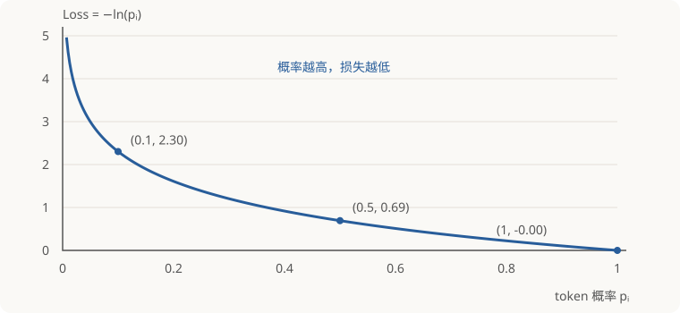
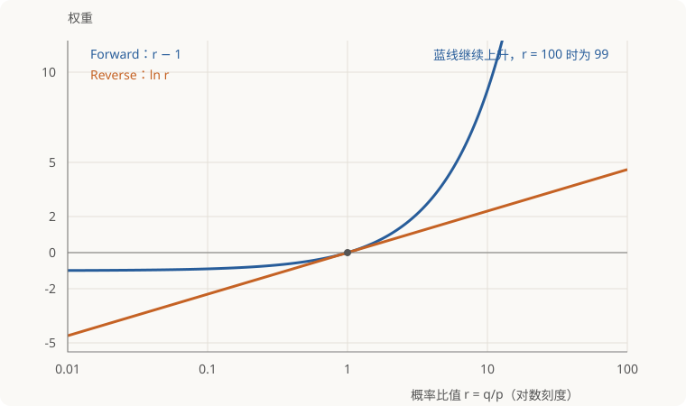

在 on-policy distillation（OPD）中，学生先生成自己的输出，老师再对这些输出给出训练信号。有些实现只使用实际抽中的 token，并把损失写成“一个权重乘以 SFT loss”：forward KL 的权重是 $q/p$，reverse KL 的权重是 $\log(q/p)$。这些权重从哪里来，为什么求导时要固定，又为什么一些实现偏向 reverse KL？

从全词表的 KL 出发，先求完整梯度，再把求和改写成学生采样下的期望，就能逐步得到这两个公式。关键是：**采样公式需要保证平均梯度正确，单次算出的 loss 数值无须等于完整 KL。**

## 1. 符号与讨论范围

固定同一个上下文，词表有限，学生和老师在这个上下文下给出的概率分别记作 $p$ 和 $q$：

| 符号 | 含义 |
| --- | --- |
| $p_i$ | 学生给第 $i$ 个 token 的概率，依赖学生参数 |
| $q_i$ | 老师给第 $i$ 个 token 的概率，老师不参与训练 |
| $a\sim p$ | 学生抽中的 token，$\Pr(a=i)=p_i$ |
| $\nabla$ | 对学生参数求梯度 |

下文统一使用自然对数，并假设所有 $p_i,q_i>0$。这覆盖有限 logit、未截断的 softmax 分布，也使概率比值和对数都有定义。讨论的是**用当前学生分布采样后，在同一参数位置计算的一次更新梯度**；上下文本身视为固定。

本文约定 forward KL 为 $D_{\mathrm{KL}}(q\|p)$，reverse KL 为 $D_{\mathrm{KL}}(p\|q)$。这里的 $p$ 始终表示学生，$q$ 始终表示老师；阅读不同资料时，需要先确认各自的符号约定。

### 1.1 先区分两层选择：采样前缀，还是采样下一 token

学生先生成一条回答，例如 `A → B → C`。这条路径提供三个前缀：原始 prompt、`prompt + A`、`prompt + A + B`。**无论使用全词表还是 sampled-token loss，都可以只在这些已经采样到的前缀上训练。** 全词表不意味着遍历其他回答路径。

到了一个固定前缀，才有第二层选择：下一 token 的损失怎么算？

- **全词表（full-vocabulary）**：使用这个前缀下所有 token 的师生概率，求完整的 KL。
- **采样 token（sampled-token）**：按学生分布抽到一个 token $a$，只用 $p_a,q_a$ 构造梯度估计。

因此，on-policy 描述的是数据是否由当前学生生成，full-vocabulary / sampled-token 描述的是每个前缀下如何计算损失。**全词表 OPD 同样可以是 on-policy。**

### 1.2 同一个前缀，两种计算方式

设词表为 $V$。全词表计算直接使用

$$
L_{\mathrm F}=\sum_{i\in V}q_i\log\frac{q_i}{p_i},
\qquad
L_{\mathrm R}=\sum_{i\in V}p_i\log\frac{p_i}{q_i},
$$

然后正常反向传播。**其中所有依赖学生参数的 $p_i$ 都参与求导，无须使用本文的 stop-gradient 采样权重。**

采样计算则抽取 $a\sim p$，使用下文推导的代理 loss：

$$
\widehat L_{\mathrm F}(a)=\operatorname{sg}(q_a/p_a)(-\log p_a),
\qquad
\widehat L_{\mathrm R}(a)=\operatorname{sg}(\log(q_a/p_a))(-\log p_a).
$$

| 固定同一个前缀 | 全词表 | Sampled-token |
| --- | --- | --- |
| 使用哪些 token | 全部词表项 | 实际抽中的 token $a$ |
| 使用哪些教师概率 | 整个分布 $q_i$ | 抽中 token 的 $q_a$ |
| 怎样求导 | 直接对完整 KL 求导 | 固定权重，对 $-\log p_a$ 求导 |
| 梯度含义 | 该前缀下的完整 KL 梯度 | 期望等于完整梯度的随机估计 |
| 下一 token 抽样带来的噪声 | 没有这一层噪声 | 存在这一层噪声 |
| 前缀是否仍可来自采样 | 可以 | 可以 |

例如词表只有 A、B、C：全词表计算同时累加三项；sampled-token 若抽到 B，本次只计算 B 的加权项。每个前缀抽一次也能得到无偏梯度估计，不需要在同一前缀反复抽样；但单次结果一般不等于完整梯度。

全词表需要处理和匹配更多概率；sampled-token 减少了损失所需的教师概率信息，但用随机估计代替了求和。只使用一个 token 的 loss，并不意味着模型输出层一定只计算一个 token 的分数。

**第 2、3 节先推导全词表梯度，再把它改写为采样估计；第 4、5 节的固定权重和减去基线，专门针对这种采样实现。**

## 2. Forward KL：把老师加权改写成学生采样

### 2.1 从完整 loss 求梯度

全词表的 forward KL 为

$$
\begin{aligned}
L_{\mathrm F}
&=\sum_i q_i\log\frac{q_i}{p_i}\\
&=\underbrace{\sum_i q_i\log q_i}_{\text{老师固定，与学生参数无关}}
+\sum_i q_i(-\log p_i).
\end{aligned}
$$

因此，它的梯度是每个 token 的负对数似然梯度，乘以老师概率后求和：

$$
\nabla L_{\mathrm F}
=\sum_i q_i\,\nabla(-\log p_i).
$$

这里把 $-\log p_i$ 称为这个 token 的 **SFT loss**（监督微调损失）；对学生参数求导得到 **SFT 梯度** $\nabla_\theta(-\log p_i)$。最小化这个损失会提高指定 token 的概率。

*自然对数下，$p_i=0.1$ 时损失约为 $2.30$，$p_i=0.5$ 时约为 $0.69$，$p_i=1$ 时为 $0$。*

**$w$ 表示乘在 SFT loss 前面的权重，本次求导时固定。** Forward 取 $w=q_i/p_i$，Reverse 取 $w=\log(q_i/p_i)$。对加权损失 $w(-\log p_i)$ 做梯度下降：

- **正权重（$w>0$）**：提高指定 token 的概率。
- **负权重（$w<0$）**：降低指定 token 的概率。
- **零权重（$w=0$）**：不产生更新。

例如，指定 token 是“巴黎”，$w=2$ 就推动模型提高“巴黎”的概率，$w=-1$ 则推动降低。这里描述的是单个样本、足够小的一步更新；多个样本的梯度会合并。

OPD 中的指定 token 可以由学生自己采样；“SFT”在这里指负对数概率的计算形式，不要求它是人工标注的答案。

### 2.2 从全词表梯度到采样 token 的梯度估计

学生抽中 $i$ 的概率是 $p_i$，而完整梯度按 $q_i$ 加权。给每项乘、除同一个 $p_i$，即可把两者连接起来：

$$
\boxed{
\nabla L_{\mathrm F}
=\sum_i p_i\left[
\frac{q_i}{p_i}\,\nabla(-\log p_i)
\right].
}
$$

外面的 $p_i$ 由学生抽样的频率提供。抽到哪个 token，就计算方括号里的梯度；在同一上下文、同一学生参数下重复采样，平均梯度便回到全词表的结果。这就是重要性采样：用 $q_i/p_i$ 修正“按学生抽样”和“按老师加权”的差别。

记 $\operatorname{sg}(x)$ 为 stop-gradient：前向计算时取值等于 $x$，反向传播时将它视为常数。抽到 token $a$ 后，可以使用代理损失

$$
\boxed{
\widehat L_{\mathrm F}(a)
=\operatorname{sg}\!\left(\frac{q_a}{p_a}\right)
(-\log p_a).
}
$$

固定权重后，它对学生参数的梯度恰好是所需的 $(q_a/p_a)\nabla(-\log p_a)$。

## 3. Reverse KL：为什么最后出现对数权重

### 3.1 外层概率也需要求导

全词表的 reverse KL 为

$$
L_{\mathrm R}=\sum_i p_i\log\frac{p_i}{q_i}.
$$

外面的 $p_i$ 和对数里面的 $p_i$ 都依赖学生参数。用乘积求导法则，得到

$$
\begin{aligned}
\nabla L_{\mathrm R}
&=\sum_i\left[
\log\frac{p_i}{q_i}\,\nabla p_i
+p_i\,\nabla\log p_i
\right]\\
&=\sum_i\left[\log\frac{p_i}{q_i}+1\right]\nabla p_i.
\end{aligned}
$$

第二步使用了 $p_i\nabla\log p_i=\nabla p_i$。其中额外的 $+1$ 不是凭空省略的；学生概率之和恒等于 $1$，所以

$$
\sum_i\nabla p_i
=\nabla\!\left(\sum_i p_i\right)
=\nabla 1=0.
$$

因此，$+1$ 对应的部分在全词表求和后恰好为零，留下

$$
\nabla L_{\mathrm R}
=\sum_i\log\frac{p_i}{q_i}\,\nabla p_i.
$$

### 3.2 改写成“采样概率乘以加权 SFT 梯度”

利用 $\nabla p_i=p_i\nabla\log p_i$，并同时翻转两个负号：

$$
\begin{aligned}
\nabla L_{\mathrm R}
&=\sum_i p_i\log\frac{p_i}{q_i}\,\nabla\log p_i\\
&=\sum_i p_i\left[
\log\frac{q_i}{p_i}\,\nabla(-\log p_i)
\right].
\end{aligned}
$$

形式已经与 forward KL 一致：外面的 $p_i$ 仍由学生采样提供，每次只计算括号里的梯度。因此，reverse KL 的采样代理损失可以写成

$$
\boxed{
\widehat L_{\mathrm R}(a)
=\operatorname{sg}\!\left(\log\frac{q_a}{p_a}\right)
(-\log p_a).
}
$$

完整 loss 中的学生概率都正常参与求导；只在构造这个采样代理损失时，才把前面的对数比值固定。

## 4. Sampled-token 实现为什么要固定权重

Reverse KL 对应的单 token 采样梯度是

$$
\log\frac{q_a}{p_a}\,\nabla(-\log p_a).
$$

为了让自动求导得到它，使用代理 loss：

$$
\widehat L_{\mathrm R}(a)
=\operatorname{sg}\!\left(\log\frac{q_a}{p_a}\right)(-\log p_a).
$$

**$\operatorname{sg}$ 保留权重的数值，但不对权重求导。** 例如权重算出来是 $2$，本次就得到 $2\nabla(-\log p_a)$；下次再重新计算权重。

如果不加 $\operatorname{sg}$，乘积求导会多出一项：

$$
\begin{aligned}
\nabla\left[\log\frac{q_a}{p_a}(-\log p_a)\right]
={}&\underbrace{\log\frac{q_a}{p_a}\,\nabla(-\log p_a)}_{\text{需要的梯度}}\\
&+\underbrace{(-\log p_a)\nabla\log\frac{q_a}{p_a}}_{\text{多出来的一项}}.
\end{aligned}
$$

老师的 $q_a$ 固定，权重里的学生概率 $p_a$ 却仍依赖参数，所以额外项一般不为零。原始 KL 已经在第 3 节完整求导；这里固定权重，是为了让代码准确实现推导出的梯度。

直接把 $\log(p_a/q_a)$ 当作 loss 也不行。两种做法都用 SFT 梯度 $\nabla(-\log p_a)$ 表示，区别是：

$$
\begin{aligned}
\text{正确的采样梯度：}\quad
&\underbrace{\log(q_a/p_a)}_{\text{比较老师与学生}}\,\nabla(-\log p_a),\\
\text{直接对对数比值求导：}\quad
&\nabla\log(p_a/q_a)
=-\nabla(-\log p_a).
\end{aligned}
$$

正确采样梯度中的系数是 $\log(q_a/p_a)$：老师给这个 token 的概率更高时，系数为正，推动学生提高概率；老师给的概率更低时，系数为负，推动学生降低概率；两者相等时，系数为零。

直接对 $\log(p_a/q_a)$ 求导，老师的 $q_a$ 是常数，求导后消失，SFT 梯度前的系数永远是 $-1$。因此，无论老师如何评价，都会沿降低抽中 token 概率的方向更新，不能实现所需的蒸馏更新。

例如，学生概率 $p_a=0.2$：老师概率 $q_a=0.4$ 时，正确系数是 $\log 2>0$，应该提高学生概率；老师概率 $q_a=0.1$ 时，正确系数是 $\log 0.5<0$，应该降低学生概率。直接对对数比值求导，两个情况的系数却都是 $-1$。

**代理 loss 的用途是让自动求导得到正确的训练梯度，不是计算 KL 的数值。** Reverse KL 使用 $\operatorname{sg}(\log(q_a/p_a))(-\log p_a)$，使采样梯度的期望等于完整 reverse KL 的梯度；Forward KL 使用 $\operatorname{sg}(q_a/p_a)(-\log p_a)$，同样只对负对数概率求导。

## 5. Sampled-token Forward 权重减去 1 有什么意义

### 5.1 先看作用：让权重直接表示学生与老师的偏差

原始的 forward 权重是 $q_a/p_a$。假设学生已经与老师完全一致，即所有 token 都满足 $p_i=q_i$，这个权重仍然是 $1$。于是抽到 token $a$ 后，单次梯度仍为

$$
\frac{q_a}{p_a}\nabla(-\log p_a)=\nabla(-\log p_a).
$$

**这是合理的随机梯度波动，但不代表还需要把这个 token 的概率提高。**

当学生已经等于老师时，完整 KL 的梯度为零。可是不减去 $1$ 的采样方法，每次只抽到一个 token，只看到它对应的那一项，所以仍可能产生非零更新。

例如学生和老师都认为：

- A 应出现 80%；
- B 应出现 20%。

抽到 A 就推高 A，抽到 B 就推高 B。**这些更新在同一参数位置按各自的抽样概率取平均后恰好抵消**，因此整体梯度仍为零。实际有限次更新则会在最优点附近波动。

减去 $1$ 的好处正是在这里：当 $p=q$ 时，权重 $q/p-1=0$，每一次更新都为零，消除了这种波动。

@@opinion-begin@@

即使学生分布已经等于教师分布，不减去 $1$ 的单样本梯度仍可能非零。这是采样噪声：其期望为零，而不是教师还要求提高该 token 的概率。

@@opinion-end@@

如果把权重改成 $q_a/p_a-1$，它就直接反映两者的偏差：

- **$q_a>p_a$：** 权重为正，推动学生提高这个 token 的概率。
- **$q_a<p_a$：** 权重为负，推动学生降低这个 token 的概率。
- **$q_a=p_a$：** 权重为零，这个样本不产生更新。

特别是当整个分布 $p=q$ 时，每个样本的梯度都为零，不再只是平均梯度为零。这里说的提高或降低，是该样本单独做足够小的一步梯度下降时的方向；实际训练还会合并其他样本的梯度。

这也让它更方便与 reverse 权重 $\log(q_a/p_a)$ 比较：两者都在 $q_a/p_a=1$ 时为零，在比值大于 $1$ 时为正、小于 $1$ 时为负。

| $q_a/p_a$ | Forward：$q_a/p_a-1$ | Reverse：$\log(q_a/p_a)$ |
| --- | ---: | ---: |
| $100$ | $99$ | $4.61$ |
| $1$ | $0$ | $0$ |
| $0.01$ | $-0.99$ | $-4.61$ |

### 5.2 为什么减去 1 不改变平均梯度

减去 $1$，相当于从每个样本的原始梯度中减去一份 SFT 梯度：

$$
\left(\frac{q_a}{p_a}-1\right)\nabla(-\log p_a)
=\frac{q_a}{p_a}\nabla(-\log p_a)-\nabla(-\log p_a).
$$

关键在于：按学生分布采样时，被减去的这一项，其期望恰好为零。逐步展开：

$$
\begin{aligned}
\mathbb E_{a\sim p}[\nabla(-\log p_a)]
&=\sum_i p_i\nabla(-\log p_i)\\
&=-\sum_i p_i\frac{1}{p_i}\nabla p_i\\
&=-\sum_i\nabla p_i\\
&=-\nabla\left(\sum_i p_i\right)\\
&=-\nabla 1=0.
\end{aligned}
$$

因此，修改后的平均梯度等于原平均梯度减去零：

$$
\begin{aligned}
\mathbb E_{a\sim p}\left[\left(\frac{q_a}{p_a}-1\right)\nabla(-\log p_a)\right]
&=\mathbb E_{a\sim p}\left[\frac{q_a}{p_a}\nabla(-\log p_a)\right]
-\mathbb E_{a\sim p}[\nabla(-\log p_a)]\\
&=\nabla L_{\mathrm F}-0\\
&=\nabla L_{\mathrm F}.
\end{aligned}
$$

实现时，修改后的权重仍然需要固定：

$$
\widehat L_{\mathrm F,0}(a)
=\operatorname{sg}\!\left(\frac{q_a}{p_a}-1\right)(-\log p_a).
$$

这种做法叫作减去一个常数基线。**它改变单次样本的梯度，但不改变平均训练方向。** 它消除了 $p=q$ 时的采样梯度波动，不过并不保证在所有分布下都能降低方差。

## 6. Forward 与 Reverse：区分目标差异和采样差异

### 6.1 目标的差异：全词表计算中也存在

全词表下，Forward 与 Reverse 仍是两个不同目标：

$$
\underbrace{\sum_i q_i\log(q_i/p_i)}_{\text{Forward：按教师概率加权}},
\qquad
\underbrace{\sum_i p_i\log(p_i/q_i)}_{\text{Reverse：按学生概率加权}}.
$$

Forward 更关注教师概率较高、但学生概率偏低的 token，倾向于提高学生对这些 token 分配的概率。Reverse 更关注学生正在分配概率、教师却不认可的 token，倾向于压低这些输出。

例如教师认为 A、B 都合理，学生却主要生成 A。Forward 倾向于提高学生生成 B 的概率；Reverse 如果认为 A 已经得到教师认可，可能更倾向集中于 A。在学生能力受限、无法完全匹配教师时，这对应常说的 mode covering 与 mode seeking 倾向；不是对每个分布都成立的简单更新规则。

**这种目标差异与是否采样下一 token 无关。** 全词表直接优化这两个不同的 KL；本文的无偏采样估计则分别对应同样的两个目标。如果学生能够完全拟合教师，两者都在 $p=q$ 取得最小值 $0$，差别主要在优化过程及无法完全拟合时的取舍。

### 6.2 采样方式的差异：罕见 token 的大权重

假设某个 token 的学生概率只有 $p=0.001$，老师概率却有 $q=0.1$。学生平均约每一千次抽样才遇到它一次；一旦抽中，forward 的原始权重为 $100$，减去基线后仍有 $99$，而 reverse 权重只有 $\log100\approx4.61$。

使用学生样本估计 forward KL 时，可能出现“多数时候没有抽到重要 token，偶尔抽到却带来很大梯度”的情况。对数权重缓和了 $q/p$ 直接增长带来的极端更新。

Sampled-token Forward KL 对“教师概率高、学生概率低”的 token 可能产生较大的更新，因此在相同训练设置下可能带来更剧烈的策略变化。

*横轴为概率比值 $r=q/p$（对数刻度）；蓝线为 Forward 权重 $r-1$，橙线为 Reverse 权重 $\log r$。两条曲线在 $r=1$ 时均为零。*

全词表计算没有“罕见 token 这次没抽中、下次抽中后权重很大”的问题：每个 token 都参与求和。

### 6.3 对数概率差方便接入 RL 流程

先固定一个前缀，把下一 token 看成动作 $a$，学生分布 $p_\theta(a)$ 看成策略。对不依赖学生参数的奖励 $R(a)$，最大化期望奖励的目标是

$$
J(\theta)=\sum_a p_\theta(a)R(a).
$$

利用 $\nabla p_\theta(a)=p_\theta(a)\nabla\log p_\theta(a)$，得到策略梯度：

$$
\begin{aligned}
\nabla J(\theta)
&=\sum_a R(a)\nabla p_\theta(a)\\
&=\sum_a p_\theta(a)R(a)\nabla\log p_\theta(a)\\
&=\mathbb E_{a\sim p_\theta}[R(a)\nabla\log p_\theta(a)].
\end{aligned}
$$

RL 中也常用 advantage $A(a)$ 代替奖励，表示动作相对基线的好坏。要用梯度下降实现这个上升方向，可以最小化采样代理 loss：

$$
\widehat L_{\mathrm{PG}}(a)
=-\operatorname{sg}(A(a))\log p_\theta(a),
\qquad
\nabla\widehat L_{\mathrm{PG}}(a)
=-A(a)\nabla\log p_\theta(a).
$$

现在把教师与学生的对数概率差作为本次固定的 token 级 advantage：

$$
A(a)=\log q_a-\log p_a=\log\frac{q_a}{p_a}.
$$

代入同一个策略梯度代理 loss，就得到

$$
\begin{aligned}
\widehat L_{\mathrm{PG}}(a)
&=-\operatorname{sg}\!\left(\log\frac{q_a}{p_a}\right)\log p_a\\
&=\operatorname{sg}\!\left(\log\frac{q_a}{p_a}\right)(-\log p_a)\\
&=\widehat L_{\mathrm R}(a).
\end{aligned}
$$

这与第 3 节的 reverse KL 采样代理 loss 完全相同。这里的 $A(a)$ 由当前学生概率计算，但本次反向传播必须固定；它的正确性由 reverse KL 的梯度推导保证，不能把它当作参数无关的奖励直接对整个期望求导。

因此，接入 RL 流程的关键很直接：保留“学生采样、计算 advantage、执行策略梯度更新”的结构，把 advantage 换成教师与学生的对数概率差。老师更认可的 token 得到正 advantage，学生过度生成的 token 得到负 advantage。

由此可以统一理解：**在本文讨论的采样策略梯度形式下，RL 与 OPD 都可以用“固定权重 × SFT loss”产生训练梯度，区别是权重的来源。**

| 训练方式 | 固定权重 $w_a$ | 采样代理 loss |
| --- | --- | --- |
| 策略梯度 RL | advantage $A(a)$ | $\operatorname{sg}(A(a))(-\log p_a)$ |
| Reverse-KL OPD | $\log(q_a/p_a)$ | $\operatorname{sg}(\log(q_a/p_a))(-\log p_a)$ |
| Forward-KL OPD | $q_a/p_a$，或 $q_a/p_a-1$ | $\operatorname{sg}(w_a)(-\log p_a)$ |

RL 的 advantage 来自奖励与基线，OPD 的权重来自教师和学生的概率比较。这里统一的是产生梯度的代理 loss；全词表 OPD 可以直接对完整 KL 求导，PPO 等方法还会加入新旧策略比值、裁剪等处理。

Thinking Machines 的 OPD 实现先记录学生生成 token 时的 log probability，再查询教师对相同 token 的 log probability，用“教师减学生”的差作为逐 token advantage，接入 RL 的 importance-sampling loss。

如果数据由旧学生 $p_{\mathrm{old}}$ 采样，RL 代理 loss 可以写成

$$
\rho_\theta(a)=\frac{p_\theta(a)}{p_{\mathrm{old}}(a)},
\qquad
\widehat L_{\mathrm{IS}}(a)
=-\rho_\theta(a)\operatorname{sg}(A(a)).
$$

分母固定。在 $\theta=\theta_{\mathrm{old}}$ 时，$\rho_\theta(a)=1$，且 $\nabla\rho_\theta(a)=\nabla\log p_\theta(a)$，因此它的梯度也是 $-A(a)\nabla\log p_\theta(a)$。这里的新旧学生比值用于修正采样策略；它与 Forward KL 中的教师／学生比值 $q_a/p_a$ 是两个不同的比值。以上对应固定前缀下的单 token 更新；复用旧数据多步训练时，还要区分当前 advantage 与固定的旧 advantage。

## 7. 用两条轴理解 OPD

| 选择 | 决定什么 |
| --- | --- |
| 当前学生、旧学生或教师生成回答 | 训练访问哪些前缀，是否 on-policy |
| Forward KL 或 Reverse KL | 在这些前缀上优化什么目标 |
| 全词表或 sampled-token | 直接求完整梯度，还是用抽中的 token 估计梯度 |

学生生成一条回答后，每个位置都有一个已经确定的前缀。在这个前缀下，全词表方法计算所有候选 token 的师生概率并求和；sampled-token 方法只取学生实际生成的那个 token，计算它的加权损失。GKD 使用前一种方式，本文推导的采样代理 loss 使用后一种方式。

两种方法都可以沿同一条学生生成路径训练，区别在于每个位置使用整个词表，还是只使用抽中的 token。Forward 与 Reverse 决定优化目标；全词表与 sampled-token 决定怎样计算这个目标的梯度。
