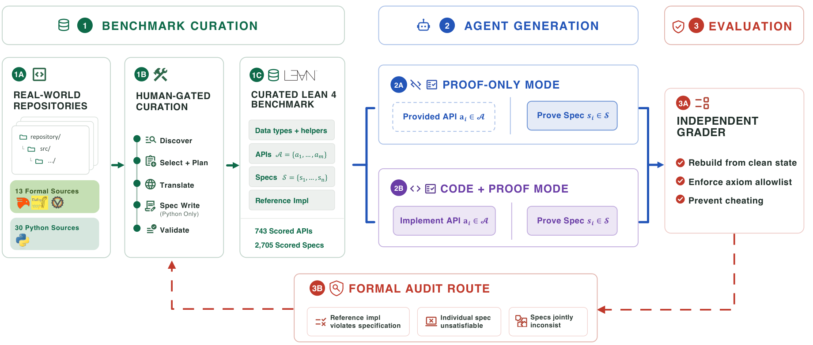
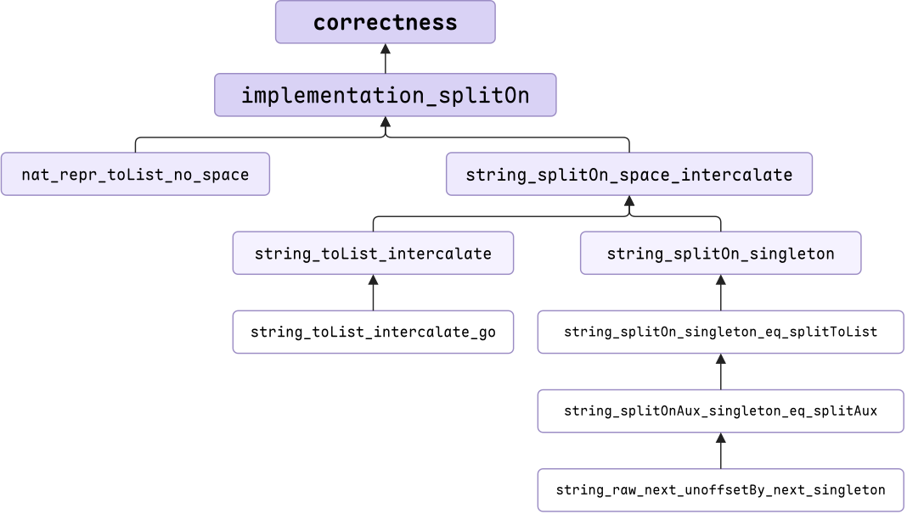
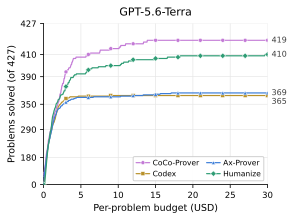
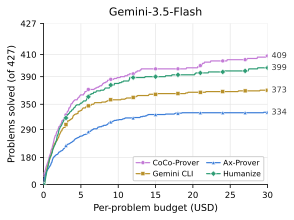
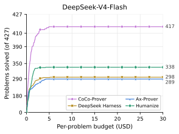
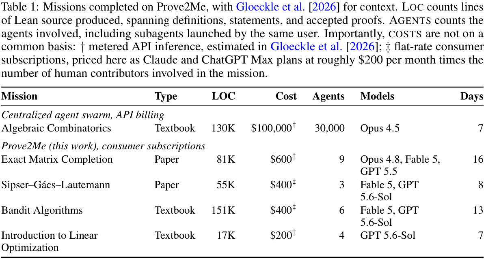
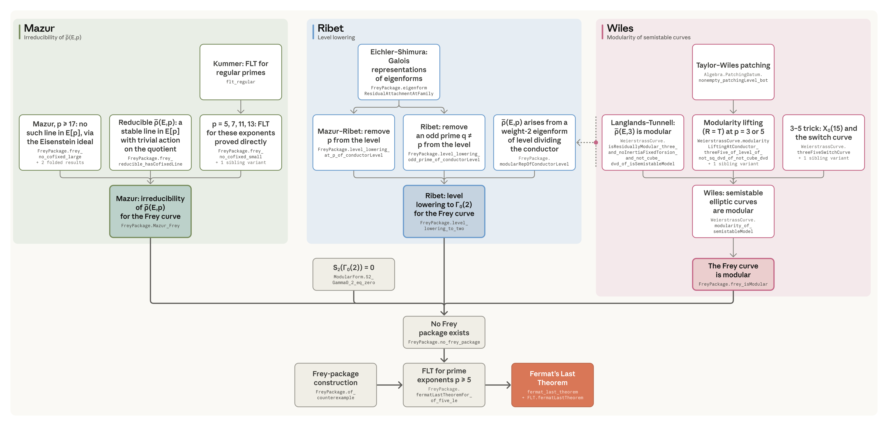

## 一、三篇论文的原意与本文的问题

### 1.1 Vero：仓库级的可验证代码生成

Ye 等人的 [*Vero: Can AI Agents Build Formally Verified Software Repositories?*](https://arxiv.org/abs/2608.13522) 于 **2026 年 8 月 13 日**公开 arXiv 版本（arXiv:2608.13522）。下面紧贴摘要介绍论文原意：AI 代理越来越常被用于编程，但生成的代码没有正确性保证；可验证代码生成要求代理同时给出实现与经机器检查的规格证明。已有基准或聚焦单个函数，或只评测对给定实现的证明生成，因此尚不清楚代理能否在真实的多模块代码库中做出彼此一致的实现与证明选择。

Vero 为此构建 **43 个来自真实仓库的多模块 Lean 4 实例**，覆盖 Python、Dafny、Verus、Coq 来源。每个实例有预定 API、人工整理的形式规格和参考实现，支持 proof-only 与 code-and-proof 两种模式；审计机制还允许代理形式化证明规格无解或参考实现有误。配备 Lean 工具链的最强编码代理只完整解决 **27/43** 个实例。

### 1.2 CoCo-Prover：先证什么，花多少钱

Yao 等人的 [*Cost-Efficient Theorem Proving via Agent Orchestration in Program Verification*](https://arxiv.org/abs/2610.09681) 被 **NeurIPS 2026 Workshop on AI for Verifiable Coding（VERICODEGEN）**接收为海报论文，并于 **2026 年 10 月 7 日**公开 arXiv 版本（arXiv:2610.09681）。摘要强调：现有证明器多以通过率为目标，很少计入搜索和采样花费；真实软件却可能有数百个互相依赖的证明义务，因此需要同时看成功数与成本。

CoCo-Prover 把低成本证明表述为带费用的元层决策：每个声明内部用 AND/OR 证明超图，声明之间用引理依赖图；系统先按图选择开放目标，再由路由器购买有费用上限的专家调用。在 **五个 Lean 4 基准**上，论文报告它取得更好的成功率—费用前沿，并在其中两个基准达到 100% 通过率。

### 1.3 Prove2Me：把形式化变成可协作的工程

Chen 等人的 [*Prove2Me: An Open Collaborative Platform for Scaling Math Formalization*](https://arxiv.org/abs/2608.28433) 于 **2026 年 8 月**公开，本文依据 8 月 31 日的 v2 版本。摘要提出：Lean 4 让数学证明可被机器检查，但大规模形式化长期受专业门槛和证明编写时间限制；AI 编码代理降低了这些门槛，让人可以用自然语言驱动代理写复杂证明。Prove2Me 因而设计开放协作平台：用户发起形式化“任务”（mission），AI 代理为任务贡献证明；专门的协作机制和工具环境让不同代理的成果能够衔接，并重用已有结果。

这篇平台论文写于费马大定理项目完成之前。**费马形式化的过程和结果来自 9 月公布的项目报告与代码仓库**，不能当成平台论文原有的实验。

### 1.4 饱和基准与反常对照

既有基准出现天花板效应：CoCo-Prover 论文引用的 Humanize 在 PutnamBench 报告 **100%**；在其函数级实验中，Humanize + GPT-5.6-Terra 完成 CLEVER 的 **97.5%**、VERINA 的 **98.9%**。Vero 转而考多模块、共享不变量和完整仓库；CoCo-Prover 也在 Vero 上测试调度效果。

反常出现在 Vero proof-only 模式：CoCo-Prover + GPT-5.6-Terra 完成 **23/43**，Vero 原论文的 Codex + GPT-5.5 (xhigh) 完成 **25/43**。CoCo-Prover 的 OpenAI 底座只有 Terra；另两组实验使用 Gemini-3.5-Flash 和 DeepSeek-V4-Flash。两篇论文的每题上限分别是 8 小时/$60 与 90 分钟。**更强模型与更高思考强度，会不会吞噬 CoCo-Prover 的方法增益？**费马项目里，Prove2Me 为何又成为完成证明的关键？后文把局部证明能力和项目级协作能力分开检验。

## 二、Vero：把验证单位从函数提升到仓库

### 基准实例究竟给了什么

Vero 的一个实例是多模块 Lean 4 项目。策展者固定数据类型、辅助定义、API 签名与规格，代理填写实现和证明。论文把接口与规格写为

$$
\mathcal A=\{a_1,\ldots,a_m\},\qquad
\mathcal S=\{S_1,\ldots,S_n\},\qquad
S_i:\texttt{RepoImpl}\to\mathtt{Prop}.
$$

`RepoImpl` 为每个 API 提供一个字段。`canonical : RepoImpl` 指定本次被证明的实现：proof-only 模式采用参考实现，code-and-proof 模式采用代理实现。同一条规格 $S_i$ 因而可以检验不同实现。

论文图 2 的银行例子可以浓缩为：

```lean
structure RepoImpl where
  createAccount : AccountId → Ledger → Ledger
  accountExists : AccountId → Ledger → Bool
  getBalance : AccountId → Ledger → Option Balance

def canonical : RepoImpl := {
  createAccount := Bank.createAccount,
  accountExists := Bank.accountExists,
  getBalance := Bank.getBalance
}

def spec_create_zero_balance (impl : RepoImpl) : Prop :=
  ∀ (id : AccountId) (ledger : Ledger),
    impl.accountExists id ledger = false →
    impl.getBalance id (impl.createAccount id ledger) = some 0

theorem proof_create_zero_balance :
    spec_create_zero_balance canonical := by
  sorry
```

这条规格把实现作为参数，**直接调用 `impl` 中的三个 API 函数**。`canonical` 将这些字段绑定到具体代码：proof-only 使用参考实现，code-and-proof 使用代理实现。证明目标 `spec_create_zero_balance canonical` 因而涉及具体实现的函数定义，并要求对所有账户和账本成立；它不是有限输入上的运行测试。代码按论文图 2 摘取并整理。

#### 执行具体输入、化简符号输入、证明全部输入

图 2 的 `spec_create_zero_balance` 确实**直接调用被验证的实现**。取 `id = 7` 和一个具体账本 `ledger₀`，执行下面的表达式，就能看到这一次创建账户后的查询结果：

```lean
getBalance 7 (createAccount 7 ledger₀)
```

如果结果是 `some 0`，只能说明这个账本通过了检查。规格实际要求的是

$$
\forall\ id,ledger,\quad
\texttt{accountExists}\ id\ ledger=\texttt{false}
\;\Longrightarrow\;
\texttt{getBalance}\ id\ (\texttt{createAccount}\ id\ ledger)=\texttt{some }0.
$$

这里的 `ledger` 没有大小上限。对一百个测试账本运行成功，仍然没有证明第一百零一个账本；反过来，只要找到一个满足前提、结果却不是 `some 0` 的账本，就能推翻这条规格。

Lean 的证明过程可以*执行符号表达式*，但能化简到哪一步取决于实现。假设 `createAccount` 把新账户放在列表开头，而 `getBalance` 从列表开头查找，那么对任意 `ledger` 都有：

$$
\begin{aligned}
\texttt{getBalance}\ id\ (\texttt{createAccount}\ id\ ledger)
&=\texttt{getBalance}\ id\ ((id,0)::ledger)\\
&=\texttt{some }0.
\end{aligned}
$$

这个证明可能只需展开定义和化简；甚至用不到“原账本不存在该账户”的前提。**图 2 只展示接口、规格和待填证明，没有展示三个函数的函数体**，因此不能从图 2 判断参考实现是否真的这么简单。

换一种同样可执行的实现：`createAccount` 把 `(id,0)` 加在列表末尾，`getBalance` 从头向后查找。展开定义后，Lean 会遇到

$$
\texttt{getBalance}\ id\ (ledger\mathbin{++}[(id,0)]).
$$

因为 `ledger` 仍是任意列表，计算无法决定它是空表，还是以哪个账户开头。证明通常要对 `ledger` 归纳：空表直接算出 `some 0`；非空表利用 `accountExists id ledger = false` 排除前面的同名账户，再把结论传给尾部。这里已经出现了**运行一个例子无法替代的全称推理**。

所以你的直觉对图 2 的小例子很准确：有些实现确实能让证明接近“执行一下”。但“执行”在这里是对带变量的程序做可复核的符号化简，并交付 Lean 接受的通用证明。Vero 把整个仓库的全部规格都作为完成条件；当函数跨模块调用、共享状态或必须保持规范形式时，单步化简就不够了。

两种模式的证明目标都是

$$
\forall S_i\in\mathcal S,\quad S_i(\texttt{canonical}).
$$

**Proof-only** 固定 `canonical` 为参考实现；**code-and-proof** 要求代理先填入每个 $a_i\in\mathcal A$ 的函数体，再证明同一组规格。实现选择会影响证明难度。Vero 只在全部规格证明成功时计为完整解决，避免大量容易的局部性质掩盖剩余难题。



*原论文图 1，展示来源仓库、人工审核的翻译流水线、两种评测模式及形式化审计。来源与授权见文末。*

### 数据从何而来，以及为什么需要审计

Vero 收集 **43 个仓库实例**：13 个原本使用 Dafny、Verus、Coq 等形式化语言，需要翻译既有定义与规格；30 个来自 Python，需要把实现迁到 Lean，并根据原项目编写规格。总计 **743 个计分 API、2,705 条计分规格**。项目覆盖密码协议、分布式系统、数据结构等领域。翻译流水线的每个阶段都经过人工审核。这个设置保留了真实项目的共享定义与模块依赖，同时统一了 Lean 4 的评测环境。

Vero 还把基准错误写成三个可证明的命题：

$$
\begin{aligned}
&\neg\bigwedge_{S\in\mathcal S}S(\texttt{canonical})
&&\text{参考实现违反规格；}\\
&\neg\exists\,impl:\texttt{RepoImpl},\ S(impl)
&&\text{某条规格无解；}\\
&\bigl(\forall S\in\mathcal S',\ \exists\,impl,\ S(impl)\bigr)
\land\neg\exists\,impl,\bigwedge_{S\in\mathcal S'}S(impl)
&&\text{各条规格单独可满足，却无法同时满足。}
\end{aligned}
$$

附录 F 的 `verdict` 案例把第三种问题说得很直白：Base64 的填充字符 `=` 是十六进制 `0x3D`。一条规格要求分类函数对它返回 `some none`，另一条“拒绝非法字符”的规格却把 `(0x39, 0x41)` 整段划为 `none`；`0x3D` 正好落在其中。于是不存在能同时满足两条规格的实现。修复方法是在拒绝范围中明确排除 `0x3D`。论文报告，审计在发布的 43 个实例中定位并修复了 **38 条有缺陷的规格**，涉及 9 个实例，另有 6 组联合不可满足的规格。

Vero 的审计机制让基准自身接受形式化检验。代理可以提交目标为假的机器检查证据，策展者据此修正规格。

### 分数揭示的真正瓶颈

Vero 原论文每个仓库限时 **90 分钟**，对四种编码代理配置同时评测两种模式。原论文图 3 给出全部结果：GPT-5.5 xhigh 在 code-and-proof / proof-only 下分别解决 **27/43**、**25/43**；GPT-5.5 medium 为 **2/43**、**6/43**；Opus 4.8 为 **8/43**、**10/43**；Sonnet 5 在两种模式下均为 **2/43**。

GPT-5.5 xhigh 的逐规格通过率在两种模式下分别达到 **87.3%** 和 **85.8%**，但完整仓库解决数仍为 27 与 25。GPT-5.5 的 medium 与 xhigh 之间差距尤其大：proof-only 从 6 增至 25。完整解决数对思考强度高度敏感，因而是检验 CoCo-Prover 方法增益的关键基线。


*原论文图 3。曲线统计 90 分钟内累计完整解决的仓库；右侧展示不同配置解决了哪些实例。*

涉及**全局覆盖性**的规格失败率最高，达 **47.1%**；在同一仓库内，使用给定辅助定义、重复调用同一 API 的规格，失败率分别高出 **14.9** 和 **11.7 个百分点**。瓶颈集中在多次执行后的不变量与可复用引理。

附录 H 的 `deposit_sc` 包含 79 条规格，跨 `Bits`、`Tree`、`Merkle`、`Contract` 四个模块。“批量 deposit 的折叠结果等于逐个 deposit”的归纳步需要同时保持中间状态有效、树高不变、合并函数不变和默认值不变。成功证明提出一个**更强的合取归纳命题**，让这些事实随归纳假设一起传递。其 code-and-proof 提交包含 99 条辅助定理和 6,052 行非空证明代码。强通用代理已经能自行组织大型引理库；CoCo-Prover 的额外价值要在这样的基线上衡量。

## 三、CoCo-Prover：把证明搜索变成受成本约束的调度

CoCo-Prover 处理两项决策：**接下来证明哪些目标**，以及**给这些目标调用什么代理、投入多少预算**。它把成本记为实际模型费用，分别计算输入、缓存与输出 token 的价格。

### 两层证明图分别保存什么

CoCo-Prover 用两层图记录证明：

$$
\mathcal D=(L,E_{\mathcal D}),\qquad
\mathcal H_{\ell}=(A_{\ell},O_{\ell},E_{\ell})\quad(\ell\in L).
$$

**声明依赖图** $\mathcal D$ 的节点 $L$ 包含目标定理与辅助引理；边 $u\to v$ 表示 $v$ 的证明使用 $u$。系统记录每个引理是稳定、暂定还是废弃。**声明内证明图** $\mathcal H_{\ell}$ 用 AND 节点 $A_{\ell}$ 表示目标状态，用 OR 节点 $O_{\ell}$ 表示可选证明步骤；步骤生成的全部子目标都要关闭。$E_{\ell}$ 保存 Lean 已检查的转换。两层图分别支持跨定理复用和定理内部搜索。


*原论文图 2。左图表示跨声明复用，右图表示单个证明步骤如何展开为子目标。*

系统在第 $t$ 轮维护

$$
s_t=(\mathfrak G_t,\mathcal F_t,\sigma_t,\mathcal M_t,\mathcal L_t),
\qquad
\mathfrak G_t=(\mathcal D_t,\{\mathcal H_{\ell,t}\}_{\ell\in L_t}).
$$

$\mathcal F_t$ 是依赖已就绪的开放目标，$\sigma_t$ 记录证明产物状态，$\mathcal M_t$ 保存失败与反馈，$\mathcal L_t$ 是成本账本。调度器对依赖图做增量拓扑遍历，把完整前沿交给路由器：

$$
U_t=\operatorname{Sched}(s_t)=\mathcal F_t.
$$

路由器购买一次有成本的证明动作，执行结果再更新状态：

$$
c_t=(G_t,o_t,\theta_t),\quad G_t\subseteq U_t,\qquad
Y_t\sim P_{c_t}(\cdot\mid s_t,U_t),\qquad
s_{t+1}=T(s_t,U_t,c_t,Y_t).
$$

$G_t$ 是目标组，$o_t$ 是四种专家之一，$\theta_t$ 设置推理强度与迭代预算，$Y_t$ 包含 Lean 检查结果。论文的成本目标是

$$
\max\;\mathbb E\bigl[\mathbf 1[\mathrm{solve}]-\lambda C\bigr],
$$

其中 $C$ 为整次任务的模型费用，$\lambda$ 控制成本权重。路由器根据当前证据选择动作，并不显式求解最优值函数。一条昂贵引理若能被多个目标复用，可能降低总成本；临时引理失败时，依赖图确定需要回滚的后继。

论文把共享引理 $h$ 的成本写得更具体。若 $K$ 个目标各自重新发现 $h$，与先证明一次再共享的费用分别是

$$
C_{\mathrm{iso}}(h)=\sum_{i=1}^{K}(c_{h,i}+d_i),\qquad
C_{\mathrm{share}}(h)=c_h+\sum_{i=1}^{K}d_i+r_h.
$$

$c_{h,i}$ 是第 $i$ 个目标单独发现该事实的费用，$c_h$ 是证明共享引理一次的费用，$d_i$ 是各目标后续证明费用，$r_h$ 是失败与回滚开销。共享成立的条件直接是 $C_{\mathrm{share}}(h)<C_{\mathrm{iso}}(h)$。

### 一轮运行如何进行


*原论文图 3。调度器给出依赖已就绪的目标；路由器决定动作；代理把检查结果写回图和共享记忆。*

系统的循环可以按论文图 3 理解：

1. **符号调度**读取两层图，找出尚未解决、依赖已就绪的 Lean 目标。路由器用语义聚类把相近目标放在一起，并读取局部证明状态、失败记录、成本账本。
2. **路由决策**选择目标组、专家、推理强度和工作预算。初始原则是：如果两种动作对最终可证明性的预期相近，选完成整个任务预计更便宜的一种。规则可根据之后的检查反馈更新。
3. **执行与反馈**由专家代理调用 Lean，成功的步骤、产生的子目标、诊断和实际成本写回图。测试能排除错误的候选引理，但不能代替 Lean 内核证明。

四类专家各有职责：**Deterministic Automation** 先尝试无需模型的规则化策略；**Proof Writer** 写 Lean 证明并迭代修复，预算耗尽仍保存已经验证的部分；**Lemma Planner** 把阻碍证明的事实提升成有类型、能明确服务于目标的辅助引理，经过语法、无环性和反例检查后加入依赖图；**Recovery Reviewer** 判断分支是否可能为假或路线过贵，必要时退回最近的安全状态。一次失败只撤销受它影响的后继，不必重做全部已验证工作。

### 案例一：一个字符串定理为什么要九条引理

附录 D.1 的 CLEVER `prob_15` 要实现 `string_sequence`：将 `0` 到 `n` 的十进制表示用空格连接。实现自然写成 `" ".intercalate ((List.range (n+1)).map Nat.repr)`；规格却用 `splitOn " "` 重新解析输出，并要求第 $i$ 段等于 `i.repr`。人眼看到“拼接再切开”，Lean 需要知道每段没有空格、`intercalate` 与 `splitOn` 相互抵消。更麻烦的是 Lean 的字符串 API 下方涉及字符列表、私有累加器、UTF-8 字节位置扫描，并没有现成的一条总定理。

CoCo-Prover 沿抽象层逐步立引理：先把规格化成拼接后切分的目标；再证明自然数表示不含空格；然后桥接字符串与字符列表；最后下降到字节扫描和偏移量性质。运行共 **8 轮控制循环、18 次路由调用**，得到 **9 条辅助引理**，无回滚，花费 **$2.36**。同一模型和价格下，两个成功的基线分别花费 **$8.67**、**$10.74**；另一个基线花费 **$5.48** 仍未完成。论文指出，成功基线发现的数学事实大致相似，差距主要来自上下文重复发送和证明进度是否持久保存。



*原论文图 6。每条边从辅助引理指向使用它的声明；图的深度对应从规格下降到 UTF-8 扫描的层级。*

这个案例说明，“发现缺少一个事实”与“把事实变成可管理的证明任务”之间有很大距离。Lemma Planner 负责后一步，两层图确保已证事实不会在下一轮模型调用中丢失。

两个成功基线找到的引理结构与 CoCo-Prover 接近。此题的主要差别在组织成本：CoCo-Prover 花费 $2.36、耗时 2,816 秒，Codex 花费 $8.67、耗时 2,550 秒。结构化上下文节省模型费用，同时增加墙钟时间。

### 案例二：56 条区间规格如何共享一座证明库

附录 D.2 的 Vero `prob_14` 验证半开整数区间 $[lo,hi)$ 构成的集合库。库提供 `overlaps`、`mergeOverlaps`、`chop` 三组操作，共 **56 条规格**：合并前后覆盖相同、合并结果严格有序且不重叠、相同覆盖集合对应唯一规范形式、输入排列不改变规范结果。

证明难在实现不是单层函数：`mergeOverlaps` 先用 `insertByLo`/`sortByLo` 排序，再用 `coalesce` 合并。插入用结构递归，排序用折叠，合并则在改变列表头之后做良基递归。若直接展开所有定义，目标会膨胀。成功路线是先证明一次插入保持覆盖，再提升到排序；证明排序结果有序且非空；最后对合并函数使用与其递归方式相匹配的函数归纳。上层的唯一性、排列不变性再从“覆盖不变 + 规范形”推出，不重新展开排序算法。

该运行完成 **56/56 条目标**，最终文件含 **55 条被实际使用的辅助引理**，依赖链最深 6 层；同一底座模型的编码代理基线只完成 **5/56**。`sortByLo_pairwise_lo` 和 `sortByLo_output_nonempty` 两条引理分别被 31 和 28 条目标间接依赖。运行也进行了 52 次有理由的回滚，常见原因是自动化过早展开递归定义；系统退回安全节点，改用归纳或现成引理。

核心是**跨目标复用**：已证目标与辅助引理一样进入依赖图，后续目标直接调用。56 条规格共同构成一座逐层增长的证明库。

在同样的 Terra 底座下，编码代理完成 5/56，CoCo-Prover 完成 56/56。持久证明图在这个实例上价值很高；强模型在同一实例上的表现仍待测量。Vero 的 `deposit_sc` 案例表明，强代理本身也能建立大型引理库。

## 四、实验：成功率、费用和强模型对照

### 4.1 任务、基线与预算

CoCo-Prover 在五个 Lean 4 基准上评估：CLEVER **161** 题、VERINA **189** 题、AlgoVeri **77** 题是函数级任务；NTP4VC 取按名称排序的前 **300** 条验证条件，Vero 包含 **43** 个仓库。Vero 使用 **proof-only** 模式。所有评测都固定实现与定理陈述，测量的是证明生成。CLEVER 与 AlgoVeri 原本缺少参考实现，作者先用 GPT-5.6-Sol（high）生成实现、人工核对，再将相同实现交给所有证明系统。

底座模型为 **GPT-5.6-Terra、Gemini-3.5-Flash、DeepSeek-V4-Flash**。基线分三类：反复生成和修复证明的 Ax-Prover-Base；单定理代理 Humanize；每个模型对应的官方编码代理（Codex、Gemini CLI、DeepSeek Harness）。前两者按单条定理工作，仓库级任务因此只与编码代理比较。函数级每题上限 **5 小时、$30**；仓库级每题上限 **8 小时、$60**。模型调用按各提供商价格计费；Lean 检查、检索、嵌入等本地计算未折算进美元账单。

论文对成功结果做五道检查：Lean 重新检查并排除 `sorry` 等占位；核对定理陈述；检查新增公理；用另一代理复审；随机人工抽查。只有通过审查的完整证明计入成功率。以上口径对应 CoCo-Prover §4、附录 C.1。

### 4.2 五个基准的成功率

原论文表 1 列出全部“基准 × 底座”组合，上半部分是两个仓库级基准，下半部分是三个函数级基准。

[](../assets/papers/coco-table-1.png)

同底座下，CoCo-Prover 在 15 组结果里最高或并列最高。函数级 CLEVER、VERINA 已接近满分，绝对提升空间有限；仓库级 Vero 的提升大得多。DeepSeek 上的差距尤其突出，论文附录 C.3 指出，若代理框架给模型过长的上下文和单次推理，DeepSeek 容易耗尽墙钟预算。这里同时存在**方法适配性**与**基线框架适配性**的差别。

### 4.3 共同成功题目的费用

论文表 2 对每个基线分别取成功交集，只比较双方都证明成功的题目。原表同时保留 Ax-Prover-Base、Humanize、编码代理三类对照、各自的交集题数与模型费用。

[](../assets/papers/coco-table-2.png)

九个函数级组合里，CoCo-Prover 对 Humanize、Ax-Prover-Base 和编码代理的共同成功题目费用都更低。对 Humanize 的差额在 AlgoVeri + Terra 上仅 **1.3%**；对 Vero + Terra，唯一共同成功仓库反而由 Codex 更便宜。Vero 的共同成功交集太小，仓库级费用结论主要看 NTP4VC。表 2 衡量的是**成功交集里的模型费用**，而非所有题目的总资源消耗。

论文图 4 还把函数级每题预算从 $0 扫到 $30，统计在不同美元上限下累计完成多少题。三个底座下 CoCo-Prover 的曲线在大部分预算区间领先；Terra 在最高预算下完成 **419/427**。时间指标则呈现另一面：在 Terra 与 Gemini 上，CoCo-Prover 的平均墙钟时间高于编码代理。逐步路由与 Lean 检查节省模型调用，却延长串行执行。







*原论文图 4 的三个子图。横轴为单题美元预算，纵轴为三个函数级基准累计完成的题数。*

### 4.4 消融与重复运行

组件消融固定 Gemini-3.5-Flash，从三个函数级基准各抽 **10 题**。原论文表 3 同时展示各基准与全部 30 题的成功数、费用；完整系统的费用为三次运行的均值。

[](../assets/papers/coco-table-3.png)

路由器和引理规划器带来明显的费用与成功率收益。自动化的平均成本收益较小：CLEVER、VERINA 受益，AlgoVeri 去掉它后反而便宜 **5.8%**。该消融覆盖 30 条函数级题目，Vero 仓库未参与。

论文还在 Gemini 上对全部 **427** 道函数级题运行三次：三次完成的题目集合相同，总费用均值 **$969.8**、标准差 **$89.5**（变异系数 **9.2%**）。30 题子集又在三个底座上各重复三次；所有重复运行都完成 30 题，费用波动集中在 AlgoVeri + Terra（变异系数 **34.2%**）。路由器、引理规划器约 40% 的消融费用差明显大于 Gemini 子集的运行波动；自动化的 5.8% 差值与波动量级接近。

### 4.5 强模型与思考强度：缺少的一格实验

对照上面的 **Vero 原论文图 3** 与 **CoCo-Prover 原论文表 1**：Codex + GPT-5.5 的 proof-only 完整解决数从 medium 的 **6/43** 增至 xhigh 的 **25/43**，每题限时 **90 分钟**。CoCo-Prover + GPT-5.6-Terra 完成 **23/43**，Gemini-3.5-Flash 组合完成 **26/43**，每题上限 **8 小时、$60**。两篇论文的模型、代理版本和预算不同；这些数字展示了思考强度的巨大影响，以及 CoCo-Prover 尚未测试的强模型对照。

CoCo-Prover 把每次调用的推理强度放入配置 $\theta$；字符串案例说引理规划使用 high-thinking、证明脚本使用 low-thinking。论文没有报告覆盖全部任务的逐次强度设置及强度扫描。OpenAI 证明底座只用了 Terra；GPT-5.6-Sol（high）只参与事先生成 CLEVER、AlgoVeri 的参考实现。**方法增益与模型增强的交互**因此仍是开放的实证问题。

## 五、Prove2Me：费马项目为何需要证明基础设施

### 5.1 论文的方法：可独立提交的定理卡片

Prove2Me 论文把形式化项目组织为 **mission**：一个主目标、依赖的定义、以及按证明路线排列的里程碑。每条定理是一张独立卡片，包含自然语言描述、Lean 形式陈述和固定的编译环境；提交定理时，证明位置可以先留 `sorry`。证明由另一份文件提交，必须声明一个与目标**类型完全相同**的 `solution`，不含 `sorry` 或新增公理。这样，两个代理可以针对同一陈述分别提交证明，陈述本身保持不变。

用符号表示，定理卡片给出目标 $T:\mathtt{Prop}$；证明提交必须给出 $p:T$。Lean 检查的是这个精确的类型关系，而不是证明文件的标题、自然语言描述或相似的定理名称。代理也能提交 $p:\neg T$ 来反驳错误陈述。平台将 Lean / Mathlib 版本钉死在验证环境中，使不同提交在同一语义下检查。

### 5.2 核心技巧：先证明连接关系，再分别填满前提

难题通常无法交给一个代理在单份文件里从头写到尾。Prove2Me 的 **proof-sketch** 允许一个目标先导入尚未完成的子定理 $L_1,\ldots,L_k$，写出无 `sorry` 的上层推导。它此时给出的逻辑承诺是

$$
L_1\land\cdots\land L_k\Longrightarrow T.
$$

这**还不是** $T$ 的最终证明；开放的子定理仍须逐一关闭。所有子定理得到 Lean 证明后，上层证明自动成为完整证明：

$$
(L_1\land\cdots\land L_k)
\land (L_1\land\cdots\land L_k\Longrightarrow T)
\Longrightarrow T.
$$

陈述和 proof-sketch 提交后保持不可变，于是子定理可以交给不同代理并行处理。一个子定理被证明，所有依赖它的上层节点都能复用这一结果；一个子定理被否证，依赖它的路径必须改写。**项目的全局状态由证明依赖图保存，而不是留在任何一个代理的上下文里。**

论文用黄浩的敏感度猜想展开这个机制。关键路径包括 Cauchy 特征值交错定理、递归矩阵 $A_n$ 的谱，以及从矩阵特征值到图最大度的界。其中矩阵定义为

$$
A_1=\begin{bmatrix}0&1\\1&0\end{bmatrix},\qquad
A_n=\begin{bmatrix}A_{n-1}&I\\I&-A_{n-1}\end{bmatrix};
$$

谱引理要求证明其特征值为 $\sqrt n$ 和 $-\sqrt n$，各有重数 $2^{n-1}$。上层 proof-sketch 导入这些定理，单独证明它们足以推出敏感度结论。原论文图 5 中，椭圆是定理或定义，紫色方块是连接它们的 proof-sketch；图中还显示同一已证明引理被多条路径共享。

[](../assets/papers/prove2me-decomposition.png)

### 5.3 编译、检索与审计分别解决什么问题

**编译。**若数十个代理共同修改一套 Lean 文件，下游定义或引理一变，上游依赖就可能大面积重编译，还会出现文件冲突。Prove2Me 将陈述与证明拆开：代理可在独立环境中证明一个子定理，无须下载并重编译整个上层工程；服务端再验证提交并更新依赖图。这个收益来自构建组织方式，模型自己写出更短的 tactic 也不能替代它。

**检索。**每张定理卡片附有自然语言描述。代理在创建新定理前搜索现有结果，找到合适的结论就直接导入。可复用的成果存入 Formalpedia，使另一条证明路径或另一项 mission 能用同一个已验证引理。这样减少重复形式化，也让贡献从一次性的文件改动变成可索引的证明资产。

**审计。**Lean 能检查“证明是否真的推出形式陈述”，却不能自动保证该陈述忠实表达原来的数学命题。Prove2Me 要求人审核 mission 的主目标、定义与里程碑；中间引理由代理自由添加，只要最终接回这些已审核目标即可。平台还让独立代理只读 Lean 声明、反向写出普通数学描述，由人对照原始陈述。原论文图 3 展示了这一 read-back 流程：它会显式指出量词范围、空乘积、边界条件等容易被标题掩盖的内容。

[](../assets/papers/prove2me-readback.png)

### 5.4 平台论文报告了哪些项目

原论文表 1 报告四项已完成的 Prove2Me mission，并以一个集中式代理群的教材形式化项目作背景对照。矩阵补全论文产生 **8.1 万行** Lean、使用 **9 个代理**、历时 **16 天**；Sipser–Gács–Lautemann 定理为 **5.5 万行、3 个代理、8 天**；《Bandit Algorithms》为 **15.1 万行、6 个代理、13 天**；《Introduction to Linear Optimization》为 **1.7 万行、4 个代理、7 天**。作为对照的《Algebraic Combinatorics》项目产生 **13 万行**、统计 **3 万次代理运行**、历时 **7 天**。正文例子中的敏感度猜想 mission 也完成了全部四个里程碑。

[](../assets/papers/prove2me-table-1.png)

表里的美元数字有两种口径：集中式项目估算按 API 用量计费，Prove2Me 的项目按参与者订阅费估算，不能直接当作成本节省倍数。论文也明确说这些是**案例**，任务难度、模型代际、工作方式同时变化，无法从表 1 单独识别平台的因果增益。费马大定理在这篇 8 月论文发表后才完成，也不在表 1 中。

### 5.5 费马大定理：接入平台前后发生了什么

Anthropic 的 9 月项目报告记载：Claude 代理最初已能解决一些局部任务，但随着工作累积，代理失去对项目状态的共同认识，协作和复用失败。早期尝试最终贡献了约 **7%** 的非样板代码行。切换到 Prove2Me 后，定理依赖图向所有代理显示当前开放的目标，陈述与证明分离降低 Lean 编译负担，自然语言检索帮助它们找到已有引理。随后，使用 Claude Code 多代理环境和一个内部研究模型，团队在 **11 天**内完成端到端形式化，消耗约 **60 亿输出 token**。项目写出约 **1,300 万行 Lean**，最终证明使用约 **29,500 条中间定理**；公开仓库列出 **29,511 条定理、60,475 个模块**。

公开仓库把目标写成具体的 Lean 定理：

```lean
theorem fermat_last_theorem (n : ℕ) (hn : 3 ≤ n)
    (a b c : ℕ) (ha : 0 < a) (hb : 0 < b) (hc : 0 < c) :
    a ^ n + b ^ n ≠ c ^ n
```

仓库的 `FinalCheck.lean` 要求它只依赖 Lean 的 `propext`、`Classical.choice`、`Quot.sound` 三项标准公理，并从这条定理推出 Mathlib 自身的费马大定理陈述。项目报告还给出独立复核：全仓重新编译通过，`comparator` 检查最终陈述与 Mathlib 的定义一致，第二个内核 `nanoda` 复核导出的声明；Kevin Buzzard 也重新编译并运行 `comparator`。这检验了**形式陈述及其完整证明链**，比平台界面显示“已完成”更强。

证明沿 Frey–Serre–Ribet–Wiles–Taylor–Wiles 路线，使用已有 Mathlib，以及先前 FLT 项目和正则素数项目中的部分形式化成果。其大规模主体处理高指数情形，再与已有的小指数结果接合。因而这次成果是对既有数学和形式库的快速扩展，不是代理独自发现一条新的费马证明。Buzzard 认为代码确实通过检查，同时指出它庞大、编译昂贵，和面向人阅读及 Mathlib 长期维护的形式化工程目标仍有距离。

Anthropic 的原始项目图把路线画成 **Mazur 的不可约性、Ribet 的降层、Wiles 的模性**三条大分支，最后合到 Frey 曲线不存在及费马结论。每个框下方标出具体 Lean 定理或定义；它让“共享进度”落到可检查的依赖对象，而不是靠代理反复阅读整个仓库。

[](../assets/papers/prove2me-flt-dag.png)

### 5.6 为什么这次方法增益没有被模型能力吞噬

费马项目的局部证明能力已经很强：同一批代理在接入 Prove2Me 前就能证明部分结果。失败发生在**三万级中间定理的协作与集成**。模型思考得更久，可以提高单个开放目标的完成率；它仍需要持久记录谁依赖谁、哪些陈述已经通过内核、哪些结果可以被另一代理导入，以及哪些核心陈述经人核对过。Prove2Me 将这些状态和操作落实为外部协议，让更强模型产出的局部证明能可靠合成。

可以把全局完成条件写成一个依赖闭合问题：若主目标 $T$ 的证明图有叶子定理 $L_i$ 和依赖边 $E$，那么成功要求每个必要的 $L_i$ 有证明、每条依赖都指向匹配的陈述，最后整张图归约到 $T$。模型能力主要改变**解决叶子目标的速度和成功率**；平台同时保证**证明版本、依赖关系、跨代理共享及最后的闭合检查**。叶子产出越快，后面这些集成操作越频繁。

这里有两层证据。**项目内的过程证据**是早期协作失效，切换平台后完成了完整证明；它支持平台在这次运行中起决定性作用。**跨模型的普遍结论**还不能从这次项目推出：报告没有让同一模型、同等 token 和同等时间分别运行“有 / 无 Prove2Me”的受控实验。未来更强的代理可能把相同功能纳入自己的工具环境，但定理依赖、可复用陈述、增量编译与语义审计这些工作仍要有人或系统承担。被保留下来的，是**可组合的证明基础设施所解决的问题**。

## 六、Compiler in the Loop 任务的消亡：方法增益如何重新分层

### 6.1 从局部反馈到全局完成

在简单的 compiler in the loop 任务中，代理写一段 Lean，收到报错，修改，再次编译。模型迭代直接提高这条循环的效率，函数级基准也容易接近满分。Vero 将完成条件提升到整个仓库：43 个实例中，每个实例的所有规格都要通过。CoCo-Prover 再把目标选择和调用成本显式化；它的同底座实验显示调度有效，但强模型对照仍有空缺。Prove2Me 面对的是更大的形式化网络：局部编译只是其中一步，整个项目还需要稳定的目标、依赖、复用、并行协作和审计。

三项工作的评估单位依次是**仓库完整解决数**、**成功率—费用前沿**、**跨代理的整项形式化任务完成**。标题中的“消亡”指把“反复调用编译器修补局部证明”单独当作方法贡献时，它会随模型能力提升而贬值；费马项目展示了另一类收益：将大量局部成功合成为经内核检查的全局结果。

### 6.2 检验模型与方法的交互

在同一批 Vero proof-only 实例上，交叉运行普通编码代理与 CoCo-Prover，并改变模型和思考强度；固定 Lean 版本、题目、审查规则、时间及美元上限。每格记录完整解决数、逐题成功集合、模型费用、墙钟时间和重复运行方差。如果强模型补上了 CoCo-Prover 独有的题，调度的成功率增益就会收缩；若 CoCo-Prover 继续补出新题，说明两者在此预算下互补。

对 Prove2Me，则应在同一项大型形式化任务上固定模型和总计算量，比较有无共享依赖图、不可变定理卡片、独立编译与检索的代理群。除最终能否闭合主目标，还应测量重复证明、编译资源、冲突次数、无效依赖和核心陈述的人工审核量。这样的实验才能把平台贡献从模型能力、巨额算力和已有数学库中分离出来。

现有结果已给出一条清晰线索：**局部证明策略最容易被模型迭代吸收；跨代理、跨文件、跨数万定理的状态管理会随着模型产出增加而变得更重要。**Vero 说明强模型的影响，CoCo-Prover 测量调度，费马项目展示可组合基础设施如何把海量局部证明接成一个已检查的定理。

## 来源与图像授权

- Zhe Ye 等，Vero: Can AI Agents Build Formally Verified Software Repositories?，arXiv:2608.13522v1，2026。文中 Vero 图 1、图 3 原样转载。
- Shuangjie Yao 等，Cost-Efficient Theorem Proving via Agent Orchestration in Program Verification，NeurIPS 2026 Workshop on AI for Verifiable Coding（VERICODEGEN）海报论文；arXiv:2610.09681v1。文中 CoCo-Prover 图 2、图 3、图 4、图 6 与表 1–3 均截自原论文。会场信息见[作者论文目录](https://cse.hkust.edu.hk/~dongdong/publications/)。
- Shuze Chen 等，Prove2Me: An Open Collaborative Platform for Scaling Math Formalization，arXiv:2608.28433v2，2026。文中 Prove2Me 图 3、图 5 和表 1 均取自原论文。费马项目的过程与数字见 [Anthropic 项目报告](https://www.anthropic.com/news/formalizing-fermats-last-theorem)，形式证明与复核方式见[公开代码仓库](https://github.com/anthropics/fermats-last-theorem)；独立编译结果见 [Kevin Buzzard 的记录](https://xenaproject.wordpress.com/2026/09/04/flt-anthropic-has-beaten-me-to-it/)。

费马证明路线图取自 Anthropic 项目报告原图，图片版权归 Anthropic。

Vero 与 CoCo-Prover 两篇论文以 [CC BY-SA 4.0](https://creativecommons.org/licenses/by-sa/4.0/) 发布。本文文字是根据论文与项目报告撰写的中文改编；图表取自标明的原论文，表格只做裁切，没有改动数值。Prove2Me 的 arXiv v2 标注为 arXiv 永久非独占授权，其图表版权归原作者。本文文字及 CC BY-SA 原图按 CC BY-SA 4.0 分享。
