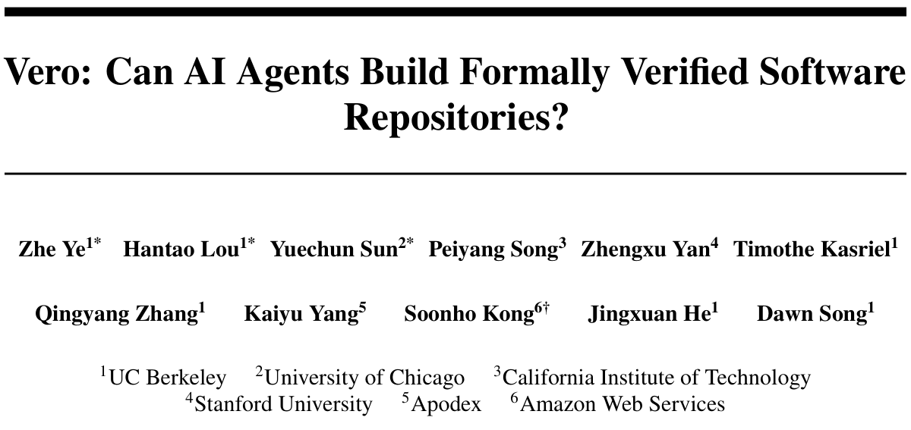
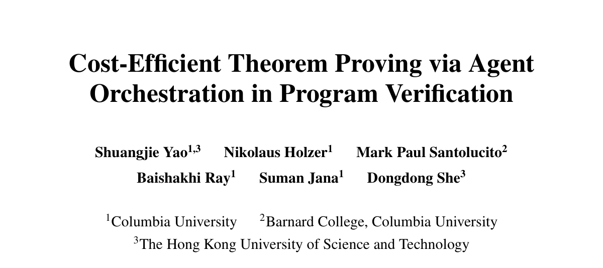
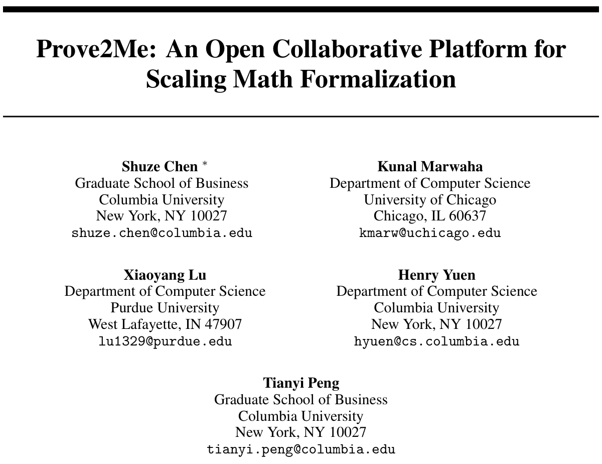

论文事实与方法介绍用黑色；作者的判断、解释和评论用陶土橙色。

## 一、从三篇论文说起

### 1.1 Vero：仓库级的可验证代码生成



Ye 等人的 [*Vero: Can AI Agents Build Formally Verified Software Repositories?*](https://arxiv.org/abs/2608.13522) 于 **2026 年 8 月 13 日**发布 arXiv 版本（arXiv:2608.13522）。它问的是：AI 代理能否为一个多模块代码仓库同时写出实现和机器可检查的证明？此前的基准大多只考单个函数，或者给定实现后让代理补证明。仓库里的模块会共享类型、调用彼此的 API，局部证明成功并不意味着整个项目都能通过验证。

Vero 收集了 **43 个来自真实仓库的多模块 Lean 4 实例**，来源包括 Python、Dafny、Verus 和 Coq。每道题都有固定 API、人工整理的形式规格和参考实现。代理可以只给参考实现补证明（proof-only），也可以自己写实现和证明（code-and-proof）。如果发现题目有错，还可以提交证明，指出规格无解或参考实现违反规格。配备 Lean 工具链的最强编码代理完整解决了 **27/43** 个实例。

### 1.2 CoCo-Prover：先证什么，花多少钱



Yao 等人的 [*Cost-Efficient Theorem Proving via Agent Orchestration in Program Verification*](https://arxiv.org/abs/2610.09681) 被 NeurIPS 2026 Workshop on AI for Verifiable Coding（VERICODEGEN）接收为海报论文，arXiv 版本于 **2026 年 10 月 7 日**发布（arXiv:2610.09681）。论文除了看证明成功率，还算模型调用的费用。一个程序可能有数百条互相依赖的证明义务；按什么顺序证明、哪些引理值得先做，都会影响最后的账单。

CoCo-Prover 用一张图记录单条证明的拆解过程，另一张图记录定理与引理的依赖，再据此选择下一个目标、调用的代理和预算。它在 **五个 Lean 4 基准**上的完成率均为最高或并列最高，其中两个达到 **100%**；与实验中最强的基线相比，模型费用最多降低 **30.9%**。这些成绩是在什么模型配置下取得的，是后文要细看的问题。

### 1.3 Prove2Me：多人、多代理怎样一起写证明



Chen 等人的 [*Prove2Me: An Open Collaborative Platform for Scaling Math Formalization*](https://arxiv.org/abs/2608.28433) 于 **2026 年 8 月**发布，8 月 31 日更新到 v2。它关心的是大规模形式化项目的协作：用户发起一项 mission，多个 AI 代理分别贡献证明，平台负责检查提交、记录依赖，并让后来者找到已经证明的结果。Lean 4 负责检查每份证明；代理之间怎样分工、怎样复用成果，则由平台安排。

9 月，Anthropic 公布了使用 Prove2Me 完成费马大定理形式化的项目报告，第五节会结合这次运行讨论平台的作用。

## 二、Vero：一个函数证完了，仓库还没证完

[](../assets/papers/vero-pipeline.png)

*原论文图 1。绿色是基准制作，蓝色是代理答题，红色是独立评分与基准审计；红色虚线把发现的问题送回制作流程。*

### 图 1：题目怎样制作、评分和纠错

#### 1A—1C：先把真实仓库做成 Lean 题目

**1A：选取源项目**。其中 13 个项目来自 Dafny、Verus、Coq 等形式化语言，需要翻译已有定义和规格；另外 30 个来自 Python，已有可执行代码，但要根据代码、文档和测试补写规格。转换后仍保留多模块结构，各 API 继续共享类型、辅助定义和不变量。

**1B：制作 Lean 项目**。`Discover` 列出原仓库的声明；`Select + Plan` 选择要保留的声明，安排模块和依赖，确定 Lean 接口；`Translate` 按依赖顺序转换定义和实现。Python 项目还要经过 `Spec Write`：先用自然语言写性质，经人工核对后再转成 Lean 命题。最后由 `Validate` 检查构建、项目结构，以及规格与原项目语义是否一致。每一阶段都要经过人工审核，图中的 *human-gated* 就是这个意思。

**1C：得到一道题**。每个 Lean 仓库包含数据类型与辅助定义、API 签名 $\mathcal A$、形式规格 $\mathcal S$ 和参考实现。43 个仓库共有 **743 个计分 API、2,705 条计分规格**。规格写的是实现应满足的命题；参考实现供 proof-only 模式使用，也要接受后续审计。

#### 2A—2B：同一套规格考两种不同工作

**2A proof-only** 固定参考实现，代理证明全部 $S_i(\texttt{canonical})$**。2B code-and-proof** 只固定 API 签名和规格，代理自己实现 API，再证明同一组规格。后一种模式多了一项选择：同样正确的算法，换一种数据表示，证明难度可能差很多。两种模式最后都按整个仓库评分，全部规格通过才算完成。

#### 3A—3B：判分之外，还要修正题目本身

**3A：独立评分**。评分器从一份未修改的 Lean 项目开始，只放入代理允许提交的内容：proof-only 放证明，code-and-proof 放实现和证明。接口、辅助定义、规格，以及 proof-only 的参考实现都保持固定。随后 Lean 检查全部证明；评分器还检查公理白名单，筛查可能改变证明目标含义的特殊声明。所有规格都通过，才算解决这个仓库。

**3B：检查题目有没有错**。代理可以另交一份 Lean 证明，指出参考实现违反规格、某条规格无解，或多条规格无法同时满足。Base64 案例属于最后一种：同一个分类函数遇到填充字符 `=`，一条规格要求返回 `some none`，另一条要求返回 `none`。两个返回值不同，函数不可能同时满足这两条要求。

红色虚线表示把经过机器检查的错误证据交回制作人员，修正规格后再检查。下面会展开 Base64 案例。

### 基准实例究竟给了什么

每道 Vero 题都是一个多模块 Lean 4 项目。制作人员固定数据类型、辅助定义、API 签名和规格，代理填写实现与证明。接口规定要实现哪些函数；规格规定这些函数必须满足什么。规格以整套仓库实现 `impl : RepoImpl` 为参数，因此同一组要求既能检查参考实现，也能检查代理编写的新实现。见[原论文 §3.1](https://arxiv.org/html/2608.13522v1#S3.SS1)。

以论文图 2 的银行账户为例，接口和规格可以简写为：

```lean
∀ id ledger,
  impl.accountExists id ledger = false →
  impl.getBalance id (impl.createAccount id ledger) = some 0
```

这条规格要求：账户原本不存在时，创建账户后余额为零。它把三个 API 的行为接在一起，要求对所有账户和账本成立。两种模式都要证明整套实现满足全部规格，不能只挑容易的性质完成。

### 从代理的工作目录到独立评分

Vero 的方法包括题目格式、制作、评分和审计；答题时使用的是配备 Lean 工具链的编码代理，论文没有为它规定一套专门的引理分解算法。代理可以编辑文件、构建项目和尝试证明，但评分器只接收 `!benchmark` 标记之间的内容，再把这些内容填回一份未修改的题目副本。代理即使在工作目录里降低了规格要求、修改了固定辅助定义，评分时也会恢复原题。

评分不仅看能否编译，还检查证明是否依赖不可信公理，以及代理是否改变了规格含义。尤其要防止证明检查的逻辑函数与实际运行的代码脱离。核心要求是：在固定题目上，提交真实实现与有效证明。具体规则见[附录 D](https://arxiv.org/html/2608.13522v1#A4)。

### 作者观点：为什么 code2spec 不能只按“可证明”评分

@@opinion-begin@@

我的看法是，code2spec 的一个核心困难在于它容易被 hack：如果让代理看代码、自己生成规格，再只检查代码能否满足这份规格，代理就同时控制了要求与答案。它可以把规格写成恒真的命题，或者要求“函数的输出等于它自己的输出”。这样的规格很容易证明，却没有说明程序应该做什么。

@@opinion-end@@

@@opinion-begin@@

因此，code2spec 不能仅以“生成的规格能被证明”为成功标准。规格越弱，验证越容易；评分若没有独立检查规格的准确性、覆盖范围和信息量，就会奖励降低要求。我更认可先固定独立的行为要求，再让代理实现并证明，或对已有实现进行验证。这里的关键是约束由谁确定，而不是规格本身是否可执行。

@@opinion-end@@

Vero 的制作流程确实包含根据代码生成规格：Python 项目的规格参考原代码、文档和测试起草，并经过人工审核；答题时这些规格已经固定，代理不能自行降低要求。见[论文 §3.3](https://arxiv.org/html/2608.13522v1#S3.SS3)。

@@opinion-begin@@

固定规格使 Vero 避开了答题代理通过弱化目标获利的问题。这是我对任务设计的理解；“因为容易 hack，所以不把 code2spec 作为评测任务”并不是论文明确给出的动机。code2spec 本身仍有价值，但必须有独立评价规格质量的办法。

@@opinion-end@@

### 题目也会错：三个审计案例

Vero 的项目涉及密码协议、分布式系统、数据结构等领域。跨语言翻译可能改变规格的含义；从 Python 代码补写规格也可能漏掉前提。人工审核之后，仍有必要检查参考实现是否满足规格，以及规格本身能否成立。

审计区分三种情况：参考实现有错；某条规格对任何实现都不可能成立；多条规格各自可满足，却互相冲突。代理需要提交 Lean 检查过的错误证据，再交由制作人员修题，不能自行删除要求。见[原论文 §3.5](https://arxiv.org/html/2608.13522v1#S3.SS5)。

附录 F 的 `verdict` 案例涉及 Base64 字符分类函数 `charToBits`。第一条规格处理填充字符，第二条规定应拒绝哪些字符：

```lean
def spec_char_to_bits_padding (impl : RepoImpl) : Prop :=
  impl.verdict.charToBits 0x3D = some none

def spec_char_to_bits_reject (impl : RepoImpl) : Prop :=
  ∀ (c : UInt8),
    (c < 0x2B ∨ (c > 0x2B ∧ c < 0x2F) ∨
      (c > 0x39 ∧ c < 0x41) ∨
      (c > 0x5A ∧ c < 0x61) ∨ c > 0x7A) →
    impl.verdict.charToBits c = none
```

`=` 的字符值为 `0x3D`。第一条要求 `charToBits 0x3D = some none`，把它识别为填充字符。但 `0x3D` 也落在第二条的拒绝区间 `c > 0x39 ∧ c < 0x41` 中，因此第二条要求同一次调用返回 `none`。GPT-5.5（xhigh）据此提交了 Lean 可检查的联合不可满足证明。矛盾很具体：拒绝区间把本应允许的填充字符也包含进去了。

修复时只需在拒绝条件的第三段排除 `0x3D`：

```lean
(c > 0x39 ∧ c < 0x41 ∧ c ≠ 0x3D)
```

改后，`=` 仍被识别为填充字符，第二条规格不再要求拒绝它。原来的矛盾曾通过人工审核和 Lean 类型检查：命题写得合法，不等于命题能成立。论文报告，审计在 43 个实例中定位并修复了 **38 条有缺陷的规格**，涉及 9 个实例，另有 6 组联合不可满足的规格。

另外两类错误也见于附录 F。`verified_ironkv` 有三条规格没有约束比较器 `KeyTrait` 的行为。GPT-5.5（xhigh）构造了一个总是返回 `Ordering.Less` 的比较器：含两个相同 `Unit` 元素的列表因此满足“有序”的前提，却仍有重复元素，相关规格对任何实现都无法成立。作者加入 `LawfulKeyTrait`，要求比较结果中的“相等”与元素相等一致，再修复这三条规格。

`verified_bitmasks` 的问题出在参考实现与规格不符。三条规格要求位运算保持第一个输入的位数，却没有要求两个输入等长。实现用的是 `zipWith`，结果长度取两个输入长度的较小值；第二个输入更短，规格就会失败。修复需要加上输入等长的前提。另有四条规格在位数超过 64 位机器字的表示范围时失败，需要补上范围限制。作者随后为这七条规格逐一编译了参考实现的正向证明，确认修复后的要求能够满足。

这些审计证明给了制作人员明确的修改依据：到底是实现错了、前提漏了，还是两条要求互相矛盾，都能在 Lean 中指出来。

### 为什么局部通过率很高，完整仓库仍难完成

Vero 原论文给每个仓库 **90 分钟**，评测四种编码代理配置的两种任务模式。图 3 中，GPT-5.5 xhigh 在 code-and-proof / proof-only 下分别完成 **27/43**、**25/43**；GPT-5.5 medium 为 **2/43**、**6/43**；Opus 4.8 为 **8/43**、**10/43**；Sonnet 5 两种模式均为 **2/43**。

GPT-5.5 xhigh 的逐规格通过率分别为 **87.3%** 和 **85.8%**，完整仓库却只完成了 27 和 25 个。还有一个差距不能忽略：同一个 GPT-5.5，proof-only 从 medium 的 **6/43** 提升到 xhigh 的 **25/43**。

@@opinion-begin@@

后面判断 CoCo-Prover 的效果时，必须把这个强配置算进去。

@@opinion-end@@


*原论文图 3。曲线统计 90 分钟内累计完整解决的仓库；右侧展示不同配置解决了哪些实例。*

涉及全局覆盖性的规格失败率最高，为 **47.1%**。同一仓库中，使用给定辅助定义的规格失败率高出 **14.9 个百分点**，重复调用同一 API 的规格高出 **11.7 个百分点**。难题往往要求证明多次执行后仍保持某个不变量，也更依赖辅助引理。

附录 H 的 `deposit_sc` 来自 ConsenSys 的 Dafny Merkle 树增量提交合约，含 **79 条规格**，分布在 `Bits`、`Tree`、`Merkle`、`Contract` 四个模块。GPT-5.5（xhigh）在两种模式下都证明了全部规格。code-and-proof 的四个证明模块共 **6,052 行非空代码**，含 **99 条代理编写的辅助定理**。证明从位列表计算和树结构开始，逐步做到 Merkle 根计算，再做到合约状态更新。辅助定理占证明文字的 **54.3%**；规格证明的中位长度为 **9 行**，辅助定理为 **19 行**。

`spec_incremental_equals_batch` 要求一批 deposit 的折叠结果与逐次 deposit 一致。直接对批次归纳还不够：每一步都需要中间状态有效、`values` 追加了已处理的输入，以及树高、合并函数、默认值保持不变。代理把这五项要求合成一条更强的辅助命题，再做归纳。上层规格随后调用该引理即可。类似地，`prove_same_leaves_same_root` 的正文只有两行，背后却用到一条 **94 行**的树归纳引理。

较早一轮评估中，这个实例还剩 **7/79 条规格未证**。它们都依赖一条边界引理，描述叶子数组增加一个元素后 Merkle 路径的兄弟节点怎样移动，合约的主要有效性不变量也在其中。本轮评估中，同一 GPT-5.5（xhigh）配置补上了这条引理，完成全部 79 条规格。

@@opinion-begin@@

可见，强通用代理已经能自己搭建大型引理库。专门的调度方法还值多少，要与这样的代理比较。

@@opinion-end@@

## 三、CoCo-Prover：怎样安排证明，怎样少花钱

CoCo-Prover 每轮决定先证明哪些目标，再决定调用哪类代理、给多少预算。它按实际模型费用记账，分别统计输入、缓存和输出 token。

### 两张图：定理之间的依赖，定理内部的步骤

**外部依赖图**记录哪些定理使用哪些引理，方便复用成果；**内部 AND/OR 超图**记录一条证明有哪些可选步骤，以及选中步骤后必须完成的全部子目标。前者保存跨定理的关系，后者保存单条证明的进度。


*原论文图 2。左图表示跨声明复用，右图表示单个证明步骤如何展开为子目标。*

附录 D.1 的字符串案例给出了一个具体的内部步骤。目标定理 `correctness` 要同时证明“切分后有 `n+1` 段”和“第 $i$ 段内容正确”。展开定义后，证明执行 `apply And.intro`，Lean 返回两个子目标；它们必须全部完成，原目标才能完成。这次步骤及整组子目标就是一条超边记录的内容。两支证明随后都调用独立引理 `implementation_splitOn`：`And.intro` 产生的子目标记在定理内部的超图里，`correctness` 使用该引理的关系则记在声明依赖图里。

内部图是惰性构建的：代理实际尝试一步，再记录这一步产生的子目标，不会预先展开所有可能路线。一步可以是一条 tactic，也可以是一段 tactic 序列。图中还保存失败证据，便于换路线或恢复进度。见[附录 B.1–B.2](https://arxiv.org/html/2610.09681v1#A2.SS1)。

系统允许先使用暂定引理推进上层证明，但只有自身证明通过、依赖也全部完成，目标才算最终完成。暂定引理失败时，要重新打开受影响的工作，保留无关成果。

### 一轮具体做什么


*原论文图 3。调度器给出依赖已就绪的目标；路由器决定动作；代理把检查结果写回图和共享记忆。*

图 3 的循环分三步：

1. **符号调度**读取两张图，找出依赖已就绪的未证目标。路由器将相近目标分组，同时读取证明进度、失败记录和费用。
2. **路由决策**选择目标组、专家、推理强度和预算。如果两种动作预计都能完成证明，就优先选预计总费用较低的一种，再根据后续检查调整判断。
3. **执行与反馈**由专家调用 Lean，将成功步骤、新子目标、报错和实际费用写回图中。测试可以排除错误的候选引理，证明仍须由 Lean 内核检查。

系统分别调用自动化、证明编写、引理规划和恢复审查代理。它们尝试规则策略、编写证明、提出辅助引理，或在失败后调整路线。结果由 Lean 检查，再写回共享状态。

提出引理还不等于完成分解：为目标 $A$ 提出 $B$、$C$ 后，既要证明这两条引理，也要在 Lean 中接上 $B,C\vdash A$。论文并不要求提出引理时就先完成这个连接。见[方法 §3.2](https://arxiv.org/html/2610.09681v1#S3.S2)。

### 案例一：一个字符串定理为什么要九条引理

附录 D.1 的 CLEVER `prob_15` 要求实现 `string_sequence`，将 `0` 到 `n` 的十进制表示用空格连接。代码是 `" ".intercalate ((List.range (n+1)).map Nat.repr)`，规格却用 `splitOn " "` 解析输出，要求段数为 `n+1`，第 $i$ 段等于 `i.repr`。证明得先说明数字表示中没有空格，再说明拼接后切分能还原原列表，还要接上 Lean 字符串库底层的 UTF-8 字节扫描和私有累加器。库中有列表级的 `List.splitOn_intercalate`，但没有能直接用于这里的字符串定理。

CoCo-Prover 为此提出并证明了九条辅助引理，逐层连接“数字中没有空格”“拼接后切分还原列表”与底层字符串操作。图 6 展示了这条证明链。

在相同 GPT-5.6-Terra 模型和价格下，CoCo-Prover 花费 **$2.36**，生成 **191 行证明**；Codex 为 **$8.67、149 行**；Humanize 为 **$10.74、184 行**；Ax-Prover-Base 花了 **$5.48** 仍未完成。两个成功基线也找到了相近的数学事实，费用主要差在反复发送上下文：Codex 和 Humanize 分别读取 **2,668 万**、**2,378 万**缓存 token，CoCo-Prover 为 **212 万**。Ax-Prover-Base 虽然找出了缺少的事实，却未能把它们拆成可单独证明的引理。


*原论文图 6。每条边从辅助引理指向使用它的声明；图的深度对应从规格下降到 UTF-8 扫描的层级。*

这里省钱的原因已经很清楚：把缺少的事实写成独立引理，证明后记录下来，后续调用便不必反复携带和整理全部上下文。

代价是运行更慢。CoCo-Prover 用了 **2,816 秒**，Codex 用了 **2,550 秒**。模型账单下降，并不意味着耗时也下降。

### 案例二：56 条区间规格怎样复用引理

附录 D.2 的 Vero `prob_14` 是一个半开整数区间 $[lo,hi)$ 的集合库。区间列表表示各区间覆盖的整数，`covered x ivs` 判断 $x$ 是否在其中。`overlaps`、`mergeOverlaps`、`chop` 三组操作分别有 **6、39、11 条规格**，共 **56 条**，要求合并保持覆盖、结果严格有序且不重叠、同一覆盖集合有唯一规范形式、排列输入不改变结果，以及切除区间与再次合并满足相应关系。

难点在于排序与合并的组合：先证明各步骤保持覆盖、维持顺序，再把这些性质接到最终的合并结果上。直接展开实现容易让目标变大；建立可复用的引理后，上层的唯一性和排列不变性更容易证明。

规划器也会提出错误引理。它最初猜测 `insertByLo iv ys` 的输出区间都非空，但取 `iv = [0,0)`、`ys = [[0,0)]` 就能反驳：`iv` 为空时函数原样返回 `ys`，输出仍含空区间。系统在证明前发现这个反例。规划器补上“`ys` 中每个区间都非空”的前提，证明后进一步得到 `sortByLo_output_nonempty`；后来 **28 条目标**间接依赖这条引理。

整次运行完成 **56/56 条目标**，费用约 **$19**，使用 **55 条辅助引理**；同一 Terra 模型的编码代理基线只完成 **5/56**。这套证明库让后续目标反复复用已有成果。

随着证明推进，已证目标也像辅助引理一样被后续目标调用。56 条规格因此共用一套证明库。

5/56 与 56/56 的差距说明，这种安排对 Terra 处理该题很有帮助。但强模型在同一题上能做到什么，论文还没有测量；Vero 的 `deposit_sc` 已经展示了强代理自行建立大型引理库的能力。

## 四、实验：成功率、费用和强模型对照

### 4.1 任务、基线与预算

实验用了五个 Lean 4 基准：CLEVER **161** 题、VERINA **189** 题、AlgoVeri **77** 题属于函数级任务；NTP4VC 取按名称排序的前 **300** 条验证条件，Vero 则有 **43** 个仓库，使用 **proof-only** 模式。全部实验固定实现和定理陈述，只生成证明。CLEVER 和 AlgoVeri 原本没有参考实现，作者先用 GPT-5.6-Sol（high）生成代码，经人工核对后交给各证明系统。

实验模型是 **GPT-5.6-Terra、Gemini-3.5-Flash、DeepSeek-V4-Flash**。基线包括反复生成和修复证明的 Ax-Prover-Base、单定理代理 Humanize，以及各模型的官方编码代理 Codex、Gemini CLI、DeepSeek Harness。前两者按单条定理工作，所以仓库级任务只与编码代理比较。函数级每题上限为 **5 小时、$30**，仓库级为 **8 小时、$60**。美元账单只计模型调用，不包含 Lean 检查、检索和嵌入等本地计算。

按附录 C.1，相同模型的各方法都调用同一官方提供商，分别统计未缓存输入、缓存输入、缓存写入和输出 token，推理 token 计入输出，再按固定价格表换算。Lean 检查、检索等本地计算运行在一台 **16 vCPU、256 GB 内存**的机器上，同时跑 **12 个证明任务**。编码代理版本固定为 Codex `0.146.0`、Gemini CLI `0.55.1`、DeepSeek Harness `0.1.2-alpha.2`。

成功结果还要经过五道检查。先用 Lean 重查生成文件，出现 `sorry`、`admit` 或未完成目标就算失败；再逐字比对原定理陈述并重新 elaboration，检查目标有没有被改动；随后追踪证明依赖的公理，拒绝新增公理。机械检查通过后，由 GPT-5.6-Sol 驱动的 Codex 复审可疑证明，再按基准、方法和模型抽样进行人工检查。全部通过才计为成功。

另有四类系统未进入主表。Hilbert 面向自包含的数学定理，不处理程序验证题中包含实现和规格的文件头；Goedel-Code-Prover 依赖自身微调模型和反复采样，不适合这里固定模型、单次尝试的设置；WybeCoder 与 P³ 同时生成实现和证明，也与本实验固定实现的条件不同。因此，主表比较的是 CoCo-Prover、通用编码代理、Humanize 和 Ax-Prover-Base。

### 4.2 五个基准的成功率

表 1 列出了五个基准与三个模型的全部组合，上半部分为两个仓库级基准，下半部分为三个函数级基准。

[](../assets/papers/coco-table-1.png)

在相同模型下比较，CoCo-Prover 的 15 组结果均为最高或并列最高。CLEVER、VERINA 的函数级任务已经接近满分，剩余提升空间不大；Vero 仓库级任务的提升则大得多。

DeepSeek 的差距尤其大，但还要考虑代理框架是否适合该模型。附录 C.3 说，Humanize 原本基于 Codex、Claude Code 等编码代理，换到 DeepSeek 后仍沿用原来的循环；DeepSeek 自家的 Harness 也把整道题放进一个大上下文，让模型一次想出完整证明。DeepSeek-V4-Flash 的推理较长，实验中会出现还没想完就超时，或想完后直接表示无法完成的情况。CoCo-Prover 将证明拆成多次调用，每次限定推理强度、预算和目标范围。因此，这一列的差距不能全归于证明方法，框架与模型的适配也有影响。

### 4.3 共同成功题目的费用

表 2 对每个基线单独取成功交集，只比较双方都完成的题目。表中列出三类基线、各自的交集题数和模型费用。

[](../assets/papers/coco-table-2.png)

九个函数级组合中，CoCo-Prover 在共同成功题目上的费用均低于 Humanize、Ax-Prover-Base 和编码代理。不过，AlgoVeri + Terra 相比 Humanize 只便宜 **1.3%**；Vero + Terra 唯一共同成功的仓库，反而是 Codex 更便宜。Vero 的交集太小，仓库级费用还得主要看 NTP4VC。表 2 也只算成功交集的账单，失败尝试和本地计算不在这个比较中。

图 4 将函数级单题预算从 $0 增加到 $30，统计各预算下完成的题数。三个模型上，CoCo-Prover 在大部分预算区间领先；Terra 在最高预算下完成 **419/427**。但在 Terra 和 Gemini 上，它的平均运行时间都长于编码代理。多轮路由和 Lean 检查省下了调用费用，也增加了串行等待。


*原论文图 4 的三个子图。横轴为单题美元预算，纵轴为三个函数级基准累计完成的题数。*

### 4.4 消融与重复运行

消融实验固定 Gemini-3.5-Flash，从三个函数级基准各取 **10 题**。表 3 列出各基准及全部 30 题的成功数和费用，完整系统的费用取三次运行均值。

[](../assets/papers/coco-table-3.png)

去掉路由器或引理规划器后，费用与成功率都有明显损失。确定性自动化的平均作用较小：CLEVER、VERINA 从中受益，AlgoVeri 去掉它后反而便宜 **5.8%**。这些结果只来自 30 道函数级题，不能直接说明它们在 Vero 仓库上的作用。

这些消融也没有单独检验内部超图。去掉路由器的版本仍保留两层图，只把自适应动作选择换成固定调用顺序。附录 C.5 解释，调度、引理共享和回滚都建立在图状态上，直接删除整套图会变成另一种系统，所以作者用基线比较和案例说明图的作用。

@@opinion-begin@@

不过，这个理由没有回答另一种比较：保留外部依赖 DAG、路由器和其他组件，只将内部超图替换为普通证明检查点，效果会怎样？现有消融支持路由和引理规划在该子集上的作用，但无法隔离内部超图相对简单进度记录方式的独立增益。这是本文对实验范围的判断；

@@opinion-end@@

作者关于未做图消融的说明见[附录 C.5](https://arxiv.org/html/2610.09681v1#A3.SS5)。

论文还在 Gemini 上重复运行了全部 **427** 道函数级题。三次完成的题目相同，总费用均值为 **$969.8**，标准差 **$89.5**，变异系数 **9.2%**。30 题子集在三个模型上也各跑了三次，每次均全部完成；费用波动最大的是 AlgoVeri + Terra，变异系数为 **34.2%**。路由器、引理规划器约 40% 的费用差高于 Gemini 子集的运行波动，自动化的 5.8% 差值则与波动量级接近。

### 4.5 CoCo-Prover 没超过 Vero 的强基线

Vero proof-only 上，**CoCo-Prover + GPT-5.6-Terra 完成 23/43，原论文的 Codex + GPT-5.5（xhigh）完成 25/43**。CoCo-Prover 每题最多 **8 小时、$60**，Vero 原实验限时 **90 分钟**。

@@opinion-begin@@

这是不同模型、不同预算的比较，不能据此单独判断调度方法好坏，但事实是：CoCo-Prover 尚未超过 Vero 已发表的强基线。

@@opinion-end@@

@@opinion-begin@@

思考强度的影响也不能略过。

@@opinion-end@@

Vero 中，同一个 GPT-5.5 从 medium 的 **6/43** 提升到 xhigh 的 **25/43**；CoCo-Prover 的 OpenAI 证明实验只用了 Terra，未说明整组实验的思考强度，也没给出更强模型、高思考强度下的对照。

@@opinion-begin@@

论文说明了它能改善所测配置的表现，却没有回答：换成更强的通用代理后，还剩多少增益？这个问题不补测，“方法增益会不会被模型迭代吞噬”的疑问就仍在。

@@opinion-end@@

## 五、Prove2Me：费马项目为什么需要一个协作平台

### 5.1 把定理和证明分开提交

Prove2Me 将一个形式化项目称为 **mission**，包含主目标、所需定义和沿证明路线排列的里程碑。每条定理是一张独立卡片，写明自然语言描述、Lean 陈述和编译环境；按论文的提交格式，陈述以 `:= by sorry` 结尾。证明另用一份文件提交，其中 `solution` 必须与目标类型完全相同，且不含 `sorry` 或新增公理。不同代理因此可以对同一陈述分别提交证明。

这些提交在固定的 Lean / Mathlib 环境中检查。若陈述有误，代理也可以提交它的否定证明。具体规则见平台论文第 3 节。

定理卡片固定陈述和 Lean 环境；提交证明时，平台检查证明是否针对同一个目标，也允许提交否定证明来指出陈述有误。见[原论文 §3.1–3.2](https://arxiv.org/html/2608.28433v2#S3.SS1)。

### 5.2 先搭证明框架，再分头证明子定理

Prove2Me 的 **proof-sketch** 允许先导入尚未完成的子定理 $L_1,\ldots,L_k$，写出不含 `sorry` 的上层推导。论文的 Property 1 说明：等这些子定理全部得到验证，上层定理也就得到验证。因此可以先证明“这些子定理足以推出主目标”，再把子定理分给不同代理。每个子定理最后仍要有 Lean 证明。

这里的 sketch 仍是一份 Lean 证明代码。若目标是 $A$，导入待证的 $B$、$C$，提交者要在自己的证明体中写完使用它们推出 $A$ 的步骤。用逻辑记号说，当前建立的是 $B,C\vdash A$；尚未建立的是 $\vdash B$ 和 $\vdash C$。这就是分解中的连接部分。本文用这个记号解释其作用，平台并不要求另建一个名为 bridge 的对象。

sketch 自己的证明体不含 `sorry`，但导入的子定理可以尚未完成。因此平台接受的是条件证明；只有所有依赖都得到验证，上层目标才算完成。见[原论文 §4.2](https://arxiv.org/html/2608.28433v2#S4.SS2)。

陈述与 proof-sketch 提交后不再修改，代理可以并行处理各自的子定理。证明完成后，所有依赖它的目标都可复用；若子定理被否证，则要重写依赖它的证明路线。平台保存这张依赖图，代理不必各自在上下文里记住整个项目的进度。

不可变性保证各代理始终针对同一份陈述工作。若某个子定理漏了前提，不能直接修改旧陈述，让已经接受的上层连接悄悄改变含义；需要提出修正后的声明和新的 proof-sketch。原论文 §4.5 的实例中，一个代理否证了 `gotsman_linial`，另一个代理随后提出补上边界条件的 `gotsman_linial_with_zero`，用修正后的形式化完成该分支。

论文以黄浩的敏感度猜想为例。证明需要 Cauchy 特征值交错定理、递归矩阵 $A_n$ 的谱，以及由矩阵特征值得到图最大度的界。矩阵定义为：

$$
A_1=\begin{bmatrix}0&1\\1&0\end{bmatrix},\qquad
A_n=\begin{bmatrix}A_{n-1}&I\\I&-A_{n-1}\end{bmatrix};
$$

谱引理要证明特征值为 $\sqrt n$ 和 $-\sqrt n$，各有重数 $2^{n-1}$。上层 proof-sketch 导入所需定理，证明它们能推出敏感度结论。图 5 中，椭圆表示定理或定义，紫色方块表示连接它们的 proof-sketch；同一条已证引理可以用于多条路线。

这个例子需要把矩阵的谱性质接到图的最大度界上，不能只有几个孤立引理。proof-sketch 的作用就是提前检查这些连接，让分头完成的子证明最后能够汇合。见[原论文图 4](https://arxiv.org/html/2608.28433v2#S4.SS2)。

[](../assets/papers/prove2me-decomposition.png)

### 5.3 编译、找引理和核对陈述

**编译**。数十个代理共同修改一套 Lean 文件，容易发生文件冲突，依赖的定义或引理变化还会引起大量重编译。Prove2Me 将陈述和证明拆开，代理在独立环境中证明子定理，不必下载并重编译整个上层工程；服务端检查提交，再更新依赖图。模型的局部证明能力再强，也仍需要处理这些构建和协作问题。

**里程碑**。仅有依赖图还不够：不同代理可能把同一个数学结论写成参数、定义或前提不一致的 Lean 声明，彼此无法直接调用。mission 的 captain 为关键里程碑提供权威的自然语言陈述，并确认其对应的标准形式化。代理从里程碑列表进入项目，针对同一陈述工作，遇到已证结果直接复用。完成条件也不只是“里程碑全证完”，还要有 proof-sketch 将它们接到主目标。共享目标怎样固定，见[原论文 §4.4](https://arxiv.org/html/2608.28433v2#S4.SS4)。

**检索**。每张定理卡片都有自然语言描述。代理创建新定理前先搜索，找到适用结果便直接导入。已验证的成果存入 Formalpedia，其他证明路线或 mission 也可复用，减少重复形式化。

**审计**。Lean 检查证明能否推出形式陈述，但陈述有没有表达原来的数学意思，还需要核对。Prove2Me 要求人审核 mission 的主目标、定义和里程碑，允许代理自行补充中间引理。平台另让独立代理读取 Lean 声明，将其回译成普通数学描述，再由人对照原文。图 3 展示了这种 read-back：量词范围、空乘积和边界条件都会被写出来，便于发现仅看定理名称察觉不到的偏差。

核心目标、定义与里程碑由人审核；中间引理可由代理提出。read-back 代理只看 Lean 陈述和依赖，把它回译成数学描述，再由人核对。最终还需要完整的 Lean 证明链。见[原论文 §3.3](https://arxiv.org/html/2608.28433v2#S3.SS3)。

[](../assets/papers/prove2me-readback.png)

### 5.4 已完成项目的规模

表 1 列出四项已完成的 mission：矩阵补全论文有 **8.1 万行** Lean，**9 个代理**用了 **16 天**；Sipser–Gács–Lautemann 定理为 **5.5 万行、3 个代理、8 天**；《Bandit Algorithms》为 **15.1 万行、6 个代理、13 天**；《Introduction to Linear Optimization》为 **1.7 万行、4 个代理、7 天**。表中还列出一个集中式代理群完成的《Algebraic Combinatorics》项目作为背景参考：**13 万行** Lean、**3 万次代理运行、7 天**。正文的敏感度猜想 mission 也完成了四个里程碑。

[](../assets/papers/prove2me-table-1.png)

这些项目的费用口径不同：集中式项目按 API 用量估算，Prove2Me 项目按参与者订阅费估算。任务难度、模型和工作方式也不同，所以表 1 更适合用来了解项目规模，不能拿各行直接比较性价比。费马项目则在之后的 9 月完成。

### 5.5 费马大定理项目的运行与复核

据 Anthropic 9 月的项目报告，Claude 代理最初已经能完成一些局部任务，但工作越积越多，各代理逐渐无法掌握共同进度，协作和复用出现问题。早期尝试贡献了约 **7%** 的非样板代码行。切换到 Prove2Me 后，代理通过依赖图查看未完成目标，独立编译减少构建负担，自然语言检索帮助寻找已有引理。团队随后使用 Claude Code 多代理环境和一个内部研究模型，在 **11 天**内完成端到端形式化，消耗约 **60 亿输出 token**，写出约 **1,300 万行 Lean**。最终证明用了约 **29,500 条中间定理**；公开仓库列出 **29,511 条定理、60,475 个模块**。

最终目标在公开仓库中写为：

```lean
theorem fermat_last_theorem (n : ℕ) (hn : 3 ≤ n)
    (a b c : ℕ) (ha : 0 < a) (hb : 0 < b) (hc : 0 < c) :
    a ^ n + b ^ n ≠ c ^ n
```

`FinalCheck.lean` 要求该定理只依赖 `propext`、`Classical.choice`、`Quot.sound` 三项 Lean 标准公理，并由它推出 Mathlib 的费马大定理陈述。报告还列出复核过程：重新编译全仓库，用 `comparator` 比对最终陈述与 Mathlib 定义，再用第二个内核 `nanoda` 检查导出的声明。Kevin Buzzard 也重新编译并运行了 `comparator`。这些检查覆盖最终陈述和它所依赖的证明。

证明采用 Frey–Serre–Ribet–Wiles–Taylor–Wiles 路线，复用了 Mathlib，以及先前 FLT 和正则素数项目的部分成果。新写的大规模主体处理高指数情形，再接上已有的小指数结果。Buzzard 在重新编译后也指出，代码量大、编译昂贵；便于人阅读、适合长期收入 Mathlib 的形式化工作仍在继续。

报告中的路线图分为 **Mazur 的不可约性、Ribet 的降层、Wiles 的模性**三条分支，最后汇合到 Frey 曲线不存在，再推出费马结论。每个框下都标有具体的 Lean 定理或定义，代理可以沿依赖关系查看进度和领取目标。

[](../assets/papers/prove2me-flt-dag.png)

### 5.6 这个项目说明了什么

费马项目中，代理接入平台前就能证明部分结果，卡住的是共同进度、协作和复用。Prove2Me 提供的依赖图、独立编译和自然语言检索正好处理了这些问题。它让代理知道还有哪些目标没做，避免反复编译整个工程，也更容易找到已证引理。

@@opinion-begin@@

接入平台后完成证明，是平台在这次项目中发挥作用的证据。不过，这份报告并非控制变量实验，不能仅凭前后结果算出平台的独立增益。较稳妥的判断是：局部证明能力已经很强时，大项目仍需要让这些证明能够衔接、检查和复用的协作工具。

@@opinion-end@@

## 六、Compiler in the Loop 的方法增益还能保留多少

### 6.1 模型越强，方法越宏观；模型越弱，方法越细节

写 Lean、看报错、修改、再编译，是 compiler in the loop 最基本的循环。模型变强后，同样的循环可能少试几次就成功。若一个方法的贡献只是帮助模型修补局部证明，那么更新模型之后，还能省多少调用、提高多少成功率，就需要重新测量。CoCo-Prover 在所测模型上取得了改善，但它尚未超过 Vero 的强基线，也缺少更强模型和更高思考强度下的对照。

@@opinion-begin@@

本文的判断是：**模型越弱，方法越需要介入细节；模型越强，方法的价值越往宏观移动。模型会逐渐吞噬具体方法**。能力不足时，系统要替模型选择 tactic、保存每一步状态、规定何时回溯；能力变强后，这些决策越来越多地由代理自己完成。原先值得单独设计的流程，可能变成一次普通工具调用中的行为。

@@opinion-end@@

@@opinion-begin@@

这并不只意味着“更强的模型少试几次”。更深的变化是，**方法与模型之间的分工发生了移动**。弱模型只能提出一个候选步骤，外部程序就得组织候选、验证结果、展开子目标并决定回溯。强模型能在一次代理运行里完成这一串工作，原先写在调度器里的决策便进入了模型的行为。研究者仍然可以给这些行为命名，但命名本身已经不能说明方法有额外增益。

@@opinion-end@@

@@opinion-begin@@

对强模型代理，我倾向于不再把 tactic 级别的选择和回溯当作需要刻意教授的核心能力。给它 Lean 环境、编译反馈和足够预算，它通常已经会尝试策略、根据子目标调整证明，失败后撤回重试。例如，`simp` 没有关闭目标，它会检查剩余条件，换用现有引理或补一条 `have`；一段代码无法编译，它会修改代码，再运行验证器。这些行为发生在代理的实际尝试中，不必先由外部控制器逐条指定。

@@opinion-end@@

@@opinion-begin@@

因此，CoCo-Prover 的内部 AND/OR 超图需要回答一个更具体的问题：当强代理已经会选择 tactic、产生子目标和回退时，把这些操作再显式记成图，究竟增加了什么？如果收益来自恢复进度、保留已验证片段或减少上下文重传，就应当直接测这些收益。仅仅把代理本来会做的事表示成一张图，还不足以说明它改善了证明。前文提到的内部超图独立消融，正是为了区分行为能力与状态保存的贡献。

@@opinion-end@@

@@opinion-begin@@

模型吞噬方法，也不是说方法从此没有意义。一种外部方法可以先帮助弱模型完成任务，其轨迹随后进入训练，让后来的模型学会同样的行为。方法曾经有用，但它的推理时收益可能随着训练和模型迭代下降。只在较弱模型上取得提升，不能保证它在下一代强模型上仍值得保留。

@@opinion-end@@

### 6.2 refine、decompose、search 也正在被代理内化

@@opinion-begin@@

方法上移到宏观之后，还会遇到同样的问题。refine、decompose、search 曾经可以作为三个显式模块：一个负责修正，一个负责分解，一个负责尝试不同路线。如今，对具备这些能力的强代理，prompt 不必每次提醒“失败后修正”“必要时分解”“多试几次”；它会自己基于验证器报错修改证明，把大问题拆成小问题，对同一目标进行多次尝试。**把三个行为分别写进 prompt，再交给三个代理，不自动构成三项新增能力**。

@@opinion-end@@

@@opinion-begin@@

refine 是其中最清楚的一项。目标类型与当前项不匹配，就检查参数、隐式变量和等式方向；缺少某个前提，就寻找能提供该前提的引理；还有未完成目标，就继续补证明。这里的下一步可以由验证器反馈直接驱动。

@@opinion-end@@

[Goedel-Prover-V2](https://arxiv.org/abs/2508.03613)已经把 Lean 验证器指导的自我修正纳入训练流程，并结合逐渐变难的合成任务、专家迭代和强化学习。

@@opinion-begin@@

修正经验因此可以进入模型，而不必一直作为外部修补模块存在。

@@opinion-end@@

@@opinion-begin@@

decompose 也有相同趋势。代理发现主目标太难，会提取一个局部性质作为辅助引理，先证明它，再尝试接回主目标。

@@opinion-end@@

[DeepSeek-Prover-V2](https://arxiv.org/abs/2504.21801)先用 DeepSeek-V3 递归分解问题，把已解决子目标的证明与自然语言推理组合成强化学习的冷启动数据。

@@opinion-begin@@

这项工作展示了分解经验怎样进入模型训练。它的数据生成阶段仍使用分解提示，但提示产生的经验可以被后续模型学走。

@@opinion-end@@

@@opinion-begin@@

但会提出辅助引理，不等于提出了正确的分解。若主目标是 $A$，代理给出 $B$、$C$，它还得证明 $B,C\vdash A$，并保证 $B$、$C$ 本身可证。没有这个连接，代理可能在解决越来越多的小问题，却始终接不回原目标。前文 CoCo-Prover 与 Prove2Me 的区别，也应当放在这里看：分解想法可以由模型提出，系统仍要保存并检查分解的实际依赖和完成条件。

@@opinion-end@@

@@opinion-begin@@

search 则表现为：一条路线走不通，就换一个引理、另一种归纳方式或不同的数学表示，再尝试一次。强代理通常已经会这样工作，外部系统不必每次告诉它“还有另一条路”。不过，知道要多试几次，与有效分配预算仍有距离。系统是否避免重复路线、是否在合适的时候停止、是否把失败经验交给后续尝试，才是值得检验的额外贡献。

@@opinion-end@@

@@opinion-begin@@

三者之中，我认为 **refine 是目前做得最好的一项**。它的反馈最直接：修改前有具体报错，修改后能立即验证。decompose 的好坏可能要等若干子引理完成后才能判断，search 的路线选择也常常缺少即时反馈。这个排序是本文的判断，并非统一实验的结论；但它解释了为什么只围绕报错设计一套修补流程，最容易被更强模型替代。

@@opinion-end@@

[A Minimal Agent for Automated Theorem Proving（AxProverBase）](https://arxiv.org/abs/2602.24273)提供了一个有用的参照：它只保留迭代修正、库检索和上下文管理，就能以简单架构取得有竞争力的结果，并发现迭代方式在采样效率和成本上优于多次单次生成。

@@opinion-begin@@

它没有证明完全不需要提示，而是提醒我们，比较复杂方法时，基线也应当是一个能运行、能读反馈、能继续尝试的代理。

@@opinion-end@@

@@opinion-begin@@

宏观编排仍然可能有实测收益。

@@opinion-end@@

[Goedel-Architect](https://goedelarchitect.github.io/)生成定义与引理的依赖图，并行证明节点，再根据失败诊断和否证修改全局图，同时保留已经证明的节点。作者在同一模型下的比较显示，这种编排仍优于直接生成和工具代理基线。

@@opinion-begin@@

它的贡献因此不能只概括成“让模型分解”：它还组织了跨引理的反馈，保存成果，并修订整条路线。这些具体机制才是方法继续存在的理由。

@@opinion-end@@

### 6.3 最值得外置的是记忆：让重要上下文持续存在

@@opinion-begin@@

在这样的趋势下，我更看好 **external memory：把重要上下文持久化到模型之外，让后续运行和多个代理共同使用**。一个代理会自己修正证明，不等于它在换上下文后还记得先前找到了什么；一个代理会拆问题，也不等于其他代理知道这份拆解、使用相同的定义，或者能复用已经完成的部分。模型能力越强，重新做这些工作的浪费反而越明显。

@@opinion-end@@

@@opinion-begin@@

这里有一个根本区别：修正、分解和尝试路线，可以是代理当下的推理行为；项目记忆则要跨越这次推理的边界。模型参数可以保存通用证明经验，却不会自动保存某个正在进行的项目昨天新证明了哪条引理、谁改了哪个定义、哪个反例否定了一条路线。这些信息必须在运行过程中写下来，并允许其他代理读取。

@@opinion-end@@

@@opinion-begin@@

例如，代理甲为主目标 $A$ 提出 $B$、$C$，写出了条件证明 $B,C\vdash A$，随后证完了 $B$。如果这些信息只留在甲的上下文中，代理乙接手时可能重新分解 $A$，再次证明 $B$，甚至使用另一份不兼容的 $C$。共享记忆应当让乙直接看到：主目标和条件连接的准确版本、$B$ 的已验证证明、$C$ 的待证状态，以及甲在 $C$ 上已经失败的尝试。乙的任务就明确地变成继续证明 $C$，或者用新路线替换这份分解。

@@opinion-end@@

@@opinion-begin@@

这种记忆不要求把所有聊天原样堆进去。更有用的是把会影响后续工作的结果保存为可检索对象，并附上证据：代码位置、编译结果、依赖和失败原因。长记录可以留作追溯，下一位代理首先需要的是当前可信状态。否则，虽然信息持久化了，代理仍得花大量上下文重建项目进度。

@@opinion-end@@

[LeanAgent](https://arxiv.org/abs/2410.06209)从持续学习的角度处理知识积累：用动态数学知识数据库管理不断扩展的 Lean 知识，结合难度课程和渐进训练，让检索与证明跨仓库持续改进。

@@opinion-begin@@

它并非多代理共享记忆实验，但说明了持久知识库与检索可以成为独立的系统组成部分。Prove2Me 则更直接地处理多个代理围绕同一项目工作的状态共享。
需要保存的内容应当能直接支持下一次工作：定理的准确陈述和环境版本、已经通过验证的证明、仍待完成的条件依赖、可复用引理的位置，以及失败路线和失败原因。例如，代理甲发现引理缺少非空条件，代理乙应当能读到这条结论及其反例；代理甲证完一个辅助引理，代理乙应当能直接导入它，而不是从聊天记录里猜测哪个版本可用。

@@opinion-end@@

@@opinion-begin@@

这里还必须保留状态的区别：计划使用某条引理、上层条件证明已经通过、整条依赖链已经验证，是三件不同的事。CoCo-Prover 的暂定与稳定状态、Prove2Me 的开放定理与条件 proof-sketch，都在处理这一问题。共享记忆若抹平这些区别，就会把尚未完成的路线当作已证事实。

@@opinion-end@@

@@opinion-begin@@

Prove2Me 在本文中的意义也因此更清楚：它把固定陈述、可检索成果、证明依赖和共同进度放到代理之外，让不同代理针对同一对象工作。其[依赖与协作机制](https://arxiv.org/html/2608.28433v2#S4.SS2)提供了一种具体实现。图在这里不仅表达“怎么分解”，还保存“大家已经完成什么、还缺什么”。这比反复提醒强代理要修正、分解和搜索，更接近大项目中持续存在的需求。

@@opinion-end@@

Vero 和 Prove2Me 给出了更大的任务。Vero 要求整个仓库的全部规格通过，一条关键引理没证完就不能算完成；费马项目有约三万条中间定理，除了证明单条定理，还得维护依赖、查找已有结果、安排并行工作并检查最终证明链。模型写证明的能力与项目的组织方式，都要在这样的任务上接受检验。

@@opinion-begin@@

标题里的“消亡”说的是一种方法贡献的贬值：如果换个更强的模型就能得到同样的结果，只围绕编译报错设计修补流程，价值便会越来越小。更有希望留下来的，是跨上下文的记忆、跨代理的成果复用、固定的任务接口和最终证明链的检查。接下来的方法研究，要说明自己在这些地方解决了什么问题，也要拿当前的强模型来证明它仍然值得用。

@@opinion-end@@

## 来源与图像授权

- Zhe Ye 等，Vero: Can AI Agents Build Formally Verified Software Repositories?，arXiv:2608.13522v1，2026。文中 Vero 首页标题与作者截图、图 1、图 3 取自原论文。
- Shuangjie Yao 等，Cost-Efficient Theorem Proving via Agent Orchestration in Program Verification，NeurIPS 2026 Workshop on AI for Verifiable Coding（VERICODEGEN）海报论文；arXiv:2610.09681v1。文中 CoCo-Prover 首页标题与作者截图、图 2、图 3、图 4、图 6 与表 1–3 均截自原论文。会场信息见[作者论文目录](https://cse.hkust.edu.hk/~dongdong/publications/)。
- Shuze Chen 等，Prove2Me: An Open Collaborative Platform for Scaling Math Formalization，arXiv:2608.28433v2，2026。文中 Prove2Me 首页标题与作者截图、图 3、图 5 和表 1 均取自原论文。费马项目的过程与数字见 [Anthropic 项目报告](https://www.anthropic.com/news/formalizing-fermats-last-theorem)，形式证明与复核方式见[公开代码仓库](https://github.com/anthropics/fermats-last-theorem)；独立编译结果见 [Kevin Buzzard 的记录](https://xenaproject.wordpress.com/2026/09/04/flt-anthropic-has-beaten-me-to-it/)。

费马证明路线图取自 Anthropic 项目报告原图，图片版权归 Anthropic。

Vero 与 CoCo-Prover 两篇论文以 [CC BY-SA 4.0](https://creativecommons.org/licenses/by-sa/4.0/) 发布。本文文字是根据论文与项目报告撰写的中文改编；图表取自标明的原论文，表格只做裁切，没有改动数值。Prove2Me 的 arXiv v2 标注为 arXiv 永久非独占授权，其图表版权归原作者。本文文字及 CC BY-SA 原图按 CC BY-SA 4.0 分享。
