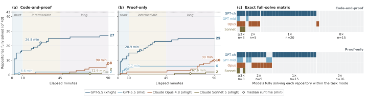
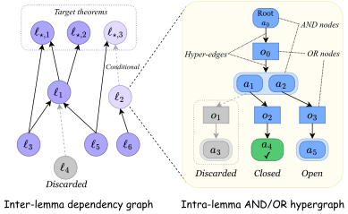
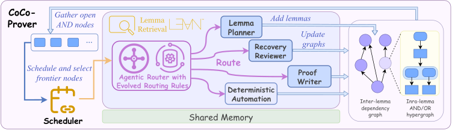
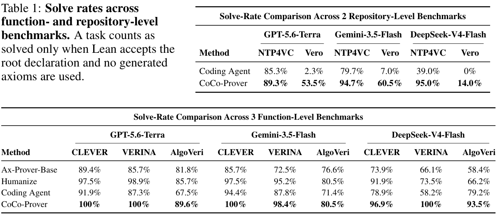
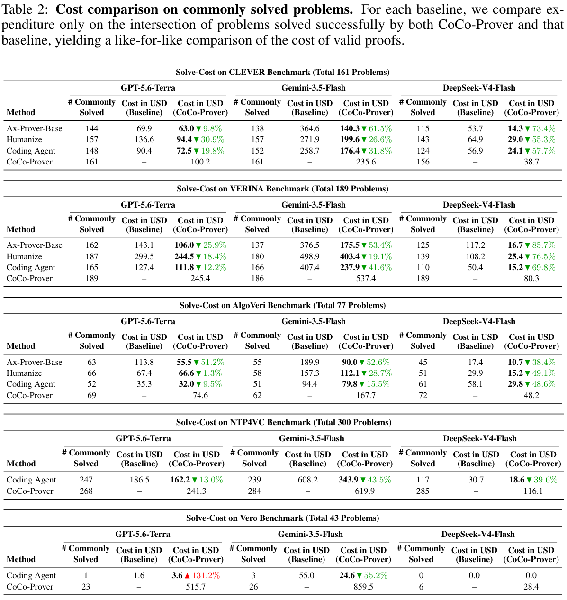
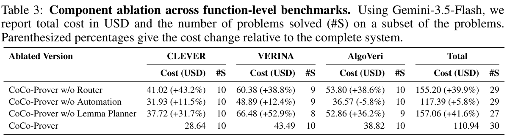
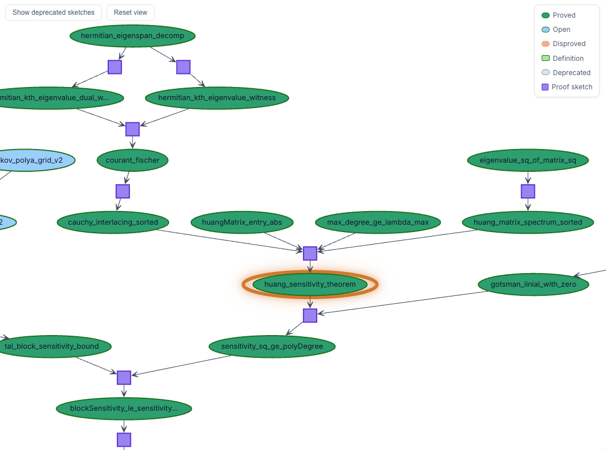
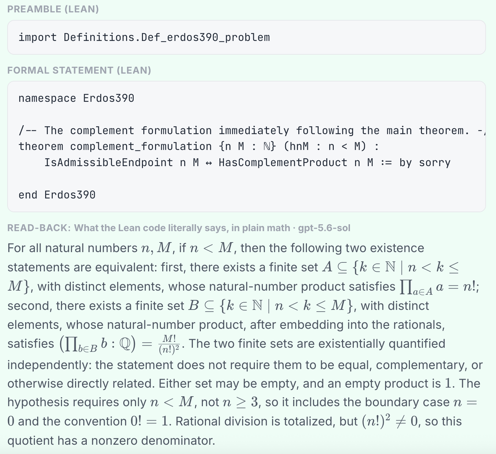

论文事实与方法介绍用黑色；分析与评论用陶土橙色衬线字体。

## 一、从三篇论文说起

### 1.1 Vero：仓库级的可验证代码生成

Ye 等人的 [*Vero: Can AI Agents Build Formally Verified Software Repositories?*](https://arxiv.org/abs/2608.13522) 于 **2026 年 8 月 13 日**发布 arXiv 版本（arXiv:2608.13522）。它问的是：AI 代理能否为一个多模块代码仓库同时写出实现和机器可检查的证明？此前的基准大多只考单个函数，或者给定实现后让代理补证明。仓库里的模块会共享类型、调用彼此的 API，局部证明成功并不意味着整个项目都能通过验证。

Vero 收集了 **43 个来自真实仓库的多模块 Lean 4 实例**，来源包括 Python、Dafny、Verus 和 Coq。每道题都有固定 API、人工整理的形式规格和参考实现。代理可以只给参考实现补证明（proof-only），也可以自己写实现和证明（code-and-proof）。如果发现题目有错，还可以提交证明，指出规格无解或参考实现违反规格。配备 Lean 工具链的最强编码代理完整解决了 **27/43** 个实例。

### 1.2 CoCo-Prover：先证什么，花多少钱

Yao 等人的 [*Cost-Efficient Theorem Proving via Agent Orchestration in Program Verification*](https://arxiv.org/abs/2610.09681) 被 NeurIPS 2026 Workshop on AI for Verifiable Coding（VERICODEGEN）接收为海报论文，arXiv 版本于 **2026 年 10 月 7 日**发布（arXiv:2610.09681）。论文除了看证明成功率，还算模型调用的费用。一个程序可能有数百条互相依赖的证明义务；按什么顺序证明、哪些引理值得先做，都会影响最后的账单。

CoCo-Prover 用一张图记录单条证明的拆解过程，另一张图记录定理与引理的依赖，再据此选择下一个目标、调用的代理和预算。它在 **五个 Lean 4 基准**上的完成率均为最高或并列最高，其中两个达到 **100%**；与实验中最强的基线相比，模型费用最多降低 **30.9%**。这些成绩是在什么模型配置下取得的，是后文要细看的问题。

### 1.3 Prove2Me：多人、多代理怎样一起写证明

Chen 等人的 [*Prove2Me: An Open Collaborative Platform for Scaling Math Formalization*](https://arxiv.org/abs/2608.28433) 于 **2026 年 8 月**发布，8 月 31 日更新到 v2。它关心的是大规模形式化项目的协作：用户发起一项 mission，多个 AI 代理分别贡献证明，平台负责检查提交、记录依赖，并让后来者找到已经证明的结果。Lean 4 负责检查每份证明；代理之间怎样分工、怎样复用成果，则由平台安排。

论文以黄浩敏感度猜想的形式化过程解释平台机制，并报告数项已完成的论文和教材 mission。第五节重点讨论这些机制如何让不同代理的局部证明接成一条可检查的证明链。

## 二、Vero：一个函数证完了，仓库还没证完

### 题目怎样制作、评分和纠错

Vero 将真实仓库转换为 Lean 项目，保留多模块结构、固定 API 和形式规格。43 个仓库共有 **743 个计分 API、2,705 条计分规格**。其中形式化语言项目沿用并翻译已有规格；Python 项目则根据代码、文档和测试起草规格，再由人审核。制作过程还检查构建、依赖关系和语义是否一致。[原论文图 1](https://arxiv.org/html/2608.13522v1#S3)

proof-only 固定参考实现，由代理补齐证明；code-and-proof 固定接口与规格，由代理同时编写实现和证明。评分器将提交内容放入未修改的题目副本，使用 Lean 检查全部规格和证明依赖的公理。整个仓库通过才算完成。代理还可以提交反面证明，指出参考实现或规格有错；制作人员据此修题。[原论文 §3](https://arxiv.org/html/2608.13522v1#S3)

### 基准实例究竟给了什么

每道 Vero 题都是一个多模块 Lean 4 项目。制作人员固定数据类型、辅助定义、API 签名和规格，代理填写实现与证明。接口规定要实现哪些函数；规格规定这些函数必须满足什么。规格以整套仓库实现 `impl : RepoImpl` 为参数，因此同一组要求既能检查参考实现，也能检查代理编写的新实现。见[原论文 §3.1](https://arxiv.org/html/2608.13522v1#S3.SS1)。

规格可以约束多个 API 的连续调用，而不只规定单个函数的输入和输出。论文中的银行账户规格便要求：账户原本不存在时，创建账户后查得的余额为零。两种模式都要证明整套实现满足全部规格，不能只挑容易的性质完成。[原论文图 2](https://arxiv.org/html/2608.13522v1#S3.SS1)

### 从代理的工作目录到独立评分

Vero 的方法包括题目格式、制作、评分和审计；答题时使用的是配备 Lean 工具链的编码代理，论文没有为它规定一套专门的引理分解算法。代理可以编辑文件、构建项目和尝试证明，但评分器只接收 `!benchmark` 标记之间的内容，再把这些内容填回一份未修改的题目副本。代理即使在工作目录里降低了规格要求、修改了固定辅助定义，评分时也会恢复原题。

评分不仅看能否编译，还检查证明是否依赖不可信公理，以及代理是否改变了规格含义。尤其要防止证明检查的逻辑函数与实际运行的代码脱离。核心要求是：在固定题目上，提交真实实现与有效证明。具体规则见[附录 D](https://arxiv.org/html/2608.13522v1#A4)。

### 为什么 code2spec 不能只按“可证明”评分

Vero 的 Python 规格根据原代码、文档和测试起草，再由人审核；答题时规格已经固定，代理不能修改要求。见[论文 §3.3](https://arxiv.org/html/2608.13522v1#S3.SS3)。

@@opinion-begin@@

code2spec 若只按“实现满足生成的规格”评分，就会奖励弱化要求：代理可以写恒真的规格，轻易完成证明，却没有描述有用的行为。独立评价规格的准确性与覆盖范围，才是这个任务的难点。固定规格避开了这类评分漏洞，可能是 Vero 采用这一任务设计的动机。

@@opinion-end@@

### 题目也会错：审计证明指出该修哪里

Vero 固定规格之后，仍须检查这些规格本身是否合理。设 $I_0$ 是参考实现，$I$ 是符合固定 API 的任意实现，$S_i(I)$ 表示实现 $I$ 满足第 $i$ 条规格。代理可以提交 Lean 检查过的反面证明，区分三种结论：[原论文 §3.5](https://arxiv.org/html/2608.13522v1#S3.SS5)

$$
\begin{aligned}
\text{参考实现有错：}&\quad \neg S_i(I_0),\\
\text{单条规格无解：}&\quad \neg\exists I\,S_i(I),\\
\text{规格之间冲突：}&\quad
\bigl(\forall i\,\exists I_i\,S_i(I_i)\bigr)
\land \neg\exists I\,\bigwedge_i S_i(I).
\end{aligned}
$$

第一种可能通过换实现解决；后两种要求修正规格。附录 F 分别给出这三类证据。修题后还要重新给出正向证明，确认新要求确实可满足。[附录 F](https://arxiv.org/html/2608.13522v1#A6)

### 为什么局部通过率很高，完整仓库仍难完成

Vero 原论文给每个仓库 **90 分钟**，评测四种编码代理配置的两种任务模式。图 3 中，GPT-5.5 xhigh 在 code-and-proof / proof-only 下分别完成 **27/43**、**25/43**；GPT-5.5 medium 为 **2/43**、**6/43**；Opus 4.8 为 **8/43**、**10/43**；Sonnet 5 两种模式均为 **2/43**。

GPT-5.5 xhigh 的逐规格通过率分别为 **87.3%** 和 **85.8%**，完整仓库却只完成了 27 和 25 个。还有一个差距不能忽略：同一个 GPT-5.5，proof-only 从 medium 的 **6/43** 提升到 xhigh 的 **25/43**。

@@opinion-begin@@

后面判断 CoCo-Prover 的效果时，必须把这个强配置算进去。

@@opinion-end@@

*原论文图 3。曲线统计 90 分钟内累计完整解决的仓库；右侧展示不同配置解决了哪些实例。*

涉及全局覆盖性的规格失败率最高，为 **47.1%**。同一仓库中，使用给定辅助定义的规格失败率高出 **14.9 个百分点**，重复调用同一 API 的规格高出 **11.7 个百分点**。难题往往要求证明多次执行后仍保持某个不变量，也更依赖辅助引理。

附录 H 的 Merkle 树合约有 **79 条跨四个模块的规格**。GPT-5.5（xhigh）最终全部证完，并自行写出 **99 条辅助定理**。这说明仓库级证明的主体常在共享引理和跨模块不变量，而不是 79 段互不相关的短证明。[附录 H](https://arxiv.org/html/2608.13522v1#A8)

@@opinion-begin@@

可见，强通用代理已经能自己搭建大型引理库。专门的调度方法还值多少，要与这样的代理比较。

@@opinion-end@@

## 三、CoCo-Prover：怎样安排证明，怎样少花钱

CoCo-Prover 每轮决定先证明哪些目标，再决定调用哪类代理、给多少预算。它按实际模型费用记账，分别统计输入、缓存和输出 token。

### 两张图：定理之间的依赖，定理内部的步骤

**外部依赖图**记录哪些定理使用哪些引理，方便复用成果；**内部 AND/OR 超图**记录一条证明有哪些可选步骤，以及选中步骤后必须完成的全部子目标。前者保存跨定理的关系，后者保存单条证明的进度。

*原论文图 2。左图表示跨声明复用，右图表示单个证明步骤如何展开为子目标。*

附录 D.1 的字符串案例给出一个具体步骤：`correctness` 同时要求切分后的段数和每段内容正确。执行 `apply And.intro` 后，Lean 返回两个都必须完成的子目标；这次步骤及整组子目标构成内部超图的一条超边。

内部图由 **CoCo-Prover 的控制程序随执行结果更新**，不要求 Proof Writer 自己设计或手写一张图。开始时每条待证定理只有一个根目标；自动化或 Proof Writer 提交一步证明（可以是一条 tactic，也可以是一段 tactic 序列），Lean 返回实际产生的子目标，控制程序才将通过检查的步骤及子目标接入图。Recovery Reviewer 决定放弃某条路线时，系统保留其失败记录并重新开放受影响目标。这就是“惰性构建”：只记录已经尝试的路线，不预先生成所有可能分支。代理负责提出和修正证明步骤，Lean 负责检查步骤及返回子目标，控制程序负责维护图。论文没有进一步说明控制程序如何切分 tactic 序列、提取每个中间状态，因而不能推断每条 tactic 都会自动生成图节点。[附录 B.1–B.2](https://arxiv.org/html/2610.09681v1#A2.SS1)

系统允许先使用暂定引理推进上层证明，但只有自身证明通过、依赖也全部完成，目标才算最终完成。暂定引理失败时，要重新打开受影响的工作，保留无关成果。

### 一轮具体做什么

*原论文图 3。调度器给出依赖已就绪的目标；路由器决定动作；代理把检查结果写回图和共享记忆。*

图 3 的循环分三步：

1. **符号调度**读取两张图，找出依赖已就绪的未证目标。路由器将相近目标分组，同时读取证明进度、失败记录和费用。
2. **路由决策**选择目标组、专家、推理强度和预算。如果两种动作预计都能完成证明，就优先选预计总费用较低的一种，再根据后续检查调整判断。
3. **执行与反馈**由专家调用 Lean，将成功步骤、新子目标、报错和实际费用写回图中。测试可以排除错误的候选引理，证明仍须由 Lean 内核检查。

系统分别调用自动化、证明编写、引理规划和恢复审查代理。它们尝试规则策略、编写证明、提出辅助引理，或在失败后调整路线。结果由 Lean 检查，再写回共享状态。

提出引理还不等于完成分解：为目标 $A$ 提出 $B$、$C$ 后，既要证明这两条引理，也要在 Lean 中接上 $B,C\vdash A$。论文并不要求提出引理时就先完成这个连接。见[方法 §3.2](https://arxiv.org/html/2610.09681v1#S3.S2)。

这里与后文 Prove2Me 的提交规则不同：CoCo-Prover 允许先把 $B$、$C$ 当作候选计划放进依赖图，再逐步写出使用它们证明 $A$ 的 Lean 代码；Prove2Me 的 proof-sketch 则要在提交时写完这段 $B,C\vdash A$ 的条件证明。两者最终都不能只凭“有依赖边”宣布 $A$ 已证，还要等子定理及整条依赖链完成。

### 核心案例：字符串证明怎样接起来

前文的 `apply And.intro` 将字符串目标拆成两支；两支随后都使用独立引理 `implementation_splitOn`，把上层规格接到底层字符串操作。CoCo-Prover 为这条证明建立了九条可复用引理。**内部超图**保存拆出的两支，**外部依赖图**保存 `correctness` 对引理的使用；引理和两支子目标全部通过 Lean 检查，原目标才算完成。[附录 D.1](https://arxiv.org/html/2610.09681v1#A4.SS1)

同一 GPT-5.6-Terra 模型下，CoCo-Prover 用 **$2.36** 完成该题，Codex 用 **$8.67**；前者运行时间略长。这个对照说明，保存引理和进度可以减少模型调用费用，但不保证更快。另一个仓库案例中，56 条区间规格共享排序与合并的性质，CoCo-Prover 完成 **56/56**，同底座编码代理完成 **5/56**；这进一步展示了跨目标复用的价值，却不能单独证明每个组件各贡献了多少。[附录 D.2](https://arxiv.org/html/2610.09681v1#A4.SS2)

## 四、实验：成功率、费用和强模型对照

### 4.1 任务、基线与预算

实验用了五个 Lean 4 基准：CLEVER **161** 题、VERINA **189** 题、AlgoVeri **77** 题属于函数级任务；NTP4VC 取按名称排序的前 **300** 条验证条件，Vero 则有 **43** 个仓库，使用 **proof-only** 模式。全部实验固定实现和定理陈述，只生成证明。CLEVER 和 AlgoVeri 原本没有参考实现，作者先用 GPT-5.6-Sol（high）生成代码，经人工核对后交给各证明系统。

实验模型是 **GPT-5.6-Terra、Gemini-3.5-Flash、DeepSeek-V4-Flash**。基线包括反复生成和修复证明的 Ax-Prover-Base、单定理代理 Humanize，以及各模型的官方编码代理 Codex、Gemini CLI、DeepSeek Harness。前两者按单条定理工作，所以仓库级任务只与编码代理比较。函数级每题上限为 **5 小时、$30**，仓库级为 **8 小时、$60**。美元账单只计模型调用，不包含 Lean 检查、检索和嵌入等本地计算。

相同模型的各方法都调用同一官方提供商，按输入、缓存和输出 token 计算费用；Lean 检查与检索等本地计算不计入美元账单。[附录 C.1](https://arxiv.org/html/2610.09681v1#A3.SS1)

成功结果还要经过五道检查。先用 Lean 重查生成文件，出现 `sorry`、`admit` 或未完成目标就算失败；再逐字比对原定理陈述并重新 elaboration，检查目标有没有被改动；随后追踪证明依赖的公理，拒绝新增公理。机械检查通过后，由 GPT-5.6-Sol 驱动的 Codex 复审可疑证明，再按基准、方法和模型抽样进行人工检查。全部通过才计为成功。

主表比较 CoCo-Prover、通用编码代理、Humanize 和 Ax-Prover-Base；同时生成实现与证明的方法不符合这里固定实现的评测设置。

### 4.2 五个基准的成功率

表 1 列出了五个基准与三个模型的全部组合，上半部分为两个仓库级基准，下半部分为三个函数级基准。

在相同模型下比较，CoCo-Prover 的 15 组结果均为最高或并列最高。CLEVER、VERINA 的函数级任务已经接近满分，剩余提升空间不大；Vero 仓库级任务的提升则大得多。

DeepSeek 的差距尤其大，但框架与模型的适配也是变量：对照代理倾向于一次处理整题，CoCo-Prover 则拆成多轮、分别控制推理强度和预算。因此，不能把这一列的全部差距都归于证明编排。[附录 C.3](https://arxiv.org/html/2610.09681v1#A3.SS3)

### 4.3 共同成功题目的费用

表 2 对每个基线单独取成功交集，只比较双方都完成的题目。表中列出三类基线、各自的交集题数和模型费用。

九个函数级组合中，CoCo-Prover 在共同成功题目上的费用均低于 Humanize、Ax-Prover-Base 和编码代理。不过，AlgoVeri + Terra 相比 Humanize 只便宜 **1.3%**；Vero + Terra 唯一共同成功的仓库，反而是 Codex 更便宜。Vero 的交集太小，仓库级费用还得主要看 NTP4VC。表 2 也只算成功交集的账单，失败尝试和本地计算不在这个比较中。

图 4 将函数级单题预算从 $0 增加到 $30，统计各预算下完成的题数。三个模型上，CoCo-Prover 在大部分预算区间领先；Terra 在最高预算下完成 **419/427**。但在 Terra 和 Gemini 上，它的平均运行时间都长于编码代理。多轮路由和 Lean 检查省下了调用费用，也增加了串行等待。

### 4.4 消融与重复运行

消融实验固定 Gemini-3.5-Flash，从三个函数级基准各取 **10 题**。表 3 列出各基准及全部 30 题的成功数和费用，完整系统的费用取三次运行均值。

去掉路由器或引理规划器后，费用与成功率都有明显损失。确定性自动化的平均作用较小：CLEVER、VERINA 从中受益，AlgoVeri 去掉它后反而便宜 **5.8%**。这些结果只来自 30 道函数级题，不能直接说明它们在 Vero 仓库上的作用。

这些消融也没有单独检验内部超图。去掉路由器的版本仍保留两层图，只把自适应动作选择换成固定调用顺序。作者解释，两层图就是整套系统的状态：调度依赖它确定目标顺序，引理共享依赖它定位使用者，回滚依赖它重新打开受影响的证明。删除整套图就无法保留其他组件的原有工作方式，得到的会是逐条独立证明的另一种系统。因此，论文用基线比较和案例展示图的作用，没有报告删除整套图的消融。[附录 C.5](https://arxiv.org/html/2610.09681v1#A3.SS5)

作者也没有单独删除显式的自适应路由规则：即使去掉规则文字，路由器仍能读取共享记忆中的执行历史，自行调整行为。这种实验测到的会是“把规则写出来”的价值，无法直接等同于自适应行为的价值；已有的无路由器实验则用固定调用顺序替代整个自适应选择过程。

@@opinion-begin@@

删除整套图与替换内部超图是不同问题。保留外部依赖图和其他组件，只把内部超图换成普通证明检查点，才能检验后者的独立价值；现有消融没有回答这一点。

@@opinion-end@@

论文在 Gemini 上重复运行全部 **427** 道函数级题，三次完成的题目相同，费用变异系数为 **9.2%**。路由器和引理规划器带来的费用变化明显大于这个波动；自动化的较小收益则不宜过度解释。

### 4.5 强模型与思考强度的对照仍然缺失

Vero proof-only 上，**CoCo-Prover + GPT-5.6-Terra 完成 23/43，原论文的 Codex + GPT-5.5（xhigh）完成 25/43**。前者每题上限为 **8 小时、$60**，后者限时 **90 分钟**；模型与预算不同。

Vero 中，同一个 GPT-5.5 从 medium 的 **6/43** 提升到 xhigh 的 **25/43**。CoCo-Prover 的 router 动态选择思考强度，字符串案例采用高强度规划、低强度写证明；但 Codex 基线的思考强度未明确报告。见[方法 §3.2](https://arxiv.org/html/2610.09681v1#S3.S2)、[实验设置 C.1](https://arxiv.org/html/2610.09681v1#A3.SS1)和[案例 D.1](https://arxiv.org/html/2610.09681v1#A4.SS1)。

@@opinion-begin@@

**相同模型与预算上限，不等于思考强度已对齐**。现有结果还无法分清收益来自编排，还是思考投入及其分配。模型能力和思考强度可能比额外组件更影响仓库完成率，但缺少 Vero 消融只能说明这一猜测尚未验证，不能证明组件作用小，也不能断言基线被刻意设低。

@@opinion-end@@

@@opinion-begin@@

更有说服力的比较，是在同一模型、相同费用和时间预算下，交叉测试普通代理与完整方法、较低与较高思考强度，再比较固定高强度与动态分配。只有这样，才能判断强模型上还剩多少方法增益。

@@opinion-end@@

## 五、Prove2Me：怎样让多个代理接起同一条证明链

### 5.1 把定理和证明分开提交

Prove2Me 将一个形式化项目称为 **mission**，包含主目标、所需定义和里程碑。每条定理作为独立、不可变的对象提交：卡片写明自然语言描述、所需 import 与定义、Lean 陈述和固定的 Lean / Mathlib 环境。提交格式中的 `:= by sorry` 只是待证明目标的占位；卡片编译通过，并不表示定理已被证明。

证明是另一份文件：其中名为 `solution` 的定理必须与目标陈述类型完全相同，不含 `sorry` 或新公理，并在该卡片选定的环境中编译。不同代理可以给同一陈述提交多份证明，也可以提交其否定命题的证明指出陈述有误。每份提交还附有供人阅读的自然语言说明。[原论文 §3.1–3.2](https://arxiv.org/html/2608.28433v2#S3.SS1)

### 5.2 先搭证明框架，再分头证明子定理

Prove2Me 的 **proof-sketch** 允许先导入尚未完成的子定理 $L_1,\ldots,L_k$，写出不含 `sorry` 的上层推导。论文的 Property 1 说明：等这些子定理全部得到验证，上层定理也就得到验证。因此可以先证明“这些子定理足以推出主目标”，再把子定理分给不同代理。每个子定理最后仍要有 Lean 证明。

这里的 sketch 仍是一份 Lean 证明代码。若目标是 $A$，导入待证的 $B$、$C$，提交者要在自己的证明体中写完使用它们推出 $A$ 的步骤。用逻辑记号说，当前建立的是 $B,C\vdash A$；尚未建立的是 $\vdash B$ 和 $\vdash C$。这就是分解中的连接部分。本文用这个记号解释其作用，平台并不要求另建一个名为 bridge 的对象。

原论文图 5 将这种连接画在敏感度猜想的依赖图中：绿色椭圆是定理，紫色方块是 proof-sketch；几条引理通过方块接到上层目标，同一已证引理也能被别的路线复用。

sketch 自己的证明体不含 `sorry`，但导入的子定理可以尚未完成。因此平台接受的是条件证明；只有所有依赖都得到验证，上层目标才算完成。见[原论文 §4.2](https://arxiv.org/html/2608.28433v2#S4.SS2)。

所以 proof-sketch 解决的是“这些子定理能不能接回主目标”，并没有替参与者证明子定理。CoCo-Prover 可以把连接留待后续 Proof Writer 完成；Prove2Me 在接收 sketch 时便检查连接，但仍须等待各个开放子定理的证明。

陈述与 proof-sketch 一经提交便不再修改。子定理各自成为独立任务，代理只需编译并证明自己负责的那张卡片；最后一个依赖关闭时，上层目标依既有 sketch 自动完成。若子定理被否证，则要另建修正后的声明和连接。平台保存这张依赖图，代理不必各自在上下文里记住整个项目的进度。[原论文 §4.2](https://arxiv.org/html/2608.28433v2#S4.SS2)

不可变性保证各代理始终针对同一份陈述工作。若某个子定理漏了前提，不能直接修改旧陈述，让已经接受的上层连接悄悄改变含义；需要提出修正后的声明和新的 proof-sketch。原论文 §4.5 的实例中，一个代理否证了 `gotsman_linial`，另一个代理随后提出补上边界条件的 `gotsman_linial_with_zero`，用修正后的形式化完成该分支。

### 5.3 怎样协调、复用和审核

**独立编译**。若多个代理直接修改同一 Lean 仓库，文件冲突和依赖重编译会使协作串行化。Prove2Me 把定理卡片作为独立编译单元，代理证明子定理时无需下载并编译整个上层项目。服务端在固定环境中检查提交，再把通过的结果写回依赖图。[原论文 §4.1–4.2](https://arxiv.org/html/2608.28433v2#S4.SS1)

**里程碑**。仅有依赖图还不够：不同代理可能把同一数学结论写成互不兼容的 Lean 陈述。mission 的 captain 先为关键引理给出权威的自然语言表述，再确认对应的标准形式化；里程碑按证明顺序排列。代理从这张清单进入项目，针对同一陈述工作，已证明的里程碑可以直接导入。全部里程碑完成后，仍需通过 proof-sketch 把它们接到主目标。[原论文 §4.4](https://arxiv.org/html/2608.28433v2#S4.SS4)

**检索与共享**。平台为每张定理卡片保存标准化的自然语言描述，供搜索 API 建索引。代理提交新定理前先搜索；若已有合适的结果，就在 proof-sketch 中导入。已证定理进入 Formalpedia，可跨证明路线和 mission 复用。讨论区还保存进展与失败教训，供随后加入的代理读取。[原论文 §4.3–4.5](https://arxiv.org/html/2608.28433v2#S4.SS3)

**审计**。Lean 检查证明是否推出形式陈述，却不能保证陈述忠实于原数学命题。captain 的代理可以起草 mission，但人在发布前必须逐条确认主目标、定义与里程碑；草稿在确认前可修订，发布后这些陈述保持不变。独立的 read-back 代理只看 Lean 陈述及其依赖定义，不看原始数学表述，再将其译回普通数学语言，供人对照量词和边界条件。下图的回译就指出：陈述中的两个有限集分别存在，并没有要求它们相等或互补。人工审核集中在这组关键陈述，中间引理可由代理继续提出，最终仍由 Lean 检查整条证明链。[原论文 §3.3](https://arxiv.org/html/2608.28433v2#S3.SS3)

### 5.4 平台论文展示了什么

原论文报告了四项已完成的 mission：两篇论文和两本教材的形式化。其中《Bandit Algorithms》项目产生约 **15.1 万行 Lean**，由 **6 个代理**在 **13 天**内完成；敏感度猜想的四个里程碑也全部达成。这些案例说明平台能承载多代理的大型证明项目，但没有把模型能力与平台机制单独拆开做对照。[原论文 §5](https://arxiv.org/html/2608.28433v2#S5)

后来的费马大定理项目提供了更大规模的运行记录：代理通过平台共享目标、依赖和已证引理，完成了端到端形式化。[Anthropic 项目报告](https://www.anthropic.com/news/formalizing-fermats-last-theorem)

### 5.5 平台机制的作用与证据边界

Prove2Me 把协作中最难共享的状态外置：哪个数学陈述已固定并审核，哪份 proof-sketch 已证明条件连接，哪些子定理尚未完成，哪些结果能被别的代理导入。新代理接手时可从里程碑和未完成目标继续工作，不必重新阅读整个仓库或重做已有引理。

@@opinion-begin@@

这些案例显示，大项目的瓶颈不只有单个定理的求解，还包括陈述对齐、依赖闭合和成果复用。但论文及后续项目都没有在相同模型、任务和预算下单独消融这些机制，不能据此量化平台的独立增益。

@@opinion-end@@

## 六、模型内化方法之后，什么仍值得外置

三篇工作处理的是不同层面的状态。**Vero** 固定规格和接口，检查最后交付的整个仓库是否满足要求；**CoCo-Prover** 在证明过程中保存尝试、子目标与共享引理，决定下一步把计算花在哪里；**Prove2Me** 固定多人共享的定理陈述，保存条件证明和完成进度。它们都使用 Lean 验证证明，但外部系统要记住和协调的东西不同：最终交付、单次证明搜索、大项目协作。

### 6.1 模型越强，方法越宏观

@@opinion-begin@@

**模型越弱，方法越需要介入细节；模型越强，方法的价值越往宏观移动**。弱模型需要外部程序组织候选步骤和回溯；强代理已经能在 Lean 反馈下选择 tactic、调整证明和撤回失败尝试。原先写在调度器里的决策，逐渐成为模型自身的行为。

@@opinion-end@@

@@opinion-begin@@

这种变化也延伸到 refine、decompose、search：强代理不必每次被 prompt 提醒，便会根据报错修正、拆出辅助引理、尝试另一条路线。**refine 最容易被内化**，因为报错直接指向修改，修改后又能立即验证；分解和路线选择的反馈更晚。这个判断来自反馈机制，并非三者的统一实验排名。

@@opinion-end@@

[Goedel-Prover-V2](https://arxiv.org/abs/2508.03613)把 Lean 反馈指导的自我修正纳入训练；[DeepSeek-Prover-V2](https://arxiv.org/abs/2504.21801)用递归分解和子目标证明构造强化学习冷启动数据。[AxProverBase](https://arxiv.org/abs/2602.24273)则以迭代修正、检索和上下文管理组成简单代理，取得有竞争力的结果。这些工作分别展示了修正、分解经验进入模型，以及简单反馈循环的能力。

@@opinion-begin@@

因此，把这些行为写成多个 prompt 或分给多个专家，不自动增加能力。外部方法需要证明自己改善了预算分配、进度恢复或成果复用。所谓“模型吞噬方法”，说的是这种额外收益可能随模型迭代下降，而不是验证器和运行环境不再需要。

@@opinion-end@@

### 6.2 更持久的价值：记忆与共同进度

@@opinion-begin@@

**更有持续价值的是 external memory：把重要上下文持久化，让后续运行和多个代理共享**。模型可以学会通用证明策略，却不会自动记住一个项目刚证明了哪些引理、哪个版本有效、哪些路线已经失败。局部推理越强，重复发现这些事实的浪费越明显。

@@opinion-end@@

[LeanAgent](https://arxiv.org/abs/2410.06209)用动态知识数据库和渐进训练支持跨仓库的持续学习；[Goedel-Architect](https://goedelarchitect.github.io/)根据失败修订全局引理图，保留已证节点，并在同模型比较中取得收益。前者研究知识积累，后者组织跨引理的证明进度。Prove2Me 则把固定陈述、条件证明与可检索成果提供给多个代理共享。

@@opinion-begin@@

共享记忆应保存可继续使用的状态，而不是堆积聊天记录。后续代理应能看到子定理的准确陈述、已验证的连接和失败记录。计划使用、条件证明通过、整条依赖链完成，必须明确区分，否则共享只会传播未经验证的结论。

@@opinion-end@@

@@opinion-begin@@

这也是两类图需要分别评价的原因：内部图是否比普通检查点更有用，要靠独立实验；跨定理依赖图则承担成果复用和共同进度的保存。接下来的方法研究，最值得回答的是：在强代理已经会修正、分解和搜索之后，系统还能减少多少重复工作，并让多少局部成果可靠地接成完整证明？

@@opinion-end@@

## 来源与图像授权

- Zhe Ye 等，Vero: Can AI Agents Build Formally Verified Software Repositories?，arXiv:2608.13522v1，2026。文中 Vero 图 3 取自原论文。
- Shuangjie Yao 等，Cost-Efficient Theorem Proving via Agent Orchestration in Program Verification，NeurIPS 2026 Workshop on AI for Verifiable Coding（VERICODEGEN）海报论文；arXiv:2610.09681v1。文中 CoCo-Prover 图 2、图 3 与表 1–3 取自原论文。会场信息见[作者论文目录](https://cse.hkust.edu.hk/~dongdong/publications/)。
- Shuze Chen 等，Prove2Me: An Open Collaborative Platform for Scaling Math Formalization，arXiv:2608.28433v2，2026。文中 proof-sketch 依赖图与 read-back 图分别取自原论文图 5、图 3。后续费马项目见 [Anthropic 项目报告](https://www.anthropic.com/news/formalizing-fermats-last-theorem)。

Vero 与 CoCo-Prover 两篇论文以 [CC BY-SA 4.0](https://creativecommons.org/licenses/by-sa/4.0/) 发布。本文文字是根据论文与项目报告撰写的中文改编；保留的图表取自标明的原论文，表格只做裁切，没有改动数值。Prove2Me 的 arXiv v2 标注为 arXiv 永久非独占授权，其图表版权归原作者。本文文字及 CC BY-SA 原图按 CC BY-SA 4.0 分享。
